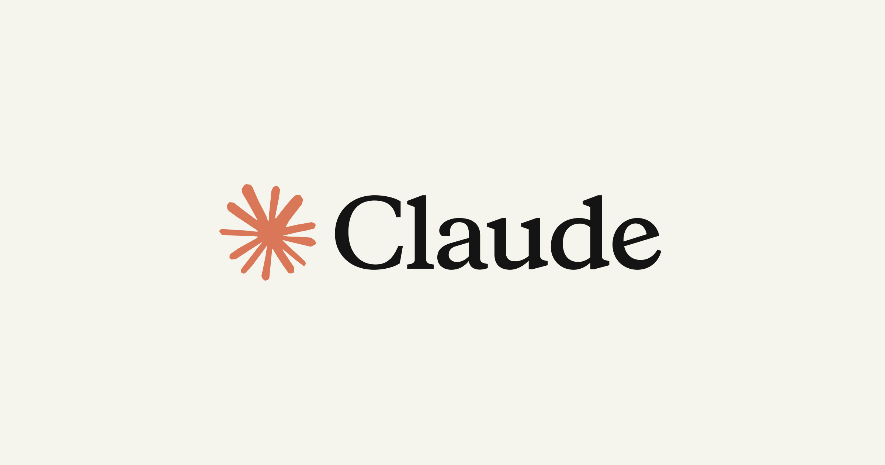
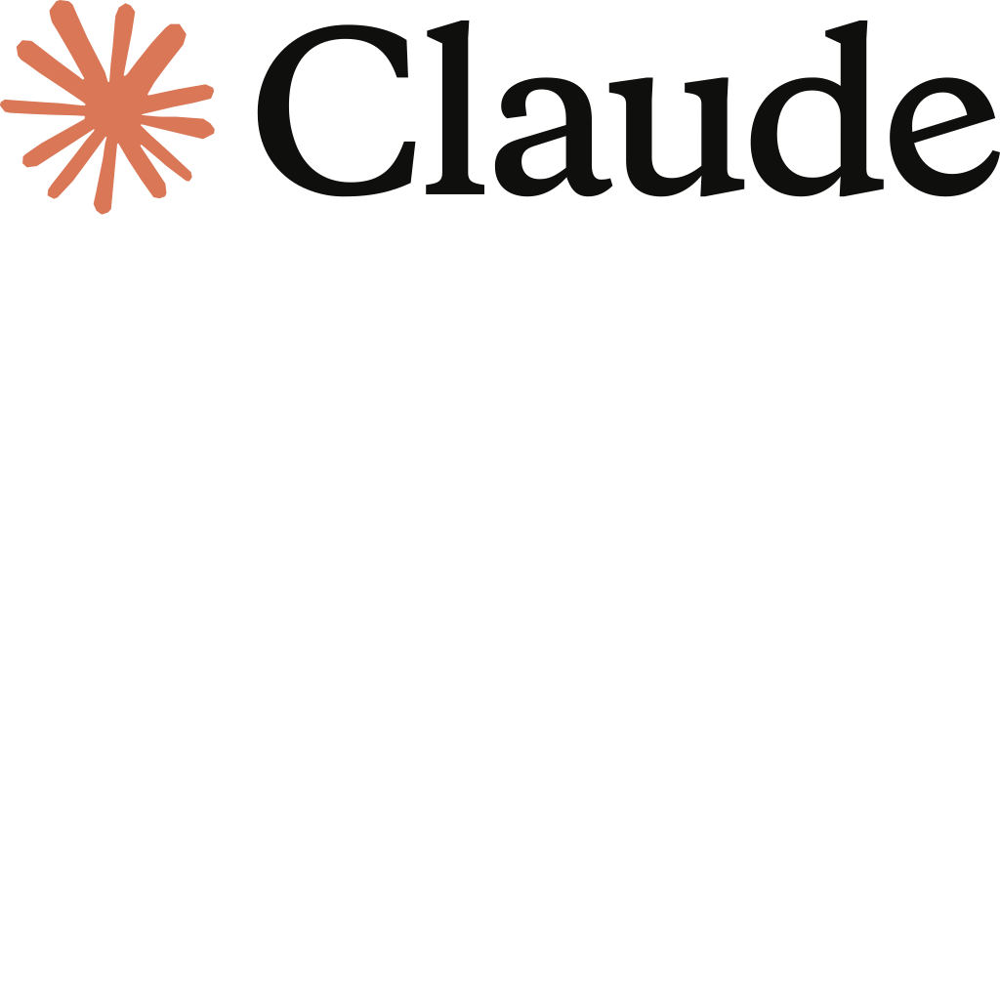

*Claude Code 공식 제품 페이지 대표 이미지. 이번 변경은 모델 가중치나 UI가 아니라, 매 세션마다 모델에 주입되는 '지침 텍스트' 계층에서 이뤄졌습니다 (출처: Anthropic 공식 사이트 claude.com/product/claude-code)*

> **📌 한줄 요약:** 2026년 **10월 30일(UTC)**, Anthropic이 **Claude Code 2.1.314**에 **두 문장짜리 새 지침**을 넣었습니다. "원작 게임은 만들되, **특정 기존 게임의 재현은 이름을 바꿔도 하지 말 것**"이라는 내용입니다. 문제는 세 가지입니다. **① 공개 체인지로그에 없었고**, **② 서버 플래그(`tengu_heron_brook`)로 원격 제어되며**, **③ 사용자가 끌 수 있는 설정이 없습니다.** 게다가 이 지침은 기술적 차단이 아니라 모델에 대한 '부탁'이라, **정당한 모드·팬 프로젝트까지 거절되는 사례**가 보고되고 있습니다.

AI 코딩 에이전트를 업무에 붙여 쓰는 분들이라면 이번 건이 남의 이야기만은 아닙니다. 게임을 만들지 않더라도, **사용 중인 도구의 행동 규칙이 내 컴퓨터 밖에서 조용히 바뀔 수 있다**는 구조적 사실이 이번에 아주 선명하게 드러났기 때문입니다.

이 글은 **① 무슨 일이 있었나(타임라인) → ② 새 지침의 정체(문구·메커니즘) → ③ 왜 하필 게임인가(배경) → ④ 영향(사용자·개발자) → ⑤ 실무 대응 체크리스트 → ⑥ 전망** 순서로 정리합니다.

---

## 1. 무슨 일이 있었나 — 타임라인

| 시점 (UTC 기준) | 사건 |
|:---|:---|
| 10월 27일 | Claude Code **2.1.312** npm 배포 — 이 버전에는 게임 관련 지침 **없음** |
| 10월 30일 00시 직후 | Claude Code **2.1.314** npm 배포. 지침 텍스트에 게임 재현 금지 문구 **포함** (공개 2.1.313은 없음) |
| 10월 30일 오전 | X 사용자 **chasm(@chasmmmmmmmmmmm)** 이 "Claude Code에 새 규칙이 붙었다"는 글 게시 → **조회 약 90만 회**, Hacker News 프런트페이지 진입 |
| 10월 30일 16:26 | 해외 테크 매체 MadRobot, 코드 diff 기반 상세 보도 — **체인지로그 미기재** 지적 |
| 10월 30일 (현지) | Game Developer, Anthropic에 질의 → **회사 측 공식 확인** ("Opus 5.5 프롬프트에 두 문장 추가") |
| 10월 31일 20:08 | Wccftech, "**정당한 프로젝트가 막히고 있다**"는 개발자 보고 정리 |
| 11월 1일 현재 | 지침 유지. Anthropic은 "균형을 계속 조정하겠다"는 입장 |

핵심은 **발표가 없었다**는 점입니다. 새 모델 출시나 요금 변경처럼 공지가 나가는 종류의 변화가 아니라, 평소 쓰던 도구의 **매 세션 주입되는 시스템 지침**이 조용히 바뀐 사건입니다.

---

## 2. 새 지침의 정체 — 두 문장, 그리고 원격 스위치

### 2-1. 실제 문구

문제가 된 지침은 딱 두 문장입니다.

> **"Do build original games, games in a genre, and games from the user's own designs and assets. Don't build a recreation of a specific existing game, even if it is renamed or called original."**
>
> (원작 게임, 특정 장르의 게임, 사용자 본인의 디자인과 에셋으로 만든 게임은 만들어도 된다. **특정 기존 게임을 재현하는 것은, 이름을 바꾸거나 '오리지널'이라고 불러도 만들지 마라.**)

해석하면 경계는 이렇게 갈립니다.

| 요청 유형 | 허용 여부 |
|:---|:---|
| 플랫포머, 로그라이크 같은 **장르 게임** | ✅ 허용 |
| 본인이 그린 스케치·직접 만든 에셋 기반 게임 | ✅ 허용 |
| 완전 창작 오리지널 게임 | ✅ 허용 |
| 특정 게임을 **이름만 바꾼 복제**(포켓몬·테트리스·GTA류) | ❌ 금지 |
| 기존 게임의 **리메이크·팬 프로젝트·모드** | ⚠️ 회색지대 (거절 보고 다수) |

### 2-2. 조용히 들어간 경로

코드 분석에 따르면 이 지침은 **세션 시작 시 Anthropic 서버에서 내려오는 추가 지침 슬롯**을 통해 먼저 배포됐습니다. X 게시물은 서버 플래그 이름을 **`tengu_heron_brook`** 으로 지목했고, 사용자가 끌 수 있는 설정은 없다고 지적했습니다.

더 흥미로운 부분은 **`original_games_guidance`** 라는 설정입니다. 코드상 이 값은 **Claude Opus 5.5용 지침과 함께 켜지며, Anthropic이 자기 쪽에서 켜고 끌 수 있게** 되어 있습니다. 즉:

- **다른 모델**을 쓰는 사용자에게는 이 지침이 아예 내려가지 않을 수 있고,
- 같은 버전을 쓰더라도 **서버 설정에 따라 행동이 달라질 수 있으며**,
- 로컬 설정이나 프롬프트로 **완전히 되돌릴 방법이 없습니다.**

버전 2.1.314의 코드에는 "서버 텍스트에 이미 게임 관련 문구가 있으면 자체 사본을 건너뛴다"는 분기가 있습니다. 원격으로 먼저 시험한 뒤 클라이언트에 내장하는, 요즘 프런티어 랩에서 흔히 쓰는 **점진 배포 패턴**입니다. 문제는 그 패턴이 **체인지로그에는 안 적힌다**는 관행과 결합된다는 점입니다.

### 2-3. '차단'이 아니라 '부탁'이라는 함정

이 지침은 필터나 정규식 같은 **기술적 차단 장치가 아닙니다.** 모델에게 주는 자연어 지시입니다. 그래서 두 가지가 따라옵니다.

1. **일관성이 없다** — 같은 요청도 표현에 따라 통과하거나 거절됩니다.
2. **경계 판정을 모델이 한다** — "이 에셋이 내 것인지"를 모델이 알 방법이 없습니다. Hacker News에서 가장 많이 나온 질문이 정확히 이것이었습니다. *"내 디자인과 에셋인지 Claude가 어떻게 아나?"*

*Claude AI 공식 로고. 이번 변경은 모델 자체가 아니라 '모델에 주입되는 지침'의 변경이어서, 같은 모델·같은 버전에서도 결과가 달라질 수 있습니다 (출처: Wikimedia Commons, Claude AI logo.svg)*

---

## 3. 왜 하필 게임인가 — 배경

이번 조치는 갑자기 나온 게 아닙니다. 2026년 가을, AI 코딩 도구로 만든 게임 복제물이 인디 신을 뒤덮으면서 쌓인 압력이 터진 결과입니다.

- **10월 19일, Ars Technica** — AI 코딩 도구가 며칠 만에 게임을 복제할 수 있게 되자, 일부 인디 개발자들이 **공개 데모 자체를 미루고 있다**고 보도했습니다.
- **개발자 Freya Holmér** 는 자신의 회전형 테트리스 프로토타입이 반복적으로 복제된 뒤 이렇게 말했습니다. *"어디에나 슬롭(slop)이 도사리고 있으면 진행 상황을 공유할 의욕이 사라진다."*
- **10월 초** — 한 개발자가 Claude로 **포켓몬 레드를 통째로 브라우저 게임으로 재구축**한 사례가 화제가 됐고, 타이베이를 배경으로 한 바이브코딩 GTA 클론은 **며칠 만에 100만 명 이상**이 플레이했습니다.
- **법적 배경** — Nintendo와 The Pokémon Company는 2024년 일본에서 Palworld 개발사 Pocketpair를 상대로 특허 소송을 냈습니다. Anthropic 자신도 학습 데이터와 출력물을 둘러싼 저작권 소송을 여럿 안고 있습니다. 지난달에만 **엘비스 프레슬리 곡 274곡 권리자**와 음악 퍼블리셔 **Reservoir**가 소송을 제기했습니다.

Anthropic의 설명도 이 맥락입니다. 회사 기술 스태프 **Addy Osmani** 는 X에서 이렇게 밝혔습니다.

> "**IP 침해에 Claude를 사용하는 것은 우리 사용 정책에 위배되기 때문에**, Claude Code의 Opus 5.5 프롬프트에 두 문장을 추가해 **다른 사람의 특정 게임을 재현하는 쪽으로 가지 않도록** 유도했다. **오리지널 게임, 장르 게임, 본인 디자인·에셋으로 만든 게임은 계속 동작해야 한다.** 균형을 맞추기 위해 계속 조정하겠다."

그리고 **자기 게임이 거절당했다면 알려 달라**고 덧붙였습니다. 사실상 **오탐(false positive)이 발생하고 있다는 것을 회사도 인정**한 셈입니다.

---

## 4. 영향 — 사용자와 개발자에게 실제로 무엇이 달라지나

### 4-1. 게임을 만드는 사람

가장 직접적인 타격입니다. 10월 31일 보도에 따르면 **모드, 팬 프로젝트, 리메이크, 심지어 오리지널 프로젝트**까지 거절됐다는 보고가 이어졌습니다. "특정 게임의 재현"이라는 기준이 워낙 주관적이라, 모델이 **장르적 유사성만 보고도** 손을 떼는 사례가 나옵니다.

특히 애매한 질문들이 커뮤니티에서 쏟아졌습니다.

- 팬 게임, 그리고 **버려진(abandoned) 게임의 리메이크**는 어디까지 허용되나?
- Electron 앱을 네이티브로 다시 쓰는 작업도 '재현'인가?
- 본인이 그린 아트를 참조 이미지로 주면, 모델은 그걸 '내 것'으로 인정하나?

### 4-2. 게임을 만들지 않는 사람

여기가 더 중요합니다. 이번 사건의 본질은 게임이 아니라 **거버넌스**입니다.

| 관점 | 달라진 점 |
|:---|:---|
| **버전 관리** | 같은 2.1.314라도 서버 플래그에 따라 동작이 달라질 수 있음 → "버전 고정 = 재현 가능" 공식이 깨짐 |
| **자동화 파이프라인** | 야간 배치로 코드 생성을 돌리는 구조라면, 어느 날 갑자기 특정 카테고리 요청이 거절되기 시작할 수 있음 |
| **감사(audit)** | 행동 변경이 체인지로그에 남지 않으면, 장애 원인 추적이 사실상 불가능 |
| **회피 비용** | 사용자가 끌 수 있는 스위치가 없어, 문제가 생기면 **워크플로 자체를 바꿔야** 함 |

여기에 **역설**이 하나 있습니다. 이 조치가 오히려 **오픈웨이트 모델의 반사이익**이 될 수 있다는 지적이 나옵니다. 클라우드 모델이 특정 창작 영역에서 스스로 브레이크를 걸기 시작하면, 로컬에서 돌리는 모델로 옮겨가는 사용자가 생기기 때문입니다. IP 보호를 위해 만든 가드레일이 **경쟁 모델로의 이동을 부추기는** 구조입니다.

한 가지 덧붙이면, 이런 '지침 계층' 변경은 AI 에이전트를 업무에 붙여 쓰는 환경에서 이미 익숙한 리스크입니다. 자동화 파이프라인을 운영하다 보면 모델 교체 없이도 출력 성향이 달라지는 일을 겪게 되는데, 이번 건은 그 원인을 **프롬프트 한 줄로 특정할 수 있었던** 드문 사례입니다.

---

## 5. 실무 대응 체크리스트

도구 제공자가 언제든 행동 규칙을 바꿀 수 있다면, 대비책은 '규칙을 아는 것'이 아니라 **'바뀌어도 버티는 구조'** 입니다.

**① 버전만 고정하지 말고, 행동도 고정하라**
- `package.json` 등에 Claude Code 버전을 핀 고정합니다.
- 그와 별개로 **대표 요청 20~30개를 골든셋으로 만들어** 주기적으로 실행하고, 거절률 변화를 기록합니다.

**② 거절을 '실패'로 로깅하라**
- 파이프라인이 조용히 다른 결과를 내는 게 가장 위험합니다.
- 응답이 "정책상 어렵다"는 형태로 바뀌는 경우를 **정규식·키워드로 탐지**해 알림을 걸어두면, 원인 모를 품질 저하를 훨씬 빨리 잡습니다.

**③ 지침 변경을 추적하라**
- npm 패키지 버전이 올라갈 때 **지침 텍스트의 diff**를 확인하는 습관이 유효합니다. 이번 변경도 사실상 그 방식으로 발견됐습니다.
- 공개 체인지로그만 믿지 마세요. 이번 문구는 체인지로그에 없었습니다.

**④ 대체 경로를 미리 정해두라**
- 특정 창작·변환 작업은 다른 모델이나 로컬 모델로 넘길 수 있게 **추상화 레이어**를 두는 편이 안전합니다.
- 모델 선택을 코드에 하드코딩하지 않는 것만으로도 대응 속도가 크게 달라집니다.

**⑤ 정당한 작업이 막히면 그대로 알려라**
- Anthropic이 공개적으로 사례를 요청한 상태입니다. 오탐은 신고되지 않으면 개선되지 않습니다.

---

## 6. 전망 — 이건 시작일 가능성이 높다

이번 변경의 성격을 정리하면 이렇습니다.

1. **저작권 리스크를 제품 계층에서 관리하기 시작했다.** Anthropic은 소송을 여러 건 안고 있고, IPO를 앞두고 있습니다. 학습 데이터뿐 아니라 **출력물의 침해 가능성**까지 관리 대상으로 삼는 흐름은 앞으로 더 강해질 가능성이 큽니다.
2. **게임이 첫 타깃이었을 뿐이다.** 같은 논리를 코드·음악·이미지·디자인으로 확장하기는 기술적으로 어렵지 않습니다. "특정 기존 앱을 복제하지 마라" 같은 지침이 추가돼도 놀랍지 않습니다.
3. **원격 토글이 표준이 된다.** 모델 업데이트 없이 행동을 바꾸는 이 방식은 랩 입장에서 효율적입니다. 반대로 사용자 입장에서는 **재현성과 감사 가능성이 계속 약해진다**는 뜻입니다.

결국 이 사건의 교훈은 "Claude가 게임을 못 만든다"가 아닙니다. **AI 코딩 에이전트의 능력은 모델 성능표가 아니라, 매 세션 주입되는 지침과 서버 플래그의 합으로 결정된다**는 것입니다. 도구를 업무에 깊게 넣을수록, 그 도구의 **정책 계층을 모니터링 대상에 올려야 하는 시대**가 됐습니다.

---

### 참고 자료

- Claude Code 2.1.314 (npm), Claude Code 공개 체인지로그
- MadRobot, "Anthropic has quietly told Claude Code to stop remaking existing video games" (2026.10.30, 10.31 업데이트)
- Game Developer, "Anthropic tells Claude to stop remaking video games" (2026.10.30)
- Wccftech, "Claude Code Game Restrictions Target Clones, But Developers Say Legitimate Projects Are Being Blocked" (2026.10.31)
- Ars Technica, 인디 개발자 데모 보류 보도 (2026.10.19)
- Addy Osmani(Anthropic) X 게시물, chasm(@chasmmmmmmmmmmm) X 게시물, Hacker News 토론
