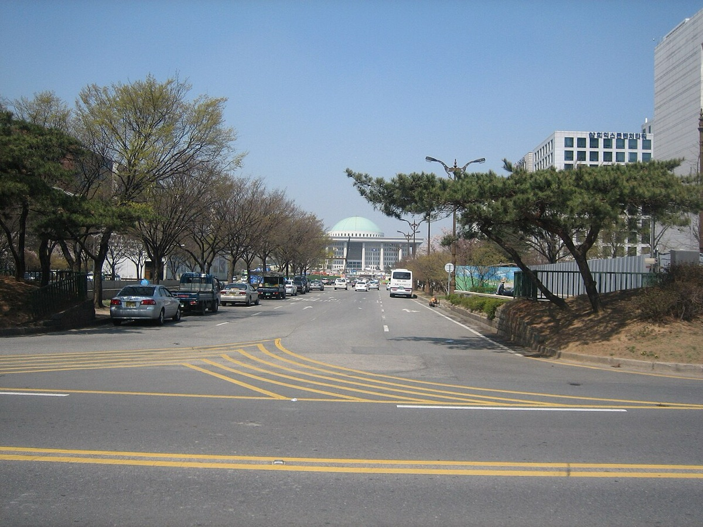

# [속보] 생각하는황소, '학원 선행학습 금지법' 반대 공식 성명 — "원안 시행 땐 학원 존립 장담 못해"

사고력수학·영재교육 브랜드 **생각하는황소**가 **2026년 10월 30일 오후 7시 34분**, 자사 홈페이지 공지사항에 **"학원 선행학습 금지법에 반대합니다"**라는 제목의 공식 성명을 게시했습니다. 법안 이름을 정면으로 언급하며 반대 입장을 밝힌 것은 최근 사고력수학 업계에서 매우 이례적인 움직임입니다.

*▲ 공교육정상화법 개정안은 국회 교육위원회 심사 단계에 있다 (사진: Wikimedia Commons)*

문제가 된 법안은 **'공교육 정상화 촉진 및 선행교육 규제에 관한 특별법 일부개정법률안'**입니다. 흔히 **공교육정상화법** 또는 **'선행학습 금지법'**으로 불리는 법의 개정안으로, **더불어민주당 김문수 의원 등 11인**이 대표발의했습니다. 국회 의안정보시스템 기준 **의안번호 2221602**, 발의일은 **2026년 9월 28일**이며 9월 29일 교육위원회에 회부돼 **현재 위원회 심사 단계**에 있습니다. 입법예고는 10월 10일 마감됐습니다.

## 핵심 요약

| 구분 | 내용 |
|:---|:---|
| 무엇 | 생각하는황소 본사 공지 **"학원 선행학습 금지법에 반대합니다"** (2026.10.30 19:34) |
| 대상 법안 | 공교육 정상화 촉진 및 선행교육 규제에 관한 특별법 일부개정법률안 (의안번호 2221602) |
| 발의 | 더불어민주당 **김문수 의원 등 11인** (2026.9.28 발의 → 9.29 교육위 회부) |
| 현재 상태 | 국회 교육위원회 **심사 중** (입법예고 10.10 마감) |
| 반대 논거 | 과거 유사 법안 **위헌 판결** 선례, 부모의 자녀교육권·학생의 교육 선택권 과잉 규제 |
| 브랜드 입장 | "원안대로 시행될 경우 학원 운영이 불가능해 **존립을 장담할 수 없다**" |
| 요청 사항 | 반대 청원 동참 (공지에 네이버 폼 링크 안내) |

## 1. 지금 법은 어떤 구조인가

2014년부터 시행 중인 공교육정상화법은 **규제 대상이 '학교'에 집중**돼 있습니다. 학교 수업·방과후학교·시험에서 교육과정보다 앞선 내용을 가르치거나 출제하는 것을 금지하는 것이 핵심입니다.

반면 **학원·교습소·개인과외**에 대해서는 **'선행학습을 유발하는 광고·선전'만 금지**합니다. 무엇을 가르칠지는 규제하지 않고, "○년 선행 보장" 같은 문구로 불안을 자극하는 광고만 막는 구조입니다.

이 구분은 2013년 첫 입법 과정에서 만들어졌습니다. 당시 법안에는 학원의 선행 교습을 정지시키는 조항까지 있었지만, 국회 논의를 거치면서 **학원은 광고 금지만 남았습니다**. 배경에는 **헌법재판소 2000년 4월 27일 선고(98헌가16 등)** 결정이 있습니다. 헌재는 과외 교습을 원칙적으로 금지한 구 학원법 조항에 대해 **부모의 자녀교육권, 자녀의 인격 발현권, 가르치는 사람의 직업 선택의 자유**를 지나치게 제한한다며 위헌으로 판단했습니다. 다만 고액 과외 억제와 교육 정상화라는 **목적 자체는 정당하다**고 봤습니다.

## 2. 개정안이 바꾸려는 세 가지

이번 개정안의 핵심은 **규제의 경계선을 학교에서 학원까지 옮기는 것**입니다.

**① 학원의 '선행 교습' 자체를 금지 (제8조 제5항 신설)**
학교교과교습학원·교습소·개인과외교습자가 선행학습을 유발하는 교습을 하거나, 학생을 모집하면서 선행학습을 유발하는 행위를 하지 못하도록 합니다. 지금은 광고만 막지만, 앞으로는 **실제 교습과 모집 과정까지** 규제 대상이 됩니다. 피아노·미술·태권도 같은 **예체능 학원은 대상에서 제외**되고, **겨울방학 중 고등학생**에게는 적용하지 않는 예외가 있습니다.

**② 위반 시 제재 근거 신설 (제14조 제4항 신설)**
조항을 어기면 교육감이 대통령령으로 정하는 바에 따라 **6개월 이내의 기간을 정해 제재**할 수 있게 합니다. 현행법에는 사실상 제재 수단이 없는데, 실제 처분 근거를 만드는 것입니다. 언론에서는 이를 두고 **"최장 6개월 교습정지"**로 요약해 보도했습니다.

**③ 초등 1·2학년 방과후 영어 예외 삭제**
현행법은 '초등학교 1·2학년의 영어 방과후학교 과정'에 이 법을 적용하지 않는 예외를 두고 있습니다. 개정안은 이 조항을 삭제합니다. 영어 교과가 초등 3학년부터 시작되는 만큼, **초1·2 방과후 영어도 선행교육 규제 대상에 들어갈 수 있다**는 해석이 나옵니다.

발의 배경으로 제시된 자료도 있습니다. **2024년 국회에서 공개된 조사**에서는 전국 17개 시도 중 **16곳에서 초등 의대반 운영이 확인**됐고, 평균 **4.6년을 앞서 가르치고 있었다**는 내용이 담겼습니다.

## 3. 생각하는황소가 든 반대 논리

*▲ 생각하는황소 공식 엠블럼 (자료: thinking-bull.com)*

생각하는황소는 공지에서 반대 이유를 크게 세 갈래로 정리했습니다.

**첫째, 위헌 판례 선례입니다.** 공지는 "과거 유사 법안이 위헌 판결을 받은 적도 있는 만큼"이라며, 사교육 교습 내용까지 국가가 규제하는 방식이 헌법재판소가 그은 선을 넘을 수 있다는 점을 지적했습니다.

**둘째, 교육 선택권 침해입니다.** "이 법안은 부모의 자녀교육권과 학생들의 교육 선택권을 지나치게 규제하고 있다"고 밝혔습니다.

**셋째, 사업 존립 문제입니다.** 브랜드 측은 "수학 선행·심화를 전문으로 교육하고 있는 입장에서 이 법안이 원안대로 시행될 경우 더 이상 학원 운영이 불가능해 **존립을 장담할 수 없을 것**"이라며 "이런 이유로 이 법률안에 **강력히 반대**한다"고 명시했습니다.

공지 마지막에는 **반대 청원 참여 링크**(네이버 폼)를 함께 안내하며 학부모들의 동참을 요청했습니다. 브랜드가 학부모를 대상으로 한 청원 운동에 직접 나선 것은 이번이 상당히 이례적입니다. 6개 사고력수학 브랜드의 공식 공지와 최근 보도를 확인한 범위에서, 이 법안에 대해 **본사 명의로 공개 입장을 낸 곳은 생각하는황소가 처음**입니다.

## 4. 언론은 어떻게 봤나

법안 발의 이후 보도는 엇갈립니다.

교육 분야 매체 **'교육을 비추다'는 10월 31일** 기사에서 "학원 '선행 수업'하면 최장 6개월 교습정지?"라며 개정안의 **취지에는 공감하면서도 '기준의 공백'**을 문제 삼았습니다. 무엇이 '선행학습을 유발하는 교습'인지, 학년·과목별로 어디까지가 심화이고 어디부터가 선행인지에 대한 판단 기준이 법문에 명확히 제시되지 않았다는 지적입니다.

**인천일보는 10월 29일** "사교육 선행학습 규제, 교육격차 키울라" 제목의 기사에서 규제 방식이 오히려 격차를 확대할 수 있다는 우려를 전했습니다.

핵심 쟁점은 결국 하나로 모입니다. **"사교육의 교습 내용까지 국가가 규제하는 것이 정당한가."** 찬성 측은 초등 의대반으로 상징되는 과도한 선행을 막을 실효적 수단이 필요하다고 보고, 반대 측은 법의 목적이 정당하더라도 수단이 과도하면 헌법이 허용한 선을 넘는다고 봅니다.

## 5. 학부모가 지금 확인해야 할 것

| 항목 | 내용 |
|:---|:---|
| 당장 바뀌는 것 | **없음**. 발의된 개정안으로, 아직 위원회 심사 단계 |
| 적용 대상 | 학교교과교습학원·교습소·개인과외 (예체능 학원 제외) |
| 예외 | 겨울방학 중 고등학생, 현행 초1·2 방과후 영어(개정안에서 삭제 추진) |
| 제재 수준 | 교육감이 **6개월 이내** 제재 (안 통과 시) |
| 법안 수명 | 22대 국회 임기(**2028년 5월**) 안에 처리되지 않으면 **자동 폐기** |
| 의견 제출 | 국회 교육위원회 소속 의원실로 직접 의견 전달, 국민동의청원 활용 |

특히 **초1·2 방과후 영어 예외 삭제** 조항은 유아·저학년 자녀를 둔 가정에 직접 영향이 갈 수 있는 부분입니다. 같은 의원이 2026년 9월 별도로 발의한 **유아교육 관련 개정안**(유아교육을 '교육관련기관'과 '선행교육' 범위에 포함)이 전제가 되는 구조라는 점도 함께 볼 대목입니다.

## 6. 전망

법안은 위원회 심사에서 **수정되거나 유사 법안과 통합(대안 반영)**되는 경우가 많습니다. 지금 단계에서 원안 그대로 본회의까지 가리라고 단정하기는 어렵습니다. 다만 **주요 사고력수학 브랜드가 본사 명의로 반대 성명을 내고 청원까지 안내했다**는 사실은, 이 법안이 학원가의 '사업 존립' 문제로 인식되고 있다는 신호입니다.

사고력수학 브랜드를 선택할 때는 커리큘럼과 진도 설계를 함께 보되, **법안 진행 상황도 병행해서 확인**하는 것이 좋습니다. 향후 교육위원회 심사 결과와 법안심사소위 논의는 국회 의안정보시스템에서 의안번호 **2221602**로 검색하면 단계별로 추적할 수 있습니다.

---

**출처**
- 생각하는황소 공지사항, "학원 선행학습 금지법에 반대합니다" (2026.10.30 19:34) — [thinking-bull.com](https://www.thinking-bull.com/notice/?idx=175347786&bmode=view)
- 국회 의안정보시스템, 공교육 정상화 촉진 및 선행교육 규제에 관한 특별법 일부개정법률안 (의안번호 2221602, 2026.9.28 발의)
- 교육을 비추다, "학원 '선행 수업'하면 최장 6개월 교습정지?… 공교육정상화법 개정안, 취지엔 공감·기준은 공백" (2026.10.31)
- 인천일보, "사교육 선행학습 규제, 교육격차 키울라" (2026.10.29)
- 헌법재판소 2000.4.27. 선고 98헌가16 등 결정

※ 법안의 세부 조문과 심사 일정은 국회 의안정보시스템 원문에서 최종 확인하시기 바랍니다.

#생각하는황소 #선행학습금지법 #공교육정상화법 #사고력수학 #초등수학 #자녀교육 #학원규제 #대치동학원 #초등맘 #영재교육
