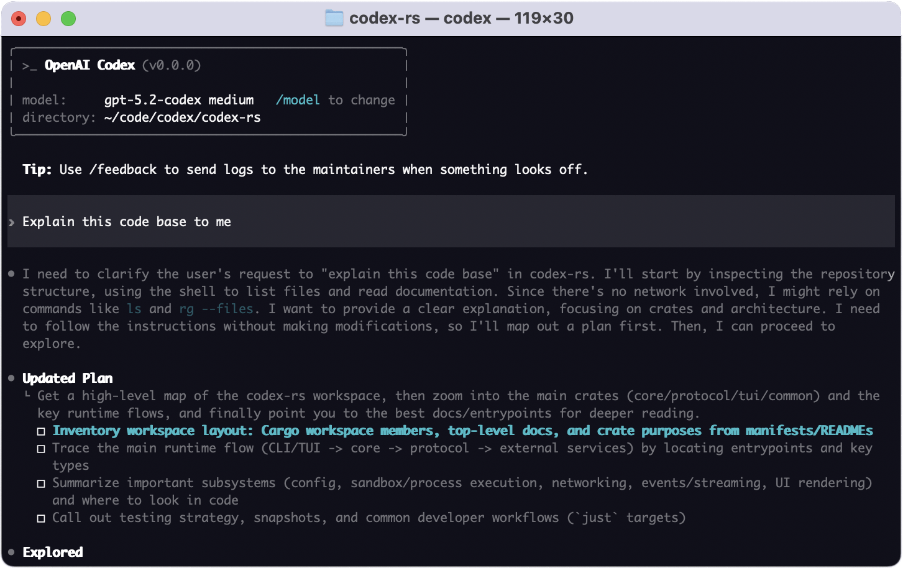
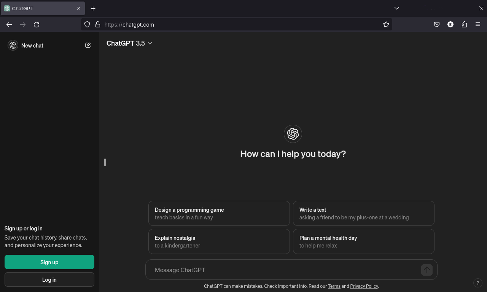

> **📌 한줄 요약:** 2026년 **11월 1일**(현지시간) 기준, OpenAI 도움말 센터의 **"Understanding ChatGPT and Codex usage limits"** 문서에 **"12월부터 Plus·Pro·Business 요금제의 사용량 한도가 ChatGPT와 Codex에 걸쳐 공유된다"** 는 내용이 반영돼 있습니다. 사용량은 **메시지 건수가 아니라 토큰**으로 계산되고, **Instant 채팅은 이 한도에서 빠집니다.** 10월 30일에는 결제(체크아웃) 화면에서 같은 취지의 문구가 먼저 포착됐습니다. 다만 **정확한 시행일, 요금제별 토큰 수, 기존 5시간·주간 창의 존치 여부**는 아직 공개되지 않았습니다.

구독형 AI 도구를 업무에 붙여 쓰는 경우, 요금제를 고르는 기준은 결국 "얼마까지 쓸 수 있나"입니다. 그런데 그 한도의 **단위**가 바뀌는 건 숫자가 조금 오르내리는 것과 체감이 다릅니다. 이번 건은 바로 그 단위가 바뀌는 쪽입니다. 채팅에 쓰는 몫과 코딩 에이전트에 쓰는 몫이 **각각 따로 있던 계량기 두 개가 하나로 합쳐지는** 구조이기 때문입니다.

이 글은 **무엇이 공식 문서에 적혀 있는지 → 무엇이 아직 확인되지 않았는지 → 왜 지금 이런 변화가 나오는지 → 12월 전에 무엇을 준비하면 되는지** 순서로 정리했습니다.

*OpenAI Codex CLI 실행 화면 (출처: Wikimedia Commons, Apache License 2.0, OpenAI Codex CLI 저장소)*

## 이슈 요약 — 한 장으로 정리

| 항목 | 내용 |
|:--|:--|
| 무엇을 | ChatGPT와 Codex의 **사용량 한도를 하나로 통합** |
| 언제부터 | **2026년 12월** (정확한 날짜 미공개) |
| 대상 요금제 | **Plus · Pro · Business** |
| 계량 단위 | **토큰** (모델·작업 복잡도에 따라 소모량이 달라짐) |
| 예외 | **Instant 채팅은 사용량에서 제외** |
| 확인 위치 | **설정(Settings) → 사용량(Usage)** 에서 통합 잔여량·리셋 시각 표시 |
| 한도 도달 시 | 리셋 대기 · 상위 요금제 업그레이드 · **크레딧 구매**(대상 기능) |
| 공식 근거 | OpenAI 도움말 센터 문서 갱신 (11월 1일 확인) |
| 선행 정황 | 10월 30일 결제 화면 문구 포착, 조직 책임자 "통합 진행 중" 언급 |
| 미공개 | 요금제별 토큰 수, 5시간·주간 창 유지 여부, Enterprise·Edu·Free 적용 여부 |

표만 보면 "요금제 안내문 한 줄 바뀐 것"처럼 보입니다. 하지만 계량 단위가 메시지에서 토큰으로 넘어가면, 같은 금액으로 할 수 있는 일의 양이 **작업 종류에 따라 달라집니다.** 이 지점이 실무에서 가장 크게 체감되는 부분입니다.

*ChatGPT 웹 인터페이스 예시 (출처: Wikimedia Commons, 퍼블릭 도메인)*

## 1. 무슨 일이 있었나 — 도움말 문서 한 줄이 시작

발단은 화려한 발표가 아니라 **안내 문서의 갱신**이었습니다. 11월 1일 확인 시점에 OpenAI 도움말 센터의 **"Understanding ChatGPT and Codex usage limits"** 문서에는 이런 취지의 문장이 들어가 있습니다.

> "Plus, Pro, Business 요금제의 사용량 한도는 **Work의 에이전트 기능을 ChatGPT 본체로 가져오는 과정에서** ChatGPT와 Codex에 걸쳐 공유됩니다."

문장이 두 겹으로 읽힙니다. 첫째는 **제품 변경**입니다. 그동안 ChatGPT Work라는 별도 영역에 있던 에이전트 기능이 ChatGPT 본체로 흡수됩니다. 둘째는 **그 결과로 생기는 계량 구조 변경**입니다. 같은 에이전트가 양쪽에서 돌아가는데 계량기를 두 개로 둘 이유가 없어진다는 논리입니다.

이보다 하루 이틀 앞서, 결제 화면에서 먼저 흔적이 잡혔습니다. 10월 30일 AI 제품 리서처 **티보르 블라호(Tibor Blaho)** 가 공유한 ChatGPT 웹 결제 페이지에는 이런 문구가 있었습니다.

> "Starting in December, plan usage will have a shared limit across all of ChatGPT and Codex."

같은 화면에 월 **23유로(세금 포함)** 요금이 표시돼 있었고, 이는 Plus 요금제에 해당하는 것으로 보도됐습니다. 이후 ChatGPT·Codex 총괄 **티보 소티오(Tibo Sottiaux)** 가 관련 대화에서 "ChatGPT와 Work의 장점을 합치는 작업을 하고 있으며, 아직 출시 단계는 아니다"라는 취지로 답하면서, 이번 변경이 **별도 발표가 아니라 제품 통합의 부산물**이라는 해석이 힘을 얻었습니다.

정리하면 순서는 이렇습니다. **결제 화면 문구(10/30) → 조직 책임자 확인 발언 → 도움말 문서 반영(11/1 확인)**. 공식 블로그 포스트나 릴리스 노트는 이 시점까지 확인되지 않았습니다.

## 2. 상세 — '메시지'에서 '토큰'으로 바뀐다는 것

이번 변경의 핵심은 **무엇을 세느냐**입니다.

지금까지 체감상의 한도는 "몇 번 물어볼 수 있나", "몇 시간 돌릴 수 있나"였습니다. 토큰 기준으로 바뀌면 **짧은 질문 하나와 몇 시간짜리 에이전트 실행이 같은 저울에 올라갑니다.** OpenAI도 문서에서 "더 고급 모델과 복잡한 작업은 일반적으로 한도를 더 많이 사용한다"고 명시하고 있습니다.

여기서 실무적으로 중요한 갈림길이 세 가지 생깁니다.

**첫째, Instant 채팅은 계량에서 빠집니다.** 문서는 Instant 채팅이 사용량을 끌어다 쓰지 않는다고 안내합니다. 가벼운 질문·검색·번역 위주로 쓰는 경우라면 체감 변화가 거의 없을 수 있다는 뜻입니다. 반대로 추론 모델과 에이전트를 상시로 돌리는 쪽은 같은 풀을 나눠 쓰게 됩니다.

**둘째, 확인 창구가 '설정 → 사용량'으로 통일됩니다.** 통합된 잔여 사용량과 리셋 시각이 한 화면에 표시됩니다. 지금은 Codex 쪽 잔량과 채팅 쪽 잔량을 각각 봐야 하지만, 앞으로는 한 숫자만 보면 됩니다. 관리 부담은 줄지만, **"어디서 얼마나 썼는지"의 분해능은 떨어질 수 있습니다.**

**셋째, 한도에 닿았을 때의 선택지가 세 갈래입니다.** 리셋을 기다리거나, 상위 요금제로 올리거나, **크레딧을 사서 이어가는** 방식입니다. 문서 표현이 "대상 기능(eligible features)"으로 돼 있어, 모든 기능이 크레딧으로 커버되는 것은 아닐 수 있습니다.

비교를 위해 옆 동네 상황도 짚어둘 만합니다. Anthropic은 10월에 최상위 Max 등급을 **Ultra**로 개편하면서 인증 계정 기준 5시간 제한을 없애고 주간 상한과 API 크레딧을 붙였습니다. 두 회사가 수렴하는 형태는 같습니다. **구독은 사실상 '주간 컴퓨트 허용량'이고, 크레딧은 넘칠 때 쓰는 배수로**가 되는 구조입니다. 다른 점은 OpenAI 쪽이 채팅과 코딩 에이전트를 **한 탱크**에 담는다는 것입니다.

## 3. 확인된 것과 확인되지 않은 것

이번 건은 "공식 문서에 있으니 사실"과 "아직 숫자가 없으니 추정"을 갈라 놓는 게 중요합니다.

| 질문 | 확인 상태 |
|:--|:--|
| 통합 자체가 사실인가 | **확인됨** — OpenAI 공식 도메인 문서에 명시 |
| 언제부터인가 | "12월"만 명시, **정확한 날짜 없음** |
| 어느 요금제인가 | **Plus · Pro · Business** 명시 |
| 무엇이 공유되는가 | ChatGPT와 Codex의 **단일 사용량 한도** |
| 어떻게 세는가 | **토큰**. 모델·작업에 따라 다름 |
| Instant 채팅은 | **사용량에서 제외** |
| 요금제별 토큰 수 | **미공개** — 문서에 수치 없음 |
| 기존 5시간·주간 창은 유지되나 | **미확인** — 문장에 언급 없음 |
| Enterprise·Edu·Free는 | **해당 문장에 이름 없음** |
| 가격이 오르나 | 문서상 **요금 변경 없음** |

마지막 항목이 특히 중요합니다. **가격은 그대로인데 통합된 토큰 예산이 지금의 두 한도를 합친 것보다 큰지 작은지는 아직 알 수 없습니다.** 이 숫자가 발표되기 전까지 소셜 미디어에 도는 구체적 수치는 근거가 없는 경우가 많습니다. 문서에는 "대부분의 사용자는 지금보다 리셋을 더 자주 기다리지 않을 것으로 예상한다"는 정도의 표현만 있습니다. 기대치를 표시한 문장이지, 데이터가 붙은 약속은 아닙니다.

## 4. 왜 지금인가 — 한도 정책이 유난히 자주 흔들린 이유

이번 변화가 갑작스럽게 느껴지는 건, 최근 몇 달간 Codex 한도가 유난히 자주 바뀌었기 때문입니다. 흐름을 되짚어 보면 이번 통합이 **왜 '구조'를 건드리는 조치인지** 이해가 됩니다.

- **2026년 7월** — Codex의 롤링 5시간 한도가 폐지되고 주간 리셋 방식이 재편됐습니다.
- **2026년 7월 말** — 한도가 소폭 상향되고, 5시간 상한이 다른 형태로 되살아났습니다.
- **2026년 8월 25일** — Codex 총괄이 Plus 대상 5시간 창 복귀를 예고했고, Pro 등급은 당분간 예외로 남았습니다.
- **2026년 9월 26일** — 장애가 발생하자 유료 사용자 한도 리셋이 예고됐습니다.
- **2026년 10월 29일** — 예고됐던 Pro 200의 Work·Codex 사용량 50% 삭감이 철회되고, 오히려 Pro·Business Premium 한도가 2배로 올랐습니다.

한도가 오르내릴 때마다 "이번 주에 고른 요금제"의 가치가 달라졌습니다. 여기에 **10월 28일에는 구독에 월 최대 500달러 API 크레딧을 붙이는 혜택**까지 예고됐습니다. 즉 최근 OpenAI의 과금 실험은 **한도의 크기(얼마나) → 한도의 단위(무엇으로) → 넘칠 때의 배수로(크레딧)** 순서로 옮겨가고 있습니다.

통합 토큰 풀은 이 흐름의 연장입니다. 버킷의 크기를 조금 키우는 대신, **버킷을 세는 자를 바꾸는** 조치이기 때문입니다. 그리고 이 방식은 양날의 성질을 갖습니다. 사용자 입장에서는 잔량을 한눈에 관리할 수 있게 되지만, **같은 토큰 수라도 작업 구성이 바뀌면 체감 허용량이 줄어들 수 있습니다.** 헤드라인 숫자가 그대로여도 실효 한도가 달라질 수 있다는 뜻입니다.

## 5. 영향 — 누가 유리하고 누가 불리한가

OpenAI가 요금제별 토큰 수를 공개하지 않았으니, 정확한 손익 계산은 아직 불가능합니다. 대신 **사용 패턴별로 무엇이 달라지는지**는 지금도 그릴 수 있습니다.

**① 채팅 위주 Plus 사용자**
Instant 채팅이 계량에서 빠지므로 가벼운 사용은 거의 영향이 없습니다. 다만 추론 모델로 글쓰기·리서치를 자주 돌리는 경우, 그 사용량이 코딩 에이전트와 **같은 탱크**에서 나가게 되는 점은 새롭습니다.

**② Codex를 오래 돌리는 개발자**
가장 노출이 큰 쪽입니다. 지금은 Codex에 자체 계량기가 있어서 채팅 사용이 Codex 한도를 건드리지 않았습니다. 통합 후에는 긴 에이전트 실행과 추론 위주 채팅이 **같은 풀을 두고 경쟁**합니다. 지금까지 "싼 모델로 Codex를 돌려 한도를 늘리는" 습관이 있었다면, 그 습관의 가치는 오히려 커집니다.

**③ Business 팀**
좌석당 단일 허용량은 설명하기는 단순해지지만, **수치가 공개되지 않은 상태에서의 예산 편성이 어려워집니다.** 확인이 필요한 항목은 두 가지입니다. 크레딧을 좌석 간에 **풀링**할 수 있는지, 새 사용량 화면이 **사용자별 소비**를 노출하는지. 팀 단위로 에이전트를 붙여 쓰는 조직이라면 한 사람의 과중한 주간 사용이 다른 사람의 채팅 몫까지 잠식할 수 있는 구조이기 때문입니다.

**④ 자동화 파이프라인 운영자**
API 키로 호출하는 사용량은 이번 구독 한도와 별개로 움직입니다. 다만 Codex를 구독 계정 기반으로 돌리는 워크플로가 섞여 있다면, 12월 이후 **배치 작업의 소모 속도가 달라질 수 있습니다.** 크론잡으로 정기 실행을 돌리는 경우, 새 단위에서 한 번의 실행이 얼마를 먹는지 초기에 측정해 두는 편이 안전합니다.

## 6. 12월 전에 해두면 좋은 것

거창한 준비는 필요 없습니다. 다만 **기준선을 지금 기록해 두는 것**이 핵심입니다. OpenAI의 "대부분은 지금과 비슷할 것"이라는 표현은 **현재 상태 대비**이므로, 현재 상태를 모르면 검증할 방법이 없습니다.

1. **지금의 리셋 빈도를 적어두기.** Codex 한도에 부딪히는 주기가 어느 정도인지 대략이라도 메모합니다.
2. **사용량 화면 위치 확인.** 앞으로는 **설정 → 사용량**에서 통합 잔여량과 리셋 시각이 보입니다. 시행 직후 화면을 캡처해 두면 이후 비교가 쉽습니다.
3. **모델 라우팅 정리.** 고급 모델은 풀을 더 빨리 먹습니다. 반복 작업은 경량 모델로, 플래그십은 정말 필요한 작업에만 쓰는 규칙을 미리 정해두면 통합 이후 충격이 줄어듭니다.
4. **넘칠 때의 계획을 미리 결정.** 크레딧 단가와 상위 요금제 가격을 **작업 도중에 막혀서가 아니라 미리** 비교해 둡니다.
5. **세부 조항 추적.** Enterprise·Edu·Free 요금제는 해당 문장에 이름이 없습니다. 팀 요금제를 쓰는 경우 관리자에게 좌석 간 크레딧 풀링과 사용자별 사용량 노출 여부를 문의해 두는 편이 좋습니다.

## 7. 전망 — 다음에 봐야 할 숫자

이번 발표에서 가장 눈에 띄는 건 **없는 정보**입니다. 요금제별 토큰 수, 정확한 시행일, 5시간·주간 창의 존치 여부가 모두 비어 있습니다. 앞으로 확인해야 할 것도 이 세 가지입니다.

판단 기준을 하나 제안하면 이렇습니다. **"통합 예산이 기존 두 한도의 합보다 큰가"** 를 먼저 보십시오. 크면 단순한 관리 편의 개선이고, 작으면 **가격 인상 없이 실효 허용량을 줄이는 조정**이 됩니다. 요금제 가격표는 그대로인데 체감이 달라지는 종류의 변화는 늘 이 지점에서 갈렸습니다.

구독형 AI 도구는 이미 "정액제로 무제한"이라는 문구가 통하기 어려운 단계에 들어섰습니다. 컴퓨트는 그렇게 동작하지 않기 때문에, 각 사가 **주간 허용량 + 크레딧**이라는 같은 형태로 수렴하는 중입니다. 그 구조에서 사용자가 할 수 있는 가장 현실적인 대비는 **자기 사용 패턴을 숫자로 알고 있는 것**입니다. 요금제를 고를 때 "넉넉해 보인다"는 인상보다, 지난달 실제 소모량이 더 신뢰할 만한 기준이 됩니다.

가성비를 따져 요금제를 고르는 분들이라면, 12월 숫자가 공개되는 시점에 **현재 플랜 유지 / 상위 플랜 / 크레딧 종량** 세 조합을 한 번에 비교해 보시길 권합니다. 통합 발표 자체보다, 그 뒤에 붙는 숫자가 실제 선택을 바꾸는 지점입니다.

---

**참고 자료**
- OpenAI Help Center, "Understanding ChatGPT and Codex usage limits" (2026년 11월 1일 확인)
- Windows Report, "OpenAI Likely to Make ChatGPT and Codex Share Usage Limits Starting in December" (2026년 10월 30일)
- explainx.ai, "ChatGPT + Codex Limits Merge in December: One Token Allowance" (2026년 11월 1일)
- Cryptobriefing, "OpenAI to merge ChatGPT and Codex token allowances" (2026년 11월 1일)
