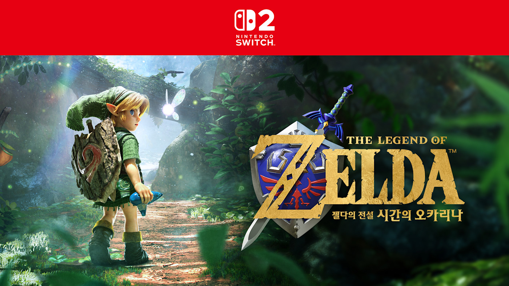
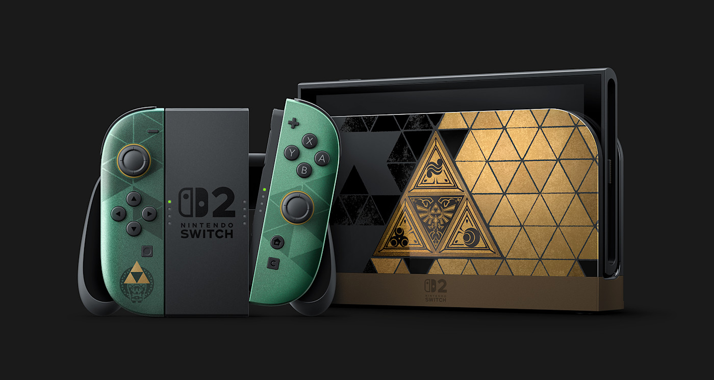
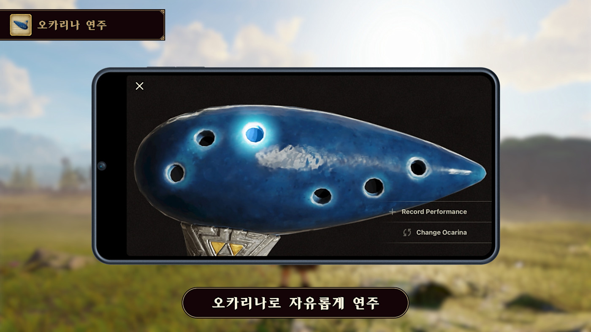
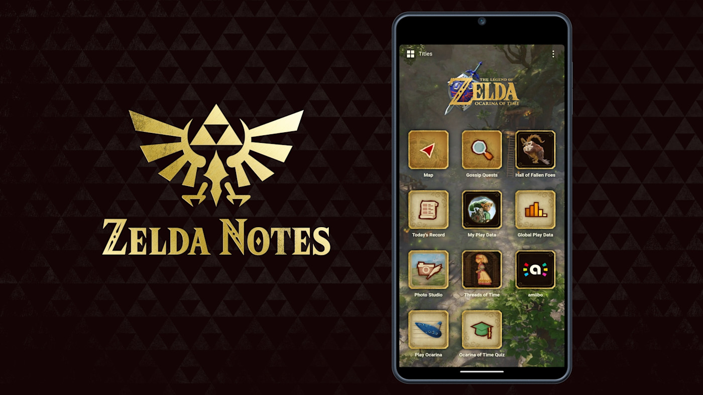
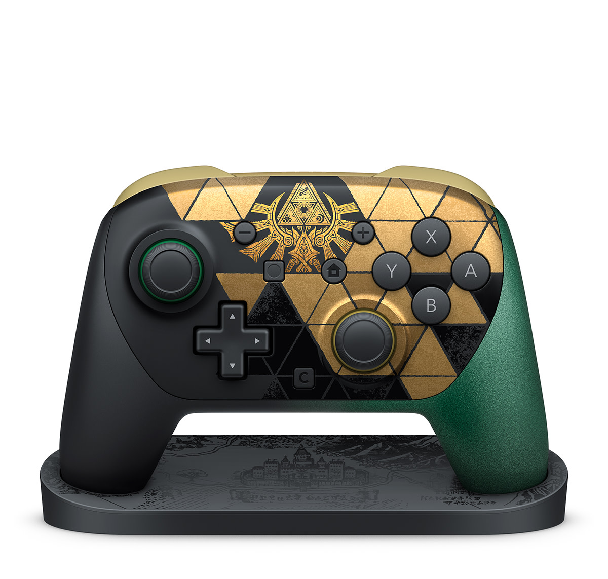

*'젤다의 전설 40주년' 특별 디자인과 시간의 오카리나 리메이크 키비주얼. 게임은 11월 5일, 40주년 에디션 본체는 10월 29일 출시됐습니다 (출처: 한국닌텐도 공식 뉴스)*

> **📌 한줄 요약:** 1998년 N64 원작 **'젤다의 전설 시간의 오카리나'** 가 **2026년 11월 5일(목)**, 스위치2 전용 풀 리메이크로 나옵니다. 국내 가격은 **패키지 88,000원 / 다운로드 79,800원** 입니다. 본체보다 먼저인 **10월 29일** 에는 트라이포스 디자인의 **'젤다의 전설 40주년 애니버서리 에디션' 스위치2(788,000원)** 가 출시됐는데, **일반판(758,000원)보다 30,000원 비싸면서 게임은 들어 있지 않습니다.** 즉 에디션 + 패키지 게임 = **876,000원**, 일반판 + 패키지 게임 = **846,000원**. "3만원 더 내고 트라이포스 각인 본체를 살 가치가 있는가"가 이 글의 핵심 질문입니다.

---

## 이 글에서 확인할 수 있는 것

- 원작 대비 리메이크에서 실제로 바뀐 것 (조작·그래픽·편의성)
- 40주년 에디션 스위치2의 구성과 국내 가격 (게임 미포함 주의)
- 에디션 / 일반판 / 게임 단품 — 경우별 총지출 계산
- 해외·국내 수급 상황과 지금 사도 되는 타이밍인지
- 스위치2로 즐길 때 미리 알아야 할 제약 (저장장치, 4K 조건)

---

## 1. 28년 만의 귀환 — "리마스터"가 아니라 "풀 리메이크"

1998년 NINTENDO 64로 나온 '시간의 오카리나'는 젤다 시리즈 최초의 3D 작품이자, 메타크리틱 **99점**이라는 기록을 세운 게임입니다. 2011년 3DS로 '시간의 오카리나 3D'가 나온 적은 있지만, 원작의 뼈대를 유지한 업그레이드에 가까웠습니다. 이번 작품은 결이 다릅니다.

한국닌텐도 공식 표현은 **"1998년에 발매된 '시간의 오카리나'를 풀 리메이크한 작품"** 이고, **"그래픽을 완전히 새롭게 하고 플레이 편의성도 크게 향상"** 시켰다고 밝혔습니다. 게임동아 보도에 따르면 코키리 숲을 비롯한 배경부터 링크의 의상과 장비까지 새로 제작했고, 소재별 질감을 살리면서도 원작의 분위기는 유지하는 방향으로 작업했습니다.

*트라이포스를 모티브로 한 40주년 에디션 본체. 도트로 표현된 링크와 젤다가 곳곳에 숨어 있습니다 (출처: 한국닌텐도 공식 뉴스)*

개발진이 내세운 키워드는 **"현대 기술을 활용한 원작의 충실한 재해석"** 입니다. 무기를 얻고, 그 도구를 어디에 쓸지 고민하는 원작의 구조는 그대로 두고, 손에 잡히는 감각만 현재 기준으로 끌어올린 셈입니다.

---

## 2. 원작과 달라진 점 — 조작이 가장 크게 바뀝니다

리메이크 소식을 듣고 "그래픽만 좋아진 거 아니야?"라고 생각하기 쉽습니다. 그런데 아오누마 에이지 프로듀서가 직접 플레이하며 공개한 내용을 보면, **체감 차이가 가장 큰 곳은 조작계** 입니다.

| 항목 | N64 원작 (1998) | 스위치2 리메이크 (2026) |
|:---|:---|:---|
| 카메라 | 제한적 (락온·시점 고정 중심) | **자유 카메라** — 주변을 원하는 방향으로 조망 |
| 점프 | 절벽 끝에서 자동 점프 | **버튼 점프** — 직접 뛰고 싶은 곳에서 점프 |
| 이동 | 구르기(롤)로 가속 | **구르지 않아도 질주** — 평원 같은 넓은 지역 이동이 쾌적 |
| 아이템 | 서브화면 전환 | **버튼으로 빠른 교체** |
| 새총 | 스틱 조준 | **모션 조작 조준** |
| 진행 안내 | 없음 | **태피스트리 형태의 진행도** — 현재 이야기·다음 목표 확인 |
| 오카리나 | 버튼 입력 | **마이크로 흥얼거림 인식**, 실제 악기 연주에도 반응 |
| 그래픽 | N64 | 배경·캐릭터 모델 신규 제작 |

특히 오카리나 연주는 이번 작품의 상징적인 변화입니다. 스위치2 본체 마이크를 활용해, 링크가 이미 배운 곡을 **입으로 흥얼거리면 게임이 이를 인식해 링크가 그 곡을 연주** 합니다. 실제 오카리나 같은 악기로 불어도 반응한다고 닌텐도는 설명했습니다. 원작을 했던 분들이라면 이 한 줄에서 감회가 다를 겁니다.

*본체 마이크로 멜로디를 인식시키는 오카리나 연주. 실제 악기 연주에도 반응합니다 (출처: 한국닌텐도 공식 뉴스)*

여기에 스마트폰 앱 **'Nintendo Switch App'** 의 게임 연동 서비스 **'ZELDA NOTES'** 가 새로 대응합니다. 하루 플레이를 시간순으로 되돌아보는 **'오늘의 기록'**, 스마트폰에 표시된 사진을 단서로 게임 속 장소를 찾는 **'소문 퀘스트'** 가 대표적입니다. 원작에는 없던, "하다가 폰을 놓게 되는" 요소입니다.

*Nintendo Switch App의 ZELDA NOTES. 하루 플레이 기록과 사진 단서 퀘스트를 제공합니다 (출처: 한국닌텐도 공식 뉴스)*

---

## 3. 40주년 에디션 — 가격표보다 "구성"을 먼저 봐야 합니다

여기가 실제 구매에서 가장 많이 갈리는 지점입니다. 한국닌텐도가 공개한 국내 가격은 다음과 같습니다.

| 제품 | 발매일 | 희망소비자가격 | 게임 포함 |
|:---|:---|:---|:---|
| **젤다의 전설 시간의 오카리나** (패키지) | 2026년 11월 5일 | **88,000원** | 본품 |
| **젤다의 전설 시간의 오카리나** (다운로드) | 2026년 11월 5일 | **79,800원** | 본품 |
| **스위치2 젤다의 전설 40주년 애니버서리 에디션** | 2026년 10월 29일 | **788,000원** | **미포함** |
| 스위치2 Pro 컨트롤러 40주년 에디션 | 2026년 10월 29일 | **139,800원** | - |
| 스위치2 휴대용 케이스 40주년 에디션 | 2026년 10월 29일 | **41,800원** | - |

가장 중요한 줄은 세 번째입니다. **40주년 에디션은 본체·독·Joy-Con 2 구성이고, 게임은 들어 있지 않습니다.** 해외 보도도 동일합니다. 미국 가격은 **519.99달러** 로, 일반 스위치2(499.99달러)보다 **20달러 비싼** 값에 본체와 독, Joy-Con 2 한 쌍이 들어갑니다. 영국은 429.99파운드입니다.

즉 국내 기준 **일반판 758,000원 + 패키지 게임 88,000원 = 846,000원**, **에디션 788,000원 + 패키지 게임 88,000원 = 876,000원**. 차액은 정확히 **30,000원** 입니다. 이 3만원은 "게임 값"이 아니라 순수하게 **디자인 프리미엄** 입니다.

*40주년 Pro 컨트롤러는 시리즈 최초로 디스플레이 스탠드가 동봉됩니다. 스탠드도 게임 속 맵 디자인입니다 (출처: 한국닌텐도 공식 뉴스)*

참고로 일반 스위치2의 국내 가격은 2026년 9월 1일부로 **648,000원에서 758,000원으로 인상**됐습니다. 40주년 에디션 788,000원은 인상된 가격을 기준으로 +30,000원인 셈이라, 예전 가격(648,000원)과 비교하면 체감 차이가 훨씬 크게 느껴질 수 있습니다.

---

## 4. 세 가지 경우로 계산 — 무엇을 사야 하나

가격만 나열하면 판단이 어렵습니다. 실제 지출로 바꿔보겠습니다.

| 구매 시나리오 | 구성 | 총지출 |
|:---|:---|:---|
| A. 소장파 | 40주년 에디션 + 패키지 게임 | **876,000원** |
| B. 실속파 | 일반 스위치2 + 패키지 게임 | **846,000원** |
| C. 다운로드파 | 일반 스위치2 + 다운로드 게임 | **837,800원** |
| D. 기존 보유자 | 게임만 (패키지/다운로드) | **88,000원 / 79,800원** |

정리하면 이렇습니다.

- **트라이포스 각인과 도트 링크·젤다 디자인에 값어치를 두는 분** → A. 어차피 3만원은 디자인 값이고, 본체를 5년 이상 쓴다고 보면 월 500원 수준입니다.
- **디자인에 관심 없고 게임만 하고 싶은 분** → B 또는 C. 다운로드를 선택하면 패키지보다 8,200원 더 아낍니다. 패키지 박스와 카트리지를 소장하고 싶은 경우가 아니라면 다운로드가 합리적입니다.
- **이미 스위치2를 가지고 있는 분** → D. 이 경우 에디션 구매는 "본체를 하나 더 사는" 결정이라 훨씬 신중해야 합니다.
- **40주년 Pro 컨트롤러(139,800원)** 는 별매입니다. 에디션 본체를 사도 기본 Joy-Con 2만 들어 있으니, 거실 TV 모드로 오래 플레이하는 분이라면 추가 지출을 예산에 넣어야 합니다.

주의할 점 하나. **에디션 패키지에 게임이 없다는 사실을 모르고 주문하는 사례** 가 해외에서 나왔습니다. 박스 이미지에 젤다 그래픽이 크게 들어가 있어 오해하기 쉬운 구성입니다. 주문 전에 "게임 포함 여부"를 반드시 확인하시기 바랍니다.

---

## 5. 수급 상황 — 해외는 품귀, 국내는 상대적으로 여유

40주년 에디션은 **10월 29일** 출시됐습니다. 해외 반응은 뜨거웠습니다. 미국에서는 예약 개시 하루 만에 Target·Best Buy·GameStop 등 주요 유통에서 매도인이 발생했고, 출시일인 10월 29일에는 GameStop이 완판, Walmart가 일부 주문을 취소했다는 보도도 나왔습니다. 이후 재입고가 이어지는 상황입니다.

국내는 분위기가 조금 다릅니다. 출시 초반 유통 물량이 예상보다 넉넉해서, 되팔이(전매) 수요가 어려움을 겪고 있다는 분석이 나왔습니다. 젤다 팬이라면 반가운 소식이고, "일단 사두고 나중에 판단하자"는 식의 접근은 권하지 않습니다. **정가 788,000원에 살 수 있는 시점이면 굳이 서두를 이유가 없다**는 뜻이기도 합니다.

게임 본편은 11월 5일 발매이고, 다운로드 버전은 이미 닌텐도 e숍에서 예약 판매 중입니다. 패키지 버전은 발매일에 맞춰 오프라인 매장과 온라인몰에 풀립니다.

---

## 6. 스위치2로 즐기기 전 체크리스트

게임 자체는 화려하지만, 하드웨어 쪽 제약을 미리 알아두면 실망이 줄어듭니다.

- **저장장치:** 스위치2 내장 저장은 256GB입니다. 확장 시 **microSD Express** 규격만 사용할 수 있고, 스위치1에서 쓰던 일반 microSD는 호환되지 않습니다. 게임을 여러 개 받아두는 편이라면 카드 값을 예산에 넣으세요.
- **TV 출력:** 독 연결 시 최대 4K 출력이 가능하지만, **4K에서는 최대 60fps** 입니다. 120fps는 1080p급에서 봐야 합니다. TV와 게임이 모두 대응해야 적용됩니다.
- **휴대 모드:** 7.9인치 1080p 디스플레이, 120Hz·VRR·HDR 대응입니다. 원작을 출퇴근길에 즐기는 용도라면 이 화면이 가장 큰 변화입니다.
- **독점 여부:** 이번 리메이크는 **스위치2 전용** 입니다. 스위치1으로는 플레이할 수 없습니다.
- **한국어 지원:** 공식 대응 언어에 한국어가 포함됩니다.

---

## 7. 40주년 프로젝트 — 게임 밖에서도 이어집니다

닌텐도는 40주년을 게임 하나로 끝내지 않습니다. 공개된 일정은 이렇습니다.

- **기념 콘서트:** 2027년 1월 도쿄를 시작으로 2월 시카고, 4월 런던, 5월 멜버른
- **실사 영화:** 2027년 4월 30일 글로벌 개봉
- **부가 콘텐츠:** '모여봐요 동물의 숲' 내 젤다 마이디자인 배포, 닌텐도 뮤지엄 40주년 굿즈 등

콘서트와 영화가 겹치는 2027년 상반기가 사실상 '젤다의 해'가 되는 셈입니다. 게임을 먼저 접해두면 이후 콘텐츠를 즐기는 재미도 배가됩니다.

---

## 8. 정리 — "3만원의 디자인 값"을 낼 만한가

시간의 오카리나 리메이크는 **원작을 기억하는 세대에게는 추억 상품이 아니라 "다시 제대로 해보는 게임"** 입니다. 자유 카메라, 버튼 점프, 질주, 아이템 퀵 스왑, 마이크 오카리나 — 다섯 가지 모두 "원작에서 답답했던 부분"을 정확히 겨냥합니다. 여기에 ZELDA NOTES 연동까지 더해져, 1998년에는 존재하지 않았던 방식으로 모험을 기록할 수 있습니다.

반대로 아쉬운 점도 분명합니다.

- **에디션에 게임이 미포함** — 788,000원을 내고도 게임을 따로 사야 한다는 사실은 여전히 설명이 필요한 구성입니다.
- **30,000원의 디자인 프리미엄** — 트라이포스 각인에 값어치를 못 느낀다면 일반판이 정답입니다.
- **9월 가격 인상 이후의 부담** — 일반판이 758,000원으로 오른 상태라, 40주년 에디션의 체감 가격은 예전 기준보다 훨씬 높습니다.

정리하면 이렇습니다.

- **젤다 팬이고 스위치2를 처음 사는 경우** → 40주년 에디션 + 패키지 게임. 3만원 차이는 소장 가치로 충분히 회수됩니다.
- **게임만 하고 싶고 디자인은 상관없는 경우** → 일반 스위치2 + 다운로드 게임(79,800원)이 가장 저렴합니다.
- **이미 스위치2 보유자** → 게임 단품만. 에디션은 "두 번째 본체"라는 점을 잊지 마세요.
- **발매 직후 구매를 서두를 필요는 없습니다.** 국내 물량이 비교적 넉넉하다는 분석이 나온 만큼, 11월 5일 게임 발매 후 실제 플레이 영상과 평가를 확인하고 결정해도 늦지 않습니다.

가성비 좋은 제품을 찾는 분께는 **일반판 + 다운로드 게임** 조합을, 40년을 함께한 시리즈를 책상 위에 남기고 싶은 분께는 **40주년 에디션** 을 권합니다. 어느 쪽이든, 11월 5일 이후 하이랄로 돌아갈 준비는 끝난 셈입니다.

---

*※ 본 글의 가격과 일정은 한국닌텐도 공식 뉴스(2026년 9월 9일)와 게임동아·Tom's Guide 등 주요 매체 보도를 기준으로 정리했습니다. 해외 가격과 재고 상황은 유통사별로 다를 수 있으며, 국내 가격은 향후 변동될 수 있습니다.*
