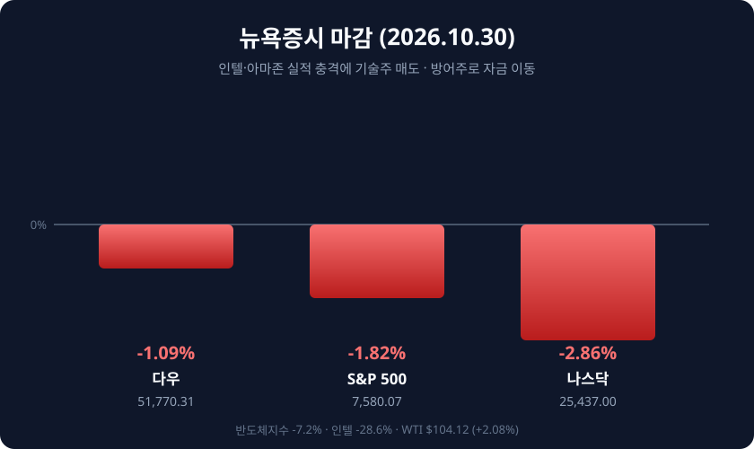

*2026년 10월 30일(현지시간) 뉴욕증시 주요 지수 등락률*

## 오늘의 증시 요약

**10월 30일(현지시간)** 뉴욕증시는 10월 마지막 거래일을 큰 폭의 하락으로 마쳤습니다. 다우는 572.25포인트(1.09%) 내린 **5만1,770.31**, S&P500은 140.32포인트(1.82%) 내린 **7,580.07**, 나스닥은 747.73포인트(2.86%) 내린 **2만5,437.00**에 마감했습니다.

| 지수 | 종가 | 전일비 | 등락률 |
|:----|:----|:------|:------:|
| **다우** | 51,770.31 | ▼ 572.25p | -1.09% |
| **S&P 500** | 7,580.07 | ▼ 140.32p | -1.82% |
| **나스닥** | 25,437.00 | ▼ 747.73p | -2.86% |
| **필라델피아 반도체** | - | ▼ | -7.2% |

나스닥의 하루 낙폭은 지난 6월 이후 가장 컸고, 한 달 기준으로도 5.3% 밀리며 2025년 3월 이후 가장 부진한 달이 됐습니다. S&P500은 6월 이후 최악의 하루를 보내며 3주 연속 주간 하락, 사상 최고가 대비 3.1% 낮은 수준으로 내려왔습니다.

## 인텔 28.6% 폭락, 아마존도 발목

하락의 출발점은 실적이었습니다. 인텔은 3분기 매출(165억1,000만달러)과 조정 주당순이익(0.52달러)이 예상을 웃돌았는데도 **28.6%** 급락했습니다. 4분기 매출 전망을 150억~160억달러로 제시했는데 시장 예상(171억달러)을 크게 밑돌았고, 주당순이익 전망도 0.43달러 대신 0.25달러에 그쳤습니다. PC 수요 부진이 배경으로 지목되며 1970년대 이후 최악의 하루를 기록했습니다.

아마존은 3분기 매출 2,019억4,000만달러, 주당순이익 1.89달러로 모두 예상치를 밑돌았습니다. AWS가 39% 성장했지만 최근 12개월 잉여현금흐름이 424억달러 적자로 돌아섰고, 올해 설비투자 2,200억달러 계획도 유지했습니다. 전날 알파벳에 이어 이틀 연속 빅테크의 공통 약점은 매출 성장이 아니라 **AI 설비투자로 인한 현금 소진**이었습니다.

반도체는 투매 양상이었습니다. 엔비디아 4.2%, AMD 10.9%, 델 10.8%, HP 6%대 하락으로 필라델피아 반도체지수는 7.2% 급락했습니다. 실적이 예상을 웃돌고 8대 1 액면분할까지 발표한 샌디스크조차 13% 내렸습니다.

## 자금은 방어주로

전 종목이 무너진 것은 아닙니다. 필수소비재 ETF(XLP)는 장중 사상 최고가를, 헬스케어 ETF(XLV)는 52주 신고가를 기록했습니다. 월마트와 코카콜라는 1% 넘게 올랐고 리제네론은 호실적에 11%대 급등했습니다. 셰브런 1.76%, 엑슨모빌 2.17%는 유가 상승과 실적 개선으로 신고가를 새로 썼습니다.

## 유가·금리와 다음 변수

WTI는 배럴당 **104.12달러**(+2.08%)로 마감했고 브렌트유는 117달러대를 유지했습니다. 10월 한 달 WTI 상승률은 13%를 넘습니다. 반면 미 10년물 국채금리는 6bp 내린 4.929%, 2년물은 4.594%로 위험자산 회피 흐름을 보여줬습니다.

연준은 10월 28일 FOMC에서 기준금리를 연 3.75~4.00%로 동결했지만 표결은 10대 2였고, 반대한 두 위원은 오히려 0.25%포인트 **인상**을 주장했습니다. 9월 PCE 물가가 전년 대비 3.6%, 근원 PCE가 3.1%로 목표를 웃돌고 3분기 성장률이 3.4%로 강했기 때문입니다. 시장은 12월 인상 가능성을 70~80%대로 반영하고 있습니다.

다음 주는 2일 애플 실적(장 마감 후), 3일 미국 중간선거와 JOLTS, 6일 10월 고용보고서가 줄줄이 대기합니다. 국내 증시는 30일 코스피가 3.48% 내린 5,730.74로 마감한 상태여서, 미국 금요일 급락분이 11월 2일 개장에 반영될지가 첫 관심사입니다.

#뉴욕증시 #다우지수 #S&P500 #나스닥 #FOMC #유가 #인텔실적 #미국증시마감
