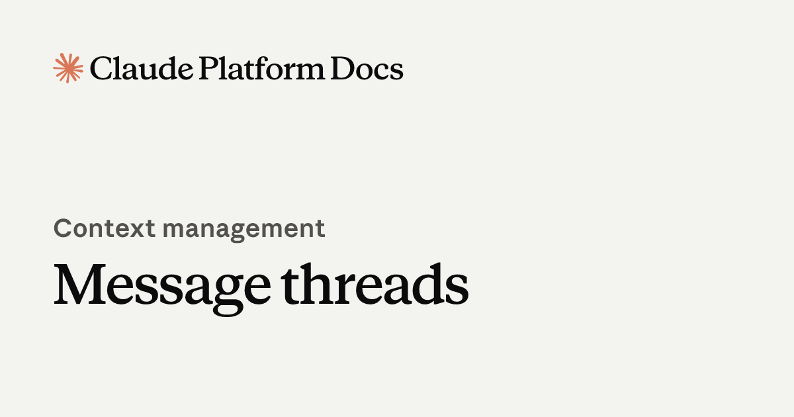

*Anthropic이 2026년 11월 2일 공개한 "Make long-running agents faster with message threads" 공식 아티클 대표 이미지. Claude Platform의 Messages API에 공개 베타로 들어간 기능입니다 (출처: Claude 공식 사이트 claude.com/resources/articles/message-threads)*

> **📌 한줄 요약:** Anthropic이 **2026년 11월 2일**, Messages API에 **메시지 스레드(message threads)** 공개 베타를 열었습니다. 매 요청마다 대화 전체를 다시 실어 보내던 구조를 바꿔, **서버가 대화를 들고 있고 클라이언트는 새 메시지만 보내는** 방식입니다. **50만~100만 토큰 구간에서 첫 토큰 도착 시간(TTFT) 중앙값이 약 35% 감소**했고, **Claude Code 사용자 대부분은 이미 기본으로 켜진 상태**입니다. 단, **토큰 사용량과 비용은 그대로**입니다. 속도만 개선된 기능입니다.

에이전트를 오래 굴리는 팀이라면 한 번쯤 겪는 장면이 있습니다. 코드 에이전트가 파일을 고치고 테스트를 돌리고 로그를 읽는 동안 대화가 수십만 토큰까지 불어나고, 어느 순간부터 **답이 나오기까지의 대기 시간**이 체감으로 확 늘어납니다. 모델이 느려진 게 아니라, **매 턴마다 지나온 대화 전체를 다시 업로드하고 다시 토큰화하는 비용**이 앞단에 붙기 때문입니다.

이번 발표는 그 앞단을 손봤습니다. 이 글은 **① 무슨 일이 있었나 → ② 작동 방식 → ③ 35%라는 숫자의 정확한 의미 → ④ 제약과 설계상 함정 → ⑤ 영향(개발자·사용자) → ⑥ 경쟁 구도 → ⑦ 전망과 점검 항목** 순서로 정리합니다.

---

## 1. 무슨 일이 있었나

| 항목 | 내용 |
|:---|:---|
| **발표일** | 2026년 11월 2일 |
| **제품** | Claude Platform · Messages API (공개 베타) |
| **기능명** | 메시지 스레드 (message threads) |
| **활성화** | 요청에 `thread` 파라미터 추가 |
| **베타 헤더** | `message-threads-2026-08-12` |
| **지원 환경** | 네이티브 Claude Platform, Claude Platform on AWS, Claude in Microsoft Foundry, Claude Models on Google Cloud(Anthropic 관리형) |
| **기본값** | Claude Code 사용자 **대부분**에게 기본 활성화 |
| **과금** | 표준 토큰 요율·기존 레이트 리밋 그대로 |

Anthropic 개발자 플랫폼 릴리스 노트에도 같은 날짜로 등록됐습니다. 스레드는 **마지막 요청 후 5분이 지나면 만료**되고, 마지막 사용 후 **최대 1시간 이내에 삭제**됩니다. 대화 내용은 **메모리에 암호화된 상태로 보관되며 디스크에 기록되지 않는다**고 회사는 설명합니다.

기능 자체는 "새로운 모델"이 아니라 **API 통신 방식의 변경**입니다. 그런데 파급은 모델 교체 못지않게 큽니다. 에이전트 구조, 재시도 로직, 로그 설계, 심지어 컴플라이언스 검토 항목까지 건드리기 때문입니다.

---

## 2. 작동 방식 — "대화를 다시 보내지 않는다"

기존 Messages API는 **무상태(stateless)** 였습니다. 100번째 턴이면 1~99턴의 사용자 메시지, 어시스턴트 응답, 툴 호출 결과를 전부 다시 배열에 담아 보내야 했습니다. 서버는 매번 그 전체를 검증하고 토큰화한 뒤 모델에 넣습니다. 대화가 길수록 **첫 토큰이 나오기까지의 대기**가 길어지는 구조적 이유입니다.

메시지 스레드는 이 지점을 바꿉니다.

1. **첫 요청** — 지금처럼 전체 대화를 보내고 `thread` 파라미터를 붙입니다. 이 요청이 스레드를 시작합니다.
2. **이후 요청** — **새 메시지와 직전 응답 ID만** 보냅니다.
3. **서버 측** — 대화는 턴 사이에 서버 메모리에 유지됩니다. 암호화되고, 디스크에는 쓰이지 않습니다.
4. **만료** — 마지막 요청 후 5분이 지나면 스레드가 사라집니다. 그때는 클라이언트가 **전체 대화를 다시 보내 새 스레드를 시작**합니다.

즉 **"대화 전체를 매번 우편으로 부치던 것을, 서버에 잠시 맡겨두고 추가분만 보내는 방식"** 으로 바꾼 것입니다. 다만 중요한 단서가 하나 붙습니다. **Claude는 여전히 매 턴 전체 대화를 읽습니다.** 요청 본문만 작아질 뿐, 모델이 참조하는 컨텍스트는 그대로입니다. 이 단서가 3장의 숫자를 이해하는 열쇠입니다.

*Claude Platform 공식 문서의 메시지 스레드 페이지 대표 이미지. 스레드는 서버에 짧게 유지되는 대화 상태로, 마지막 요청 후 5분이 지나면 만료됩니다 (출처: Claude Platform 공식 문서 platform.claude.com/docs)*

---

## 3. "35%"의 정확한 의미 — 속도는 줄고, 비용은 그대로

Anthropic이 제시한 수치는 조건이 붙어 있습니다. 그대로 읽어야 왜곡이 없습니다.

| 항목 | 내용 |
|:---|:---|
| **측정 지표** | TTFT(첫 토큰 도착 시간) **중앙값** |
| **감소 폭** | 약 **35%** |
| **조건** | 요청 토큰 **50만~100만** 구간 |
| **데이터 출처** | **Claude Code 사용자** 트래픽, 기능이 기본 활성화된 상태 |
| **토큰 사용량** | **변화 없음** |
| **요금** | 표준 토큰 요율, 기존 레이트 리밋 동일 |

여기서 실무적으로 중요한 해석이 세 가지 나옵니다.

**첫째, 비용 절감 효과는 없습니다.** 요청 본문이 작아져도 모델이 읽는 컨텍스트는 같으므로 과금 토큰은 동일합니다. "지연은 줄고 청구서는 그대로"입니다. 비용 최적화를 기대하고 도입하면 실망합니다.

**둘째, 효과는 컨텍스트가 클수록 커집니다.** 5만 토큰짜리 짧은 대화에서는 차이가 거의 체감되지 않습니다. 반대로 파일 편집과 툴 결과가 쌓여 50만 토큰을 넘어가는 코딩 에이전트·컴퓨터 유즈 에이전트에서 효과가 집중됩니다. Anthropic이 활용 사례로 **장시간 코딩 에이전트, 컴퓨터 유즈(스크린샷이 매 턴 재업로드되지 않음), 문서·이미지가 많은 워크플로**를 꼽은 이유입니다.

**셋째, 35%는 '중앙값'입니다.** 평균이 아니라 중간값이므로, 상위 절반과 하위 절반의 분포는 공개되지 않았습니다. 네트워크 상황, 툴 호출 패턴, 스레드 재시작 빈도에 따라 체감 차이가 커질 수 있습니다.

---

## 4. 제약과 설계상 함정 — 상태를 서버에 두면 생기는 일

무상태 API에 익숙한 팀이 상태 유지 API로 넘어갈 때 반드시 부딪히는 지점이 있습니다. 공개된 사양만으로도 다음 항목은 설계에 반영해야 합니다.

| 제약 | 실무 영향 | 대응 |
|:---|:---|:---|
| **5분 만료** | 사람이 개입해 승인하는 워크플로, 배치성 작업, 야간 유휴 후 재개 시 스레드가 사라짐 | 만료 감지 → 전체 대화 재전송 → 새 스레드 시작하는 폴백 경로 필수 |
| **서버 메모리 보관** | 대화 상태가 클라이언트 밖에 존재. 리전·보관 정책 확인 필요 | 디스크 미기록·암호화 명시는 확인됐으나, 사내 데이터 처리 방침과 대조 |
| **공개 베타** | 헤더 기반 기능이라 사양 변경 가능 | 프로덕션 의존 시 추상화 레이어 뒤에 배치 |
| **토큰 과금 불변** | 요청 크기 축소 ≠ 비용 절감 | 비용 최적화는 프롬프트·캐싱·모델 선택으로 따로 설계 |
| **로그 파편화** | 요청 본문에 전체 대화가 없어 관측 도구가 맥락을 잃음 | 대화 상태는 클라이언트에서 별도 저장·기록 |
| **재시도 중복** | 스레드 ID와 직전 응답 ID를 잃으면 복구 불가 | 스레드 ID 영속화, 실패 시 무상태 모드로 폴백 |

특히 **5분 만료**는 사양에서 가장 실무적인 숫자입니다. API 호출만으로 끝나는 자동화는 문제가 없지만, **사람 승인 단계**나 **외부 시스템 대기**가 끼는 워크플로는 거의 예외 없이 만료를 만납니다. 이때 전체 대화를 다시 보내는 경로가 없으면 작업이 끊깁니다. 반대로 그 폴백이 준비돼 있으면, 스레드는 "짧은 구간을 빠르게" 쓰는 가속 장치로 안전하게 쓸 수 있습니다.

또 하나, **스레드가 암호화된 메모리에만 있고 디스크에 남지 않는다**는 점은 보안에는 유리하지만 **감사(audit)에는 불리**합니다. 사후에 "그때 모델에 무엇이 들어갔는가"를 재구성하려면 클라이언트 쪽 기록이 유일한 증거가 됩니다.

---

## 5. 영향 — 사용자와 개발자에게 실제로 무엇이 달라지나

### 5-1. Claude Code 사용자

Anthropic은 메시지 스레드가 **Claude Code 사용자 대부분에게 기본 활성화**됐다고 밝혔습니다. 즉 별도 설정 없이, 긴 세션에서 첫 응답이 빨라지는 변화를 이미 겪고 있는 셈입니다. 체감 포인트는 세 가지입니다.

- **긴 세션의 초반 대기가 줄어듭니다.** 특히 파일을 여러 개 건드리는 리팩터링, 테스트 반복 실행 구간에서 차이가 납니다.
- **비용은 그대로입니다.** 사용량 대시보드 숫자가 달라지지 않는 것이 정상입니다.
- **세션을 오래 비워두면 스레드가 끊깁니다.** 5분 이상 자리를 비운 뒤 이어가는 흐름에서는 내부적으로 전체 대화를 다시 보내는 동작이 일어납니다. 눈에 보이는 오류는 없지만, 첫 응답이 상대적으로 느려질 수 있습니다.

### 5-2. API로 에이전트를 운영하는 팀

여기가 실질 영향 구간입니다. 메시지 스레드는 **에이전트 아키텍처의 전제를 바꿉니다.** 지금까지는 "대화 이력은 클라이언트가 들고, 매번 전부 보낸다"가 기본값이었습니다. 이제는 **"짧은 구간은 서버에 맡기고, 경계에서 동기화한다"** 는 선택지가 생겼습니다.

| 워크로드 | 기대 효과 | 주의점 |
|:---|:---|:---|
| 장시간 코딩 에이전트 | 툴 결과·파일 편집이 쌓일수록 TTFT 개선 폭 확대 | 툴 실행이 5분을 넘기면 만료. 재전송 폴백 필요 |
| 컴퓨터 유즈 에이전트 | 스크린샷 재업로드 제거로 요청 크기 급감 | 이미지 보관 정책·리전 확인 |
| 문서·이미지 중심 워크플로 | 대용량 첨부 반복 전송 제거 | 토큰 과금은 동일 |
| 야간 배치·스케줄 작업 | 효과 제한적 | 유휴 시간이 길어 스레드 만료가 기본값 |
| 사람 승인 끼는 워크플로 | 승인 대기 구간에서 만료 | 승인 후 전체 재전송 경로 설계 |

정리하면 **"짧고 촘촘한 루프"에 유리하고, "길게 쉬는 루프"에 불리**합니다. 스레드를 켤지 여부를 워크로드 단위로 결정하는 것이 합리적입니다.

---

## 6. 경쟁 구도 — "상태를 누가 들고 있는가" 싸움

이번 발표는 단독 기능이라기보다 **API 설계 트렌드**의 한 칸입니다. 대화 상태를 어디에 두느냐는 최근 프론티어 API들의 공통 고민입니다.

- **무상태 유지 + 캐싱** — 매번 전체를 보내되 서버가 프리픽스를 캐싱해 비용·지연을 줄이는 접근. 구현이 단순하고 장애 격리가 쉽습니다.
- **상태 유지 + 참조** — 이전 응답이나 대화 ID를 참조해 새 입력만 보내는 접근. 요청이 가벼워지고 지연이 줄지만, 상태 만료·복구·감사 문제가 따라옵니다. OpenAI의 Responses API가 이전 응답 ID를 참조하는 방식을 일찍 도입했고, Anthropic은 여기에 **5분 만료·메모리 전용 보관**이라는 보수적인 안전장치를 붙여 늦게 합류한 형태입니다.
- **컨텍스트 캐싱** — 구글이 Gemini에서 일찍부터 밀어온 축으로, 반복되는 대용량 컨텍스트의 재처리 비용을 줄이는 방향입니다.

세 접근은 대체 관계가 아니라 **조합**입니다. 메시지 스레드가 지연을 줄이고, 캐싱이 비용을 줄이고, 모델 선택이 품질을 맞추는 식입니다. 그래서 "이 기능 하나로 에이전트가 빨라진다"는 식의 기대는 정확하지 않습니다.

---

## 7. 전망

1. **상태 유지 API가 기본값 쪽으로 이동합니다.** 공개 베타가 정식 출시(GA)로 넘어가고, SDK 기본 동작에 스레드가 스며들 가능성이 큽니다. 이미 Claude Code에서 "기본 켜짐"을 택했다는 점이 방향을 보여줍니다.
2. **다음 단계는 만료 연장과 비용입니다.** 5분은 에이전트 루프에는 충분하지만 사람이 끼는 워크플로에는 짧습니다. 만료 시간 조정, 또는 스레드와 프롬프트 캐싱의 결합으로 **토큰 비용까지** 낮추는 업데이트가 예상됩니다.
3. **엔터프라이즈 검토 항목이 늘어납니다.** "대화 상태가 어느 리전 메모리에, 얼마나 머무는가"는 보안 심사에서 반드시 나오는 질문입니다. 디스크 미기록·암호화 명시는 좋은 출발이지만, 리전별 동작은 별도 확인이 필요합니다.
4. **관측 도구가 따라와야 합니다.** 요청 본문이 얇아지면 기존 로그 기반 추적은 맥락을 잃습니다. 에이전트 트레이싱 도구들이 "스레드 ID + 클라이언트 대화 상태"를 함께 다루는 방향으로 바뀔 것입니다.

한 줄로 정리하면, 이번 변경은 **모델 성능 뉴스가 아니라 에이전트 운영 방식 뉴스**입니다. 성능표에 잡히지 않는 구간에서 시간이 줄어드는 종류의 개선이고, 그만큼 설계 쪽에서 챙길 것이 늘어납니다.

---

## 8. 도입 전 점검 체크리스트

**① 워크로드별로 켤지 결정**
- 툴 루프가 촘촘하고 컨텍스트가 큰 작업 → 켜는 것이 유리합니다.
- 승인 대기·야간 배치처럼 유휴가 긴 작업 → 무상태 유지가 단순합니다.

**② 만료 폴백 경로 구현**
- 스레드 만료 응답을 감지하면 **전체 대화를 재전송해 새 스레드를 시작**하는 경로를 코드에 넣습니다. 이 경로는 테스트로 강제 발동시켜 검증해야 합니다.

**③ 스레드 ID 영속화**
- 프로세스가 재시작되거나 워커가 교체되면 스레드 ID와 직전 응답 ID를 잃습니다. 작업 큐나 세션 저장소에 함께 보관합니다.

**④ 비용 기대치 정정**
- 토큰 과금은 그대로입니다. 비용 목표는 프롬프트 축소·캐싱·모델 다운시프트로 따로 세웁니다.

**⑤ 로그·감사 설계 재확인**
- 서버는 대화를 디스크에 남기지 않습니다. 사후 재구성이 필요하면 클라이언트 측 기록이 유일한 근거가 됩니다.

**⑥ 데이터 보관·리전 확인**
- 메모리 보관·암호화는 확인됐지만, 사용 중인 클라우드 경로(AWS·Google Cloud·Foundry)별 동작과 보관 위치는 문서로 재확인합니다.

**⑦ 베타 의존도 관리**
- 헤더 기반 베타이므로 사양 변경 가능성을 전제로, 스레드 사용 여부를 설정값으로 분리해 두는 편이 안전합니다.

---

### 참고 자료

- Anthropic, "Make long-running agents faster with message threads" (2026.11.02, claude.com/resources/articles/message-threads) — TTFT 중앙값 약 35% 감소, 5분 만료, 메모리 보관·암호화 명시
- Claude Platform 릴리스 노트 (2026.11.02) — `message-threads-2026-08-12` 베타 헤더, 지원 환경 4종
- Claude Platform 공식 문서, 메시지 스레드 가이드 (platform.claude.com/docs) — `thread` 파라미터 사용법
- Claude Platform 릴리스 노트 (2026.10.30) — Claude Opus 4.8 fast mode 지원 종료(2026.11.30) 공지
