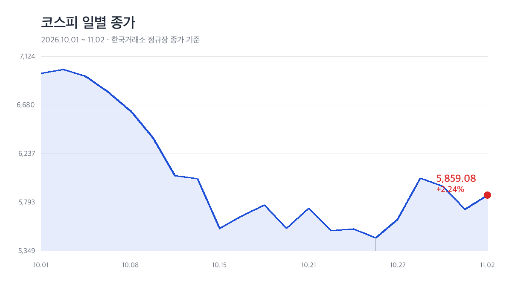

*코스피 일별 종가 (2026.10.01~11.02, 한국거래소 정규장 종가 기준)*

## 한 줄 요약

11월 2일(월) 코스피는 **5,859.08(+2.24%)**로 마감했습니다. 지난달 30일 미국 인텔이 하루 만에 28.58% 폭락하면서 '검은 월요일' 우려가 컸지만, 1.62% 하락 출발(5,637.77)을 딛고 오전 중 상승 전환했습니다. 장중 고가는 5,910.83으로 5,900선을 터치했고, 저가는 5,616.50이었습니다.

| 구분 | 종가 | 전일비 | 등락률 |
|:----|:----|:------|:------:|
| **코스피** | 5,859.08 | ▲ 128.34 | +2.24% |
| **코스닥** | 734.36 | ▲ 9.98 | +1.38% |
| 원/달러 | 1,343.9원 | ▲ 9.5원 | +0.71% |

## 기관이 지수를 끌어올렸다

수급은 기관 홀로 강했습니다. 유가증권시장에서 **기관 1조 2,331억 원 순매수**, 자사주 매입이 집계되는 기타법인도 4,880억 원을 순매수했습니다. 반면 개인은 1조 3,465억 원, 외국인은 3,743억 원을 순매도했습니다. 외국인이 반도체 대형주를 덜어내는 사이 연기금·금융투자 중심의 기관 자금이 하방을 받아낸 구조입니다.

업종별로는 **항공 +6.41%**, **조선 +5.23%**, 복합기업 +3.75%, 백화점·일반상점 +3.62%, 전기장비 +3.60%가 강했습니다. 반대로 은행 -1.11%, 손해보험 -0.93%, 건강관리업체·서비스 -0.93% 등 방어주는 밀렸습니다.

상승 종목은 657개, 하락 230개, 보합 29개로 상승 쪽이 압도적이었고, 거래대금은 14조 8,700억 원을 기록했습니다. 거래대금 1위는 SK하이닉스(3조 5,428억 원)입니다.

## 특징주: 반도체 반등, 철강은 공개매수

- **삼성전자 +1.78%** 22만 9,000원, **SK하이닉스 +3.81%** 147만 2,000원 — SK하이닉스는 자사주 매입을 재개하며 투자심리를 지지했습니다.
- **한국철강 +23.68%** — 모회사 KISCO홀딩스가 주당 1만 3,000원 공개매수로 상장폐지를 추진한다고 밝히며 52주 신고가를 새로 썼습니다. KISCO홀딩스도 +19.92% 올랐습니다.
- **효성화학 -20.32%** — 3분기 매출 7,335억 원, 영업손실 195억 원으로 적자 전환한 실적이 매물을 불러 52주 신저가로 밀렸습니다.

## 코스닥도 동반 상승

코스닥은 9.98포인트(1.38%) 오른 **734.36**으로 마감했습니다. 외국인 322억 원, 개인 261억 원 순매도, 기관 623억 원 순매수입니다. 상승 1,120개·하락 553개로 상승 종목이 두 배 수준이었고 거래대금은 4조 8,000억 원이었습니다. 다만 20일선보다 8.34% 아래로 회복 속도는 코스피보다 더뎠습니다.

## 반등일까, 되돌림일까

코스피는 5일 누적 7.12% 올랐지만 여전히 20일선을 2.2% 밑돌고, 연중 고점과 비교하면 35.72% 낮은 자리입니다. 52주 신고가 3개, 신저가 9개로 지수 상승 폭에 비해 시장 온도는 아직 차갑습니다.

배경에는 인텔發 충격이 있습니다. 인텔은 4분기 가이던스 부진으로 1974년 이후 52년 만에 가장 큰 하루 낙폭을 기록했고, 필라델피아 반도체지수는 7.2%, 나스닥은 2.86% 밀렸습니다. 다만 국내 증시는 지난달 30일 3.48% 급락으로 악재를 선반영했고, 10월 수출이 1,152억 8,000만 달러로 두 달 연속 1,100억 달러를 넘어선 점도 심리 회복에 힘을 보탰습니다.

이번 주는 변수도 많습니다. 11월 3일 미국 중간선거를 시작으로 국내 10월 소비자물가, 11월 6일 밤 미국 10월 고용보고서가 대기하고, 한국은행 금통위는 11월 26일 열립니다. 외국인 매도가 반도체를 넘어 확산되는지, 5,600선이 다시 지지되는지가 단기 방향을 가를 것으로 보입니다.

*본 포스팅은 한국거래소 종가 데이터와 국내 언론 마감 보도를 바탕으로 작성했으며, 특정 종목의 매매를 권유하는 글이 아닙니다.*

#코스피 #코스닥 #한국증시 #외국인 #증시시황 #마감시황 #인텔쇼크 #반도체
