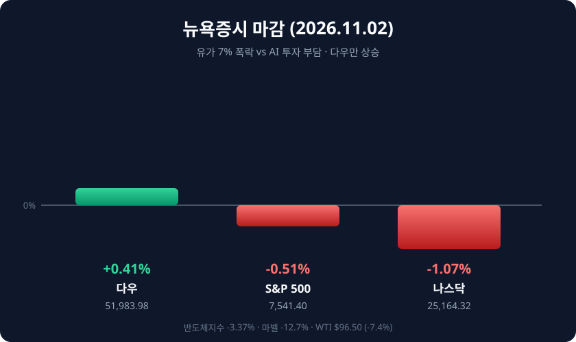

*2026년 11월 2일(현지시간) 뉴욕증시 주요 지수 등락률*

## 오늘의 증시 요약

**11월 2일(현지시간)** 뉴욕증시는 11월 첫 거래일을 혼조세로 마감했습니다. 다우는 213.67포인트(0.41%) 오른 **5만1,983.98**, S&P500은 38.67포인트(0.51%) 내린 **7,541.40**, 나스닥은 272.68포인트(1.07%) 내린 **2만5,164.32**를 기록했습니다. 중소형주 러셀2000도 약세였습니다.

| 지수 | 종가 | 전일비 | 등락률 |
|:----|:----|:------|:------:|
| **다우** | 51,983.98 | ▲ 213.67p | +0.41% |
| **S&P 500** | 7,541.40 | ▼ 38.67p | -0.51% |
| **나스닥** | 25,164.32 | ▼ 272.68p | -1.07% |
| **필라델피아 반도체** | - | ▼ | -3.37% |

나스닥100은 고점 대비 10% 넘게 밀리며 기술적 조정 구간에 들어섰습니다. 지수 하락에도 S&P500 편입 종목의 다수는 올랐다는 점이 이날 장세의 성격을 보여줍니다. 지수를 끌어내린 것은 소수 대형 기술주였습니다.

## 유가 7% 폭락, 그러나 기술주는 못 살렸다

이날 가장 큰 변수는 유가였습니다. 이란 최고지도자가 정부의 협상 추진을 승인했다는 보도와 카타르 중재안 진전 소식이 전해지면서 **WTI는 7.4% 급락한 배럴당 96.50달러**, 브렌트유는 6.1% 내린 106.50달러에 마감했습니다. 지난달 급등분을 하루에 상당 부분 되돌린 셈입니다. 통상 유가 급락은 인플레이션 부담 완화로 위험자산에 우호적인데, 이날은 달랐습니다.

매수세를 막은 것은 **AI 설비투자에 따른 자금 부담**이었습니다. 오라클이 200억달러 규모 자금 조달에 나서면서 부채 증가 우려가 부각됐고, 마벨테크놀로지는 광부품 업체 루멘텀을 **1,150억달러 전액 주식 교환**으로 인수하기로 하면서 주가가 12.7% 급락했습니다. 루멘텀도 18.6% 밀렸습니다. 지난달 말 인텔·아마존 실적에서 드러난 '현금 소진' 우려가 11월 첫날에도 이어진 모습입니다.

## 다우는 왜 올랐나

다우 구성종목은 유가 하락의 수혜를 봤습니다. 운송·산업재의 비용 부담이 낮아지고, 에너지 비중이 상대적으로 작은 데다 헬스케어와 필수소비재로 순환매가 이어졌습니다. 여기에 10월 ISM 제조업지수가 **55.5**로 확장세를 유지한 점도 경기 우려를 덜었습니다.

## 장 마감 후: 애플·팔란티어

애플은 회계연도 4분기 매출 **1,145억달러(전년비 +12%)**, 주당순이익 2.10달러로 시장 예상(1.99달러)을 웃돌았습니다. 다만 중국 매출은 기대에 못 미쳤고, 12월 분기 가이던스는 7~10% 성장으로 제시됐습니다. 팔란티어는 매출 23억1,000만달러(+96%), 주당순이익 0.44달러로 호실적을 냈지만 향후 매출을 가늠하는 지표가 부진해 시간외에서 밀렸습니다.

## 다음 변수

3일 미국 중간선거와 JOLTS 구인 보고서, 6일 10월 고용보고서가 대기합니다. 연준은 10월 FOMC에서 기준금리를 3.75~4.00%로 동결했지만 2명이 인상을 주장했고, 시장은 12월 인상 가능성을 70~80%대로 반영하고 있습니다. 국내 증시는 전일 코스피가 2.24% 반등한 상태로, 유가 급락과 반도체 약세가 엇갈려 들어오는 하루가 될 전망입니다.

#뉴욕증시 #다우지수 #S&P500 #나스닥 #FOMC #유가 #마벨루멘텀 #미국증시마감
