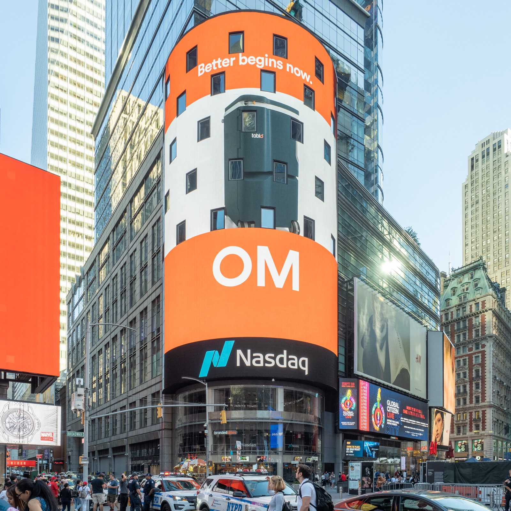

*Anthropic(앤트로픽) 공식 워드마크. 2026년 11월 2일(미국 현지) 수정 S-1 제출로 3분기 실적이 처음 공개됐습니다 (이미지 출처: Wikimedia Commons, "Anthropic logo", Public domain — Anthropic)*

> **📌 한줄 요약:** Anthropic이 **2026년 11월 2일(미국 현지)** 미 증권거래위원회(SEC)에 **수정 S-1(Form S-1/A)** 을 제출했습니다. 10월 26일 첫 신고서가 상반기까지만 담았던 재무제표를 **9월 30일까지 9개월치로 교체**한 문서입니다. **3분기 매출은 169억 5,600만 달러**로 전 분기 대비 **46.7% 증가**했지만, 2분기의 **9억 7,400만 달러 영업이익은 5억 6,700만 달러 영업손실로 반전**했습니다. 손실의 주된 원인은 **단기 계약으로 급히 사들인 50억 달러어치 컴퓨트**와 **20억 달러 비현금 기부 매칭 비용**입니다. 같은 문서에서 **컴퓨트·인프라 약정 총액 8,954억 달러**, **1년 내 만기 약 700억 달러**도 처음 숫자로 확인됐습니다.

AI 모델 뉴스는 "얼마나 똑똑해졌나"로 읽지만, **상장을 앞둔 회사의 신고서는 "이 사업이 어떤 속도로 현금을 태우는가"** 를 드러냅니다. API 요금, 사용 한도, 모델 교체 주기가 결국 이 숫자 위에서 결정되기 때문에, Claude를 업무 파이프라인에 얹어 쓰는 쪽이라면 한 번은 읽어볼 가치가 있는 문서입니다.

이 글은 **① 무슨 일이 있었나 → ② 3분기 숫자 읽기 → ③ 손실이 돌아온 진짜 이유 → ④ 8,954억 달러 약정의 구조 → ⑤ 가격 인하가 매출에 남긴 흔적 → ⑥ 영향(사용자·개발자·운영팀) → ⑦ 전망과 점검 항목** 순서로 정리합니다.

---

## 1. 무슨 일이 있었나

| 항목 | 내용 |
|:---|:---|
| **제출일** | 2026년 11월 2일(미국 현지) |
| **문서** | 수정 S-1 (Form S-1/A, SEC) |
| **핵심 변경** | 상반기(1~6월) 재무제표 → **9개월(1~9월)** 로 교체, 분기 표에 7번째 분기 추가 |
| **3분기 매출** | **169억 5,600만 달러** (전 분기 115억 5,500만 달러) |
| **3분기 영업손익** | **−5억 6,700만 달러** (2분기 +9억 7,400만 달러) |
| **3분기 순손실** | **232억 9,100만 달러** (대부분 비현금 평가손) |
| **약정 총액** | **8,954억 달러** (구매 약정 + 리스, 대부분 컴퓨트·인프라) |
| **상장 조건** | 나스닥 글로벌 셀렉트 마켓, 티커 **ANT**, 주관사 22곳 |
| **미확정 항목** | 공모가 범위·공모 주식수·순조달액 (여전히 공란) |

첫 신고서가 "회사의 반쪽짜리 성적표"였다면, 수정 신고서는 **가장 최근 분기까지 채운 성적표**입니다. 첫 제출 이후 일주일 만에 나왔고, 골드만삭스·모건스탠리를 필두로 한 22개 주관사 체제, 창업자 의결권(Class F)과 장기이익신탁(Class T)으로 짜인 지배구조는 그대로 유지됐습니다.

바뀐 것은 숫자만이 아닙니다. **위험요인(Risk Factors) 문구**도 손봤습니다. 이 부분은 6장에서 따로 다룹니다.

---

## 2. 3분기 숫자 읽기 — 매출은 계속 늘었지만, 속도는 꺾였다

먼저 매출입니다. 3분기 169억 5,600만 달러는 **전 분기 대비 46.7% 증가**, **전년 동기(13억 8,200만 달러) 대비 1,127% 증가**입니다. 9개월 누적은 **332억 4,200만 달러**로 전년 동기 25억 4,500만 달러에서 **1,206% 늘었습니다**. 최근 12개월 매출(TTM)은 약 **352억 8,200만 달러**로 계산됩니다.

문제는 증가율의 방향입니다.

| 구분 | 전분기 대비 매출 증가율 |
|:---|:---|
| 2026년 1분기 | **+132%** |
| 2026년 2분기 | **+144%** |
| 2026년 3분기 | **+46.7%** |

한 분기에 매출이 54억 달러 늘어난 것은 사실이고, 이는 **2025년 연간 매출(약 45억 8,500만 달러)을 한 분기에 넘어선 규모**입니다. 그런데 성장률만 놓고 보면 100%대에서 40%대로 내려앉았습니다. 절대 금액이 커지면 성장률은 구조적으로 낮아지지만, 상장을 앞둔 회사 입장에서 **"성장률이 꺾였다"** 는 신호는 밸류에이션에 직접 영향을 줍니다.

비용 쪽은 더 빠르게 늘었습니다. 3분기 총영업비용은 **175억 2,300만 달러**로 전 분기 105억 8,100만 달러에서 **65.6% 증가**했습니다. 매출 증가율(46.7%)을 웃돌면서 **영업비용이 매출의 103%** 가 됐습니다. 2분기에는 92%였습니다.

여기서 계산 하나가 따라옵니다. 2분기 영업이익 9억 7,400만 달러에서 3분기 영업손실 5억 6,700만 달러로, **한 분기 만에 약 15억 4,000만 달러의 영업손익 스윙**이 발생했습니다.

---

## 3. 손실이 돌아온 진짜 이유 — "컴퓨트를 급하게 샀다"

신고서는 3분기 영업손실의 원인을 두 가지로 명시합니다.

**첫째, 50억 달러어치 단기 계약 컴퓨트입니다.** Anthropic은 통상 컴퓨트를 **가용 시점 12~18개월 전**에 다년 계약으로 확보합니다. 그런데 고객·연구 수요가 계약분을 앞지르면 **단기 시장에서 웃돈을 주고** 추가 조달합니다. 신고서는 이 단기 컴퓨트가 **"다년 약정으로 확보한 동급 컴퓨트보다 현재 상당히 더 비싸다"** 고 명시했습니다. 9개월간 단기 계약 컴퓨트는 65억 달러, 그중 **50억 달러가 3분기에 집중**됐습니다. 3분기 컴퓨트·인프라 비용 98억 6,300만 달러의 **절반가량이 단기 조달분**이라는 계산이 나옵니다.

**둘째, 20억 달러 비현금 기부 매칭 비용입니다.** 현금이 나가는 비용은 아니지만 회계상 영업비용으로 잡히면서 손익을 끌어내렸습니다.

이 구조는 일회성이 아닙니다. 신고서는 **"단기 컴퓨트 사용은 당분간 계속 늘어날 것이며, 그에 따라 영업이익률과 조정 영업이익률이 압박받을 것"** 이라고 못 박았습니다. 이유도 설명합니다. **컴퓨트는 매출보다 먼저 도착하고, 비용은 먼저 나간다**는 것입니다. 회사 표현을 그대로 옮기면, "현재 단계에서 이 사이클은 사업의 내재적 측면이며, 기초 경제성이 개선되더라도 기간별 영업이익률을 때때로 상당히 변동시킬 것"입니다.

실제로 컴퓨트·인프라가 매출에서 차지하는 비중은 2분기 **48%** 에서 3분기 **58%** 로 올라갔습니다. 9개월 누적으로는 188억 800만 달러로 매출의 57%, 전년 동기 43억 8,100만 달러 대비 **329% 증가**입니다.

> 정리하면 이렇습니다. **매출은 잘 나오는데, 그 매출을 받쳐줄 컴퓨트가 제때 오지 않아 비싼 임시 컴퓨트로 메우고 있고, 그 비용이 마진을 갉아먹는 구간**입니다. 성장의 문제가 아니라 **공급망의 문제**에 가깝습니다.

---

## 4. 8,954억 달러 약정 — 숫자의 구조를 뜯어보면

수정 신고서에서 가장 눈에 띄는 숫자는 **8,954억 4,000만 달러**입니다. 구매 약정과 리스 계약의 합계이고, **"대부분이 컴퓨트·인프라 관련"** 이라고 명시됐습니다. 첫 신고서에서 공란으로 남았던 항목입니다.

이 숫자를 그대로 "빚"으로 읽으면 안 됩니다. 성격이 다른 두 덩어리가 섞여 있습니다.

| 구분 | 규모 | 성격 |
|:---|:---|:---|
| 기존 계약상 의무 | 약 **3,200억 달러** | 이미 체결된 구매 의무 |
| 개시 전 리스 | 약 **4,510억 달러** | 계약은 됐으나 아직 개시되지 않은 리스 |
| **합계** | **약 8,954억 달러** | 대부분 컴퓨트·인프라 |
| 1년 내 만기 | 약 **700억 달러** | 단기 유동성 부담 구간 |
| 2030년 말 이전 만기 | 약 **4,475억 달러** | 중기 집중 구간 |

비교 기준이 되는 현금은 **2026년 9월 30일 기준 약 1,320억 달러**(현금성자산·단기투자)입니다. 약정 총액이 현금의 **약 6.8배**입니다. 다만 이 약정은 **향후 20년에 걸친 미래 지출 약속**이고, 매출이 발생하면서 함께 소진되는 성격입니다. 실제로 1년 내 만기분(약 700억 달러)은 보유 현금으로 감당 가능한 범위입니다.

*미국 뉴욕 타임스퀘어의 나스닥 마켓사이트(Nasdaq MarketSite). Anthropic은 나스닥 글로벌 셀렉트 마켓 상장을 신청했고 티커는 'ANT'입니다. 공모가와 주식수는 아직 공란입니다 (이미지 출처: Wikimedia Commons, "Nasdaq MarketSite" — ajay_suresh, CC BY 2.0)*

한 가지 더 눈에 띄는 변화가 있습니다. **구글 클라우드에 대한 약정이 약 1,213억 달러로 늘었습니다.** 첫 신고서의 1,145억 달러에서 일주일 만에 68억 달러가 추가된 것입니다. 단기 컴퓨트를 줄이기 위한 해법으로 신고서가 새로 언급한 **'Anthropic Direct'** 라는 조달 모델도 같은 맥락입니다. 수요가 몰리는 구간의 단기 컴퓨트를, 전용 인프라가 들어오는 대로 **더 저렴한 장기 컴퓨트로 대체(backfill)** 하겠다는 구상입니다.

여기서 실무적으로 중요한 해석이 하나 나옵니다. **컴퓨트 약정은 "비용"이 아니라 "선택지 확보 비용"** 입니다. 지금 확보해두지 않으면 2027~2028년에 원하는 만큼의 용량을 못 쓸 수 있고, 그때는 단기 시장에서 훨씬 비싸게 사야 합니다. 8,954억 달러는 그 공포의 크기이자, 동시에 **"앞으로도 모델과 API를 계속 공급하겠다"는 회사의 베팅**입니다.

---

## 5. 가격 인하가 매출에 남긴 흔적 — 6억 달러

이번 신고서에서 실무자에게 가장 쓸모 있는 문장은 따로 있습니다. **가격 인하가 매출에 얼마나 영향을 줬는지**를 처음 숫자로 공개했습니다.

신고서는 2분기에서 3분기 사이 **사용량 증가에 따른 매출 증가분이, 새 모델 버전 도입과 계약 할인으로 인한 약 6억 달러의 매출 감소로 일부 상쇄됐다**고 밝혔습니다. 3분기 매출의 약 3.5%, 순차 증가분(54억 달러)의 약 11%에 해당합니다. 이 인하가 없었다면 3분기 매출 증가율은 46.7%가 아니라 약 52%였을 것이라는 계산도 가능합니다. 비교 사례로 2025년 3분기에서 4분기 사이에는 같은 효과가 약 7,000만 달러였습니다.

**한 분기에 6억 달러.** 1년 전 7,000만 달러와 비교하면 **약 8.6배**로 커진 규모입니다. 이 숫자는 두 가지를 동시에 말합니다.

- **사용자에게는 유리한 방향으로 작동하고 있습니다.** Claude Opus 5.5는 Opus 5 대비 **작업당 비용을 약 40% 낮춘 것**으로 신고서에 기재됐습니다. 모델 교체만으로 단가가 내려가는 구조입니다.
- **회사에는 매출 희석으로 작용합니다.** 그리고 이 희석은 빠르게 전체 매출에 퍼집니다. 신고서에 따르면 **2026년 상반기에 출시된 모델 버전이 3분기 매출의 80% 이상**을 차지합니다. 새 모델에 붙은 가격 인하는 **두 분기 안에 매출 대부분에 도달**한다는 뜻입니다.

자동화 파이프라인을 운영하며 모델을 고정(pin)해 쓰는 팀이라면, 이 대목이 특히 중요합니다. **모델 수명이 짧아지고 있다**는 신호이기 때문입니다. 6개월 안에 나온 모델이 매출의 80%를 만든다는 것은, 반대로 말하면 **6개월 지난 모델은 사실상 레거시**라는 뜻입니다.

---

## 6. 리스크 문구의 변화 — "곧 자체 RSP 기준에 도달할 수 있다"

수정 신고서는 재무제표만 바꾼 게 아닙니다. 위험요인에 **회사 스스로의 안전 프레임워크**에 관한 문장이 추가됐습니다.

내용은 이렇습니다. 내부 추정과 향후 모델에 대한 기대치가 **"AI로 인한 급격한 진전(dramatically accelerated progress attributable to AI)"** 이라는 **책임있는 확장 정책(RSP)상 정의를 곧 충족할 수 있음을 시사한다**는 것입니다.

RSP는 Anthropic이 모델 능력이 일정 임계치를 넘을 때 추가 안전 조치를 의무화하는 자체 규약입니다. 상장 신고서의 위험요인에 **"우리가 곧 우리 기준에 걸릴 수 있다"** 는 문장이 들어간 것은 상당히 이례적입니다. 해석은 두 갈래입니다.

- **솔직한 공시** — 상장 후 투자자 소송 리스크를 줄이기 위해, 안전 관련 불확실성을 미리 문서화한 것입니다.
- **출시 일정의 변수** — RSP 단계가 발동하면 모델 공개·배포 전에 추가 평가와 안전조치가 붙습니다. **신모델 출시 일정이 늦어질 수 있는 구조적 요인**입니다.

어느 쪽이든, API 사용자 입장에서는 **"다음 모델이 예고한 날짜에 안 나올 수 있다"** 는 가능성을 전제에 넣어야 한다는 뜻입니다.

---

## 7. 영향 — 사용자·개발자·운영팀에게 실제로 무엇이 달라지나

### 7-1. 개인 사용자·구독자

- **가격 방향은 여전히 아래쪽입니다.** 새 모델마다 작업당 비용이 내려가는 패턴이 신고서에 숫자로 확인됐습니다. 같은 요금제에서 더 많은 작업을 처리하는 흐름은 당분간 유지될 가능성이 큽니다.
- **무료 사용도 비용입니다.** 신고서는 판매·마케팅 비용에 **"Claude 무료 접근을 위한 컴퓨트"** 가 포함된다고 밝혔습니다. 9개월 판매·마케팅 비용 66억 1,900만 달러 안에 무료 사용자 컴퓨트가 들어 있다는 뜻이고, 이는 **무료 티어 정책이 컴퓨트 사정에 따라 조정될 수 있는 항목**임을 시사합니다.
- **한도 변동은 계속됩니다.** 단기 컴퓨트로 용량을 메우는 구조인 만큼, 수요가 몰리는 시기에는 레이트 리밋·대기열 정책이 조정될 여지가 남습니다.

### 7-2. API로 에이전트를 돌리는 개발자

| 항목 | 지금 확인된 사실 | 실무 대응 |
|:---|:---|:---|
| **단가** | 모델 업데이트·계약 할인으로 분기 6억 달러 규모 인하 발생 | 분기마다 단가 재계산, 새 모델 마이그레이션 비용 함께 비교 |
| **모델 수명** | 6개월 내 출시 모델이 매출 80% 이상 | 버전 고정은 짧게, 마이그레이션 테스트 자동화 |
| **용량** | 단기 컴퓨트 의존, 공급이 수요를 못 따라가는 구간 존재 | 429·타임아웃 재시도, 배치 API·캐싱으로 피크 완화 |
| **가격 정책** | 상장 후 분기 공시로 정책 변화가 더 자주 노출 | 단가·한도를 설정값으로 분리, 청구서 이상 감지 |
| **출시 일정** | RSP 발동 가능성 문구 추가 | 로드맵 의존 기능은 폴백 모델 함께 설계 |

특히 **모델 수명**과 **용량**은 함께 봐야 합니다. 새 모델이 자주 나오고, 그때마다 단가가 내려가며, 피크에는 용량이 빠듯한 구조입니다. 이 조합에서 가장 위험한 운영 방식은 **"최신 모델 하나에 모든 워크로드를 고정"** 하는 것입니다. 라우팅 레이어를 두고, 품질 요구가 낮은 작업은 저가 모델로 내리는 구성이 이 구조에 잘 맞습니다.

### 7-3. 기업·자동화 운영팀

재무 숫자는 남의 회사 이야기처럼 보이지만, **벤더 리스크**라는 형태로 구매·보안 검토 항목에 직접 들어옵니다.

- **공급 지속성** — 8,954억 달러 약정은 역설적으로 **"앞으로도 공급이 이어진다"** 는 신호입니다. 다만 그 약정의 상당 부분이 아직 개시되지 않은 리스이고, 1년 내 만기분이 약 700억 달러라는 점은 유동성 관리 부담으로 남습니다.
- **가격 협상력** — 상장 후에는 분기 실적 공시가 의무화됩니다. 매출 성장률 둔화와 마진 변동성이 공개되면, **엔터프라이즈 계약 할인 압력**은 오히려 커질 수 있습니다.
- **감사·컴플라이언스** — 상장사가 되면 공시 의무와 내부통제 요구가 강화됩니다. 데이터 처리 계약(DPA), 하위 처리자 목록, 보관 정책 문서가 **더 자주, 더 구체적으로 갱신**될 가능성이 큽니다. 계약서 갱신 주기를 함께 점검할 시점입니다.
- **의존도 분산** — 단일 모델 제공자에 업무 파이프라인을 몰아넣은 구성이라면, **프롬프트·툴 스키마를 제공자 중립적으로 추상화**해 두는 것이 여전히 유효한 보험입니다.

---

## 8. 전망 — 상장 카운트다운에서 봐야 할 세 가지

1. **공모가와 주식수 확정이 임박했습니다.** 신고서에는 여전히 공모가 범위, 공모 주식수, 순조달액이 공란입니다. 로드쇼가 시작되면 이 빈칸이 채워지고, 시장은 **성장률 47%와 영업손실 복귀**를 어떤 배수로 평가하는지 드러납니다. 10월 31일 기준 런레이트 매출(Run-Rate Revenue)도 아직 공란이라, 다음 수정 신고서에서 확인될 항목입니다.
2. **단기 컴퓨트 비중이 마진의 변동성 지표가 됩니다.** 회사는 Anthropic Direct로 이 비중을 줄이겠다고 밝혔습니다. 다음 분기에 **단기 컴퓨트 금액과 컴퓨트/매출 비율(58%)** 이 함께 내려가는지가 핵심 관찰점입니다. 이 비율이 다시 오르면 마진은 또 흔들립니다.
3. **가격 인하는 계속되지만, 폭은 조절될 수 있습니다.** 분기 6억 달러 규모의 인하는 성장률을 깎는 요인입니다. 상장 후 주주 압력이 커지면 **"모델 교체 시 대폭 인하"** 에서 **"계약 할인 중심"** 으로 무게가 옮겨갈 수 있습니다. API 단가를 예산에 반영할 때 이 차이를 감안하는 편이 안전합니다.

한 줄로 정리하면, **이번 신고서는 "매출이 폭발하는 회사"가 아니라 "매출은 폭발하는데 컴퓨트가 병목인 회사"** 의 얼굴을 처음으로 보여줬습니다. 모델 성능 뉴스보다 이쪽이 요금표와 사용 한도에 더 직접적으로 연결됩니다.

---

## 9. 점검 체크리스트

**① API 예산은 분기 단위로 재계산**
- 새 모델 출시·계약 할인으로 단가가 내려간 이력이 숫자로 확인됐습니다. 연간 예산을 고정하지 말고 분기마다 재산정합니다.

**② 모델 버전 고정 기간 단축**
- 6개월 내 출시 모델이 매출의 80% 이상입니다. 6개월 넘은 모델에 핵심 워크로드를 묶어두는 구성은 유지비가 커집니다.

**③ 피크 대응 설계**
- 단기 컴퓨트 의존 구간에서는 용량이 빠듯할 수 있습니다. 재시도·백오프, 배치 API, 프롬프트 캐싱으로 피크를 낮춥니다.

**④ 라우팅 레이어 유지**
- 품질 요구가 낮은 작업은 저가 모델로, 실패 시 다른 모델로 넘기는 구조를 기본값으로 둡니다.

**⑤ 출시 일정 의존 기능은 폴백 확보**
- RSP 발동 가능성 문구가 신고서에 들어갔습니다. 신모델 의존 기능은 대체 모델·대체 경로를 함께 설계합니다.

**⑥ 계약·정책 문서 갱신 주기 확인**
- 상장사 전환으로 DPA·하위 처리자·보관 정책 문서 갱신이 잦아질 수 있습니다. 갱신 알림과 재검토 담당자를 정해 둡니다.

**⑦ 벤더 집중도 점검**
- 특정 제공자 비중이 지나치게 높다면 프롬프트·툴 스키마를 중립적으로 추상화해 이전 비용을 낮춥니다.

---

### 참고 자료

- Anthropic, 수정 S-1 (Form S-1/A, SEC, 2026.11.02) — 3분기 매출 169억 5,600만 달러, 영업손실 5억 6,700만 달러, 약정 8,954억 4,000만 달러
- CNBC, "Anthropic reports $17 billion in Q3 revenue, purchase commitments of $895.4 billion in revised S-1" (2026.11.02) — 9개월 매출 332억 4,000만 달러, 순손실 1,040억 달러, 3분기 성장률 47%
- PPC Land, "Anthropic swings to $567m Q3 operating loss on $5bn of short-term compute" (2026.11.02) — 단기 컴퓨트 50억 달러, 기부 매칭 20억 달러, 가격 인하 6억 달러, 7개 분기 표
- The Register, "Anthropic's compute tab could top $1T as Q3 revenue nears $17B" (2026.11.02) — 기존 계약 3,200억 달러, 개시 전 리스 4,510억 달러
- Yahoo Finance, "Anthropic's new IPO filing puts its computing bill near $900 billion" (2026.11.02) — 1년 내 만기 약 700억 달러, 현금성자산 약 1,320억 달러
