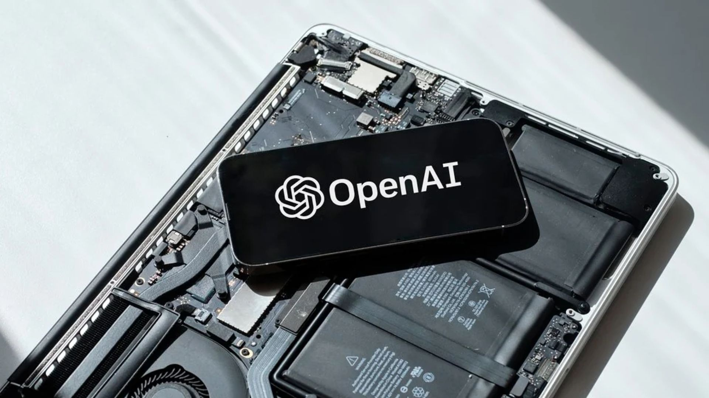
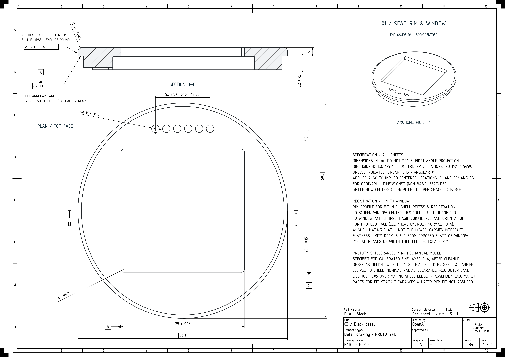

> **📌 한줄 요약:** 2026년 **11월 3일(현지시간)**, OpenAI가 **'Accelerating engineering for the physical world'** 를 공개했습니다. 핵심은 **GPT-6로 기능 요구사항을 정의하고, GPT-6 Astra가 외관·엔클로저·PCB·펌웨어·UI·Codex 연동까지 설계**해서 **두 명의 팀원이 사이드 프로젝트로 일주일 이내**에 동작하는 기기 프로토타입을 만든 실험입니다. **위탁 제조사가 한 달 이내 소량 배치를 생산**했지만, OpenAI 스스로 **"Astra가 제조사의 생산 한계·공차·조립에 필요한 세부사항을 일관되게 반영하지 못했다"** 고 밝혔습니다. 같은 글에서 **사내 하드웨어팀 토큰 사용량이 2월 이후 23배** 늘었다는 수치와, **BenchCAD 2.0에서 내부 신모델 0.875 vs GPT-6 Astra 0.594** 라는 비교, 그리고 **Chip Ganassi Racing 협업 확대·Mazda 신규 연구 협업**이 함께 나왔습니다.

도면 한 장 그리고, 부품 골라서 회로 잡고, 펌웨어 올리고, 케이스 맞춰서 시제품 뽑는 일. 기계·전기·소프트웨어·제조가 한 줄로 이어져야 하는 작업이라, 자동화를 붙이려는 순간마다 "여기서 모델이 어디까지 해도 되는가"라는 벽에 부딪힙니다.

이번 OpenAI 발표는 그 벽을 **실제 하드웨어 한 대**로 밀어본 결과물입니다. 마케팅 문구가 아니라 **어디까지 됐고 어디서 막혔는지**를 같이 적어놨다는 점이 눈에 띕니다.

이 글은 **무엇이 발표됐는지 → 모델이 실제로 한 일 → 제조 단계에서 드러난 한계 → 숫자로 본 변화 → 산업 협업 → 개발자·엔지니어에게 무엇이 달라지는지 → 솔직한 주의점과 전망** 순서로 정리했습니다.

## 무엇이 발표됐나

2026년 **11월 3일**, OpenAI가 **'Accelerating engineering for the physical world(물리적 세계의 엔지니어링 가속)'** 라는 제목의 글을 올렸습니다. 기계·전기 엔지니어링과 시스템 설계 전반에서 자사 모델이 어디까지 쓸 수 있는지를 정리한 **역량 공개 + 협업 모집** 성격의 문서입니다.

내용은 크게 네 덩어리입니다.

| 구분 | 내용 |
|:---|:---|
| 실험 | GPT-6 + GPT-6 Astra로 **Codex와 대화하는 기기**를 사람의 직접 수정 없이 설계 |
| 사내 지표 | 하드웨어·인프라 팀의 모델 사용량이 **2월 이후 23배**(토큰 기준) |
| 평가 | 신규 벤치마크 **BenchCAD 2.0** 공개, 내부 신모델 **0.875** vs **GPT-6 Astra 0.594** |
| 협업 | **Chip Ganassi Racing** 협업 확대, **Mazda**와 신규 연구 협업 발표 |

주의할 점은 이게 **신모델 출시가 아니라는 것**입니다. 새 모델 발표가 아니라, **이미 나와 있는 GPT-6 계열 모델을 실제 엔지니어링 워크플로에 넣었을 때의 결과 보고서**에 가깝습니다. 그래서 읽는 방법도 "성능표 비교"가 아니라 "우리 업무에 어디까지 붙일 수 있나"가 됩니다.

## ① 일주일 만에 나온 'Codex와 대화하는 기기'

실험 자체는 소박합니다. 사용자가 **Codex(코딩 에이전트)와 음성으로 대화할 수 있는 물리적 인터페이스**를 만드는 것. 목적은 예쁜 제품이 아니라 **"사람이 직접 손대지 않고 기기를 설계할 수 있는가"** 를 확인하는 것이었습니다.

진행 방식은 역할이 나뉘어 있습니다.

- **GPT-6**: 기능 요구사항 정의, 전체 설계 방향 제시
- **GPT-6 Astra**: 외관 디자인, 엔클로저(케이스)와 내부 구조, 전자 부품 선정, PCB 설계(부품 배치·배선), UI 디자인, 펌웨어 생성, Codex 연동 소프트웨어

여기서 중요한 건 **"부품을 골라서 케이스 안에 물리적으로 들어가게 배선까지 그렸다"** 는 부분입니다. 텍스트로 그럴듯한 설계안을 뽑는 것과, 케이스 치수 안에 부품을 배치하고 회로를 연결하는 것은 난이도가 다릅니다. OpenAI는 이걸 **멀티모달·컴퓨터 사용(computer use) 워크플로의 성능 테스트**로 규정했습니다.

결과는 이렇습니다.

- **두 명의 팀원**이 **사이드 프로젝트**로 **일주일 이내**에 설계 완료
- **위탁 제조사**가 **한 달 이내** 소량 프로토타입 배치 생산
- 외관 레퍼런스는 최근 협업한 **Work Louder의 Codex Micro**와 게임·장난감 이미지에서 가져옴

## ② 숫자로 본 변화 — 23배와 BenchCAD 2.0

OpenAI가 함께 공개한 내부 수치는 두 개입니다. 둘 다 **자사 측정**이라 그대로 일반화하기는 어렵지만, 방향성은 읽을 수 있습니다.

**(1) 하드웨어팀 모델 사용량 23배**

로보틱스와 컴퓨트 인프라를 포함한 **하드웨어·인프라 팀**이 Codex와 ChatGPT로 **CAD 모델 생성·수정, 제조 도면 작성, 시뮬레이션 세팅, 설계 리뷰**를 하고 있고, **2월 이후 토큰 기준 사용량이 23배** 늘었다고 합니다. 8개월 남짓의 증가율로는 상당히 가파른 수치입니다.

**(2) BenchCAD 2.0 — 0.875 vs 0.594**

새로 만든 벤치마크 **BenchCAD 2.0**은 두 가지를 봅니다.

- **3D 부품·어셈블리 재구성** 능력
- **회로기판의 연결 관계 식별** 능력

여기서 **내부의 더 새로운 모델이 평균 0.875**, **GPT-6 Astra는 최고 추론 설정에서 0.594** 를 기록했습니다. 즉 **아직 공개되지 않은 상위 모델이 Astra보다 설계 과제를 훨씬 잘한다**는 뜻이고, 동시에 **현재 공개 모델도 절반 이상은 해낸다**는 뜻이기도 합니다.

솔직히 이 벤치마크는 **OpenAI가 직접 만들고 직접 채점한 것**입니다. 외부 재현이 없으니 절대 점수보다는 **"설계 과제를 정량 평가하는 지표가 생겼다"** 정도로 받아들이는 게 안전합니다.

## ③ 제조 단계에서 드러난 한계 — 여기가 진짜 핵심

이 글에서 가장 값어치 있는 부분은 **실패담**입니다. OpenAI는 이렇게 적었습니다.

> "기기를 제조 가능한 상태로 만들려면 **여러 차례 리뷰와 반복**이 필요했다. Astra는 **제조사의 생산 한계, 공차(tolerance), 조립에 필요한 세부사항을 일관되게 고려하지 못했다.** 이 격차가 앞으로 모델이 무엇을 더 잘해야 하는지 알려준다."

정리하면 이렇습니다.

| 단계 | 모델이 해낸 것 | 사람이 개입해야 했던 것 |
|:---|:---|:---|
| 요구사항 | 기능 정의, 전체 구조 | 목표·제약 조건 결정 |
| 외관·기구 | 엔클로저 형상, 내부 구조 | 제조사 금형·공정 제약 반영 |
| 전기 | 부품 선정, PCB 배치·배선 | 공차, 실장 가능 여부 검증 |
| 소프트웨어 | UI, 펌웨어, Codex 연동 | 실제 하드웨어에서의 디버깅 |
| 양산 | (사실상 미흡) | 조립 순서, 검사 기준, 반복 리뷰 |

한 줄로 줄이면 **"설계 초안 속도는 극적으로 빨라졌지만, 양산 가능성 검증은 여전히 사람 몫"** 입니다. 이건 AI 설계 도구를 도입하려는 조직이 반드시 예산에 넣어야 하는 부분이기도 합니다. 초안이 빨라질수록 **검토·검증 단계가 병목**이 됩니다.

## ④ 협업 — Chip Ganassi Racing 확대, Mazda 신규

**(1) Chip Ganassi Racing(CGR) 협업 확대**

기존 협업을 넓혀, **기존 부품의 3D 스캔을 편집 가능한 CAD 모델과 2D 제조 도면으로 바꾸는 워크플로**를 테스트합니다. 원본 설계 파일이 없어진 부품을 다시 살리는 작업이라, 실제 제조·정비 현장에서 수요가 큰 유형입니다. CGR 엔지니어가 **정확성과 제조 가능성을 리뷰**하고 피드백을 돌려주는 구조입니다.

**(2) Mazda 신규 연구 협업**

OpenAI의 **연구팀과 Forward Deployed Engineering 팀**이 Mazda의 **공기역학·충돌안전 엔지니어**와 함께합니다.

- **공기역학**: GPT-6 Astra가 **노즈 형상(nose shape)을 모델링**하고 **공기 흐름을 시뮬레이션**해 **항력(drag) 감소** 방향을 탐색
- **충돌안전**: 구조 거동 시뮬레이션을 활용해 성능 개선안 탐색
- **제약**: 스타일링과 비용을 함께 고려
- 결과는 **향후 몇 달 안에** 공개 예정

OpenAI는 Mazda 측 엔지니어의 코멘트도 함께 실었습니다.

> "공기 흐름을 개선하는 형상을 찾았을 때, 우리 디자이너들은 늘 '꼭 이렇게 생겨야 하나?'라고 묻습니다. 수십 가지 변형을 탐색하고 시뮬레이션하면서 Astra는 어떤 요소가 공기역학에 중요한지, 디자이너가 어디까지 자유를 가질 수 있는지를 이해하게 해줍니다. 그래서 Astra와 OpenAI 협업의 가치는 단순한 작업 자동화나 개발 기간 단축을 넘어섭니다. 마쓰다 고유의 디자인과 공기역학 성능 중 하나를 포기하지 않고 함께 가져갈 수 있게 해주니까요."
> — **Akihiro Nakata**, Principal Engineer at Mazda

이 코멘트가 시사하는 바는 분명합니다. 엔지니어링 자동화의 가치가 **"일을 대신 해주는 것"** 이 아니라 **"탐색 횟수를 늘려주는 것"** 에 있다는 겁니다. 사람이 감당할 수 있는 시안 수에는 한계가 있고, 그 한계가 곧 설계 품질의 상한이 되기 때문입니다.

※ Mazda 시뮬레이션 이미지는 OpenAI 원문에만 게재되어 있어, 재사용 제한 안내에 따라 이 글에는 넣지 않았습니다.

## 사용자·개발자·제조사에게 무엇이 달라지나

**개발자 입장**에서 가장 실질적인 변화는 **"텍스트 코드 생성"에서 "물리적 산출물 생성"으로 평가 기준이 넓어진 것**입니다. 컴퓨터 사용(computer use) 능력이 CAD·시뮬레이션 도구 조작까지 확장되는 흐름이기 때문에, 앞으로 에이전트를 붙일 때 **"도구를 조작할 수 있는가"** 가 모델 선택의 핵심 축이 됩니다.

**엔지니어링 조직 입장**에서는 도입 순서가 중요해집니다. OpenAI가 공개한 사용 패턴을 그대로 옮기면 이렇습니다.

1. **도면·CAD 초안 생성** — 가장 먼저 효과가 나는 구간
2. **시뮬레이션 세팅 자동화** — 반복 세팅 비용이 큰 구간
3. **설계 리뷰 보조** — 변경점 추적·체크리스트 생성
4. **양산 검증** — 아직 사람이 최종 판단

**제조 중소기업 입장**에서는 **CGR 사례(3D 스캔 → CAD → 2D 도면)** 가 현실적인 출발점입니다. 설계 원본이 없거나, 단종 부품을 다시 만들어야 하는 상황은 규모와 상관없이 자주 생기기 때문입니다.

## 솔직한 주의점

첫째, **이 글은 OpenAI가 자기 모델을 홍보하기 위해 쓴 문서**입니다. 23배, 0.875, 0.594는 모두 자사 측정이고 외부 검증이 없습니다. 방향성은 신뢰할 만하지만 절대 수치로 인용하기는 이릅니다.

둘째, **설계 도면은 영업비밀에 가깝습니다.** CAD 파일과 시뮬레이션 설정을 외부 모델에 넣는 순간 데이터 거버넌스 이슈가 생깁니다. 도입 전에 **어떤 데이터가 어디로 가는지**를 먼저 정해야 합니다.

셋째, **"일주일"의 의미를 과대해석하면 안 됩니다.** 일주일은 **동작하는 프로토타입 설계**까지이고, 양산까지는 **한 달 이상의 제조 반복 + 엔지니어 리뷰**가 붙었습니다. 실제 제품 개발 일정에서 줄어드는 건 **초안 구간**이지 전체 일정이 아닙니다.

## 전망

이번 발표의 진짜 신호는 성능 숫자가 아니라 **평가 방식**입니다. OpenAI가 **BenchCAD 2.0** 같은 도메인 특화 벤치마크를 직접 만들고, **CGR·Mazda 같은 실제 산업 파트너의 엔지니어 리뷰를 데이터로 회수**하는 구조를 만들었다는 점입니다.

이 구조가 자리 잡으면 다음 단계는 자연스럽게 **"설계 → 검증 → 제조 문서"의 연결**로 갑니다. 지금 막힌 지점이 **공차·생산 제약·조립 요구사항**이니, 다음 모델들의 개선 포인트도 그쪽일 가능성이 큽니다.

업무 자동화 관점에서 정리하면 이렇습니다.

- **초안 생성형 자동화**는 이미 실사용 구간에 들어왔습니다.
- **검증형 자동화**는 아직 사람이 최종 서명하는 구조가 안전합니다.
- **도구 조작(computer use)** 능력이 모델 선택의 새 기준이 됩니다.

엔지니어링·제조 쪽에서 AI 에이전트 도입을 검토하는 분들이라면, 이번 사례는 **"어디까지 맡기고 어디서 사람이 멈춰야 하는지"** 를 그려보는 좋은 참고자료입니다. 특히 반복 도면 작업이나 시뮬레이션 세팅이 많은 팀이라면, **초안 자동화 → 리뷰 체계 정비** 순서로 접근하는 게 생각보다 실속 있는 경로입니다.

---

**참고 출처**
- OpenAI, "Accelerating engineering for the physical world" (2026년 11월 3일)
- Interesting Engineering, "OpenAI uses GPT-6 and Astra to design a working hardware device in under one week" (2026년 11월 3일)
- 이미지: OpenAI 공식 리서치 블로그 / OpenAI 콘텐츠 CDN
