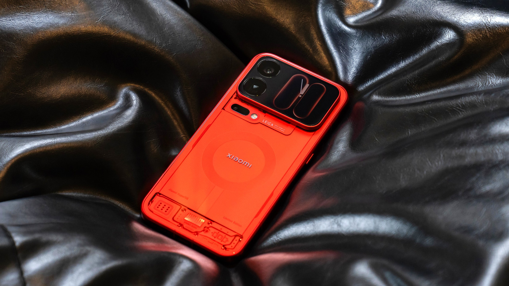
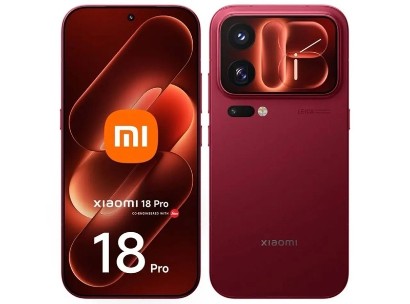
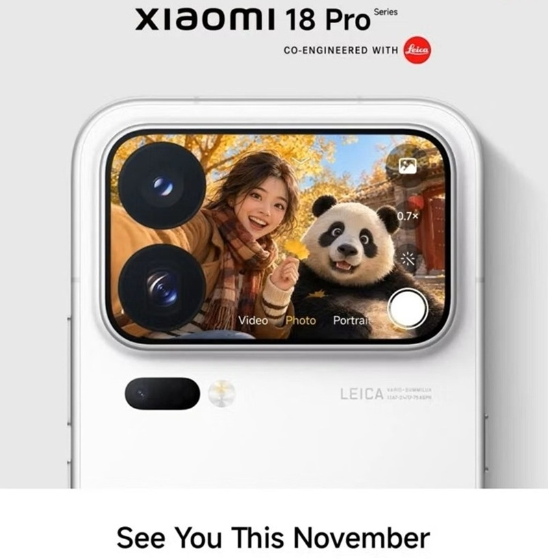
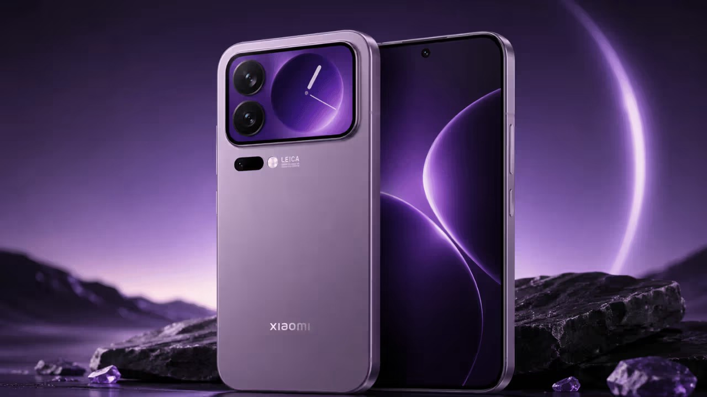

*샤오미 18 프로(맥스) 글로벌 색상 렌더 — 유럽에는 투명 레드 대신 불투명 '벨벳 레드'가 들어갑니다 (출처: 샤오미 공식 렌더 / Notebookcheck)*

> **📌 한줄 요약:** 샤오미가 **2026년 11월, 샤오미 18 프로·18 프로 맥스의 글로벌 출시를 공식 예고**했습니다. 공식 X 계정에 "going global this November" 문구를 올리고 출시 국가만 남겨둔 상태입니다. 문제는 두 가지입니다. ① **배터리가 중국판보다 줄어듭니다** — 18 프로 7,000mAh → **6,000mAh**, 18 프로 맥스 8,500mAh → **7,050mAh**. ② **유럽 예상가가 1,449유로·1,649유로(프로 맥스)** 로, 중국 판매가(5,999위안·6,999위안)의 **약 두 배** 수준입니다. 칩은 2nm 스냅드래곤 8 엘리트 Gen 6 계열, 카메라는 라이카 듀얼 200MP, 후면 보조 디스플레이까지 중국판과 같습니다.

## 1. "이번엔 진짜 글로벌" — 3년 만에 문이 열렸습니다

플래그십을 고를 때 은근히 발목을 잡는 게 **"국내에 정식으로 안 들어오는 모델"** 입니다. 스펙은 좋은데 AS가 없고, 밴드가 맞지 않고, 글로벌 롬을 따로 올려야 하는 경우죠. 샤오미 프로 라인이 딱 그런 위치였습니다. **샤오미 17 프로 시리즈는 중국 전용으로 남았고**, 그 전에도 프로 계열은 사실상 중국·일부 지역 한정이었습니다.

그런데 이번엔 다릅니다. 샤오미는 **2026년 9월 23일 중국 발표 직후부터 "연내 글로벌 출시"** 를 예고했고, **11월 2일 공식 X 계정에 "Xiaomi 18 Pro series is going global this November"** 라는 문구를 올렸습니다. 어느 나라에 먼저 풀릴지 팬들에게 묻는 형식이었고, **정확한 날짜와 국가 목록은 아직 비공개**입니다.

*샤오미 18 프로 — 0.99mm 초슬림 베젤과 후면 카메라 모듈 옆 보조 디스플레이가 특징입니다 (출처: 샤오미 공식 이미지 / 3DNews)*

러시아 매체 3DNews는 11월 4일 보도에서 **"글로벌 출시는 이달 안(11월 말까지)"** 이라면서도 **정확한 판매 개시일과 국가 명단은 샤오미가 여전히 공개하지 않았다**고 전했습니다. 유통 범위는 **EU, 중동, 북미·중남미**로 거론되는데, **미국 정식 출시는 여전히 불확실**합니다. 국내(한국) 일정도 아직 공지된 바가 없습니다.

정리하면 이렇습니다.

| 구분 | 내용 |
|:----|:----|
| 글로벌 출시 시점 | **2026년 11월 중** (정확한 날짜 미공개) |
| 공식 확인 | 샤오미 공식 X — "going global this November" (11월 2일) |
| 거론 시장 | EU, 중동, 북미·중남미 |
| 미국 | 정식 출시 불확실 |
| 한국 | 공식 일정 미공지 |

---

## 2. 글로벌판, 중국판과 뭐가 같고 뭐가 다른가

먼저 **같은 부분**부터. 9월 중국 발표에서 확인된 핵심은 그대로 갑니다.

- **2nm 공정 플래그십 칩** — 스냅드래곤 8 엘리트 Gen 6, 그리고 상위 모델에는 **스냅드래곤 8 엘리트 익스트림 Gen 6** 이 함께 거론됩니다
- **라이카 듀얼 200MP 카메라** — 2억 화소 메인 + 2억 화소 페리스코프 망원
- **후면 보조 디스플레이** — 샤오미 17 시리즈에서 시작된 후면 화면이 더 커지고 카메라 모듈과 평평하게 정리
- **0.99mm 초슬림 베젤**의 신형 Super Pixel 패널, **HyperOS 4**
- **샤오미 18 울트라는 사실상 보류** — 당분간 18 프로·프로 맥스가 최상위 라인업입니다

**달라지는 부분**은 배터리·충전·색상 세 가지입니다. 이게 이번 글의 핵심이에요.

### ① 배터리 — 1,000~1,450mAh가 빠집니다

| 모델 | 중국판 | 글로벌판 | 차이 |
|:----|:----|:----|:----|
| 샤오미 18 프로 | 7,000mAh | **6,000mAh** | -1,000mAh (약 -14%) |
| 샤오미 18 프로 맥스 | 8,500mAh | **7,050mAh** | -1,450mAh (약 -17%) |

숫자만 보면 "왜 좋은 걸 빼지?" 싶습니다. 이유는 **실리콘 카본 배터리의 지역별 인증·물류 문제**로 설명됩니다. 중국판은 실리콘 함량 32%의 GSR VIII 배터리를 쓰는데, 같은 셀을 유럽·북미 유통에 그대로 넣기 어려워 용량을 낮춘 셀로 대체한다는 겁니다. 비보·오포도 글로벌 모델에서 같은 선택을 해왔으니 샤오미만의 문제는 아닙니다.

그래도 **6,000mAh / 7,050mAh 자체는 결코 작은 용량이 아닙니다.** 아이폰 18 프로 맥스가 5,500mAh대, 갤럭시 Z 폴드8이 4,880mAh 수준인 걸 감안하면 여전히 상위권입니다. 다만 **"중국 리뷰에서 봤던 그 배터리"** 를 기대하고 글로벌판을 기다린 분이라면 기대치를 조금 낮춰야 합니다.

### ② 충전 — 프로는 90W로 한 단계 내려갑니다

- **18 프로(글로벌)**: 90W 유선 (중국판 100W)
- **18 프로 맥스(글로벌)**: 100W 유선 유지

이탈리아 유통업체 에프토(Epto) 등록 정보 기준입니다. 100W → 90W는 체감 차이가 크지 않은 수준이지만, 스펙표를 꼼꼼히 보는 분이라면 짚고 갈 부분입니다.

### ③ 색상 — '벨벳 레드'와 '코스믹 블루', 핑크는 없습니다

글로벌 라인업은 **블랙, 화이트, 벨벳 레드(Velvet Red), 코스믹 블루(Cosmic Blue)** 네 가지로 정리됩니다.

- 중국 한정 **투명 레드**는 유럽에 들어가지 않고, 대신 **불투명 벨벳 레드**가 들어옵니다
- 중국판의 파란색은 **코스믹 블루**라는 이름으로 글로벌 판매가 예상됩니다
- 중국에 있는 **핑크는 유럽 라인업에서 빠집니다**

*샤오미 18 프로 맥스 — 대화면과 후면 보조 디스플레이, 라이카 카메라 모듈이 그대로 유지됩니다 (출처: 샤오미 공식 이미지 / 3DNews)*

---

## 3. 스펙 한눈에 보기

| 항목 | 샤오미 18 프로 | 샤오미 18 프로 맥스 |
|:----|:----|:----|
| 디스플레이 | 6.4형급 (보도 기준) | 6.9형급 2K OLED (보도 기준) |
| 칩셋 | 2nm 스냅드래곤 8 엘리트 Gen 6 계열 | 동일 계열 (익스트림 Gen 6 거론) |
| 카메라 | 라이카 듀얼 200MP (메인 + 페리스코프) | 동일 |
| 후면 디스플레이 | 지원 | 지원 (면적 더 큼) |
| 배터리 (중국) | 7,000mAh | 8,500mAh |
| 배터리 (글로벌) | **6,000mAh** | **7,050mAh** |
| 충전 (글로벌) | 90W 유선 | 100W 유선 |
| OS | HyperOS 4 | HyperOS 4 |
| 메모리/저장 | 12GB/256GB, 12GB/512GB (글로벌) | 12GB/256GB, 12GB/512GB (글로벌) |

⚠️ 화면 크기와 칩 매핑은 **중국 발표 및 보도 기준**이며, 글로벌 모델의 최종 사양표는 출시일에 확정됩니다.

---

## 4. 가격 — 중국의 두 배, 이건 샤오미만의 문제가 아닙니다

이번 글로벌 출시에서 가장 논쟁적인 부분입니다. 유출된 유럽 가격은 이렇습니다.

| 모델 | 유출가 (유럽, 세금 포함) | 중국 판매가 |
|:----|:----|:----|
| 18 프로 12/256 | **1,449유로** | 5,999위안 |
| 18 프로 12/512 | 1,649유로 | — |
| 18 프로 맥스 12/256 | **1,649유로** | 6,999위안 |
| 18 프로 맥스 12/512 | **1,849유로** | — |

이탈리아 유통업체 에프토가 먼저 올린 가격은 조금 다릅니다. **18 프로 12/256 1,398.90유로, 12/512 1,591.90유로, 18 프로 맥스 12/512 1,783.90유로**(화이트·벨벳 레드는 1,761.90유로)입니다. 유출처에 따라 50~100유로 차이가 있으니 **"1,400~1,850유로 사이"** 로 보는 게 현실적입니다.

중국판과 비교하면 **약 1.8~2배**입니다. 5,999위안이 대략 780유로, 6,999위안이 910유로 수준이니, 같은 제품에 유럽에서 두 배 가까운 값을 지불하는 셈입니다.

왜 이렇게 올랐을까요. 두 가지가 겹쳤습니다.

1. **AI발 메모리 가격 급등** — 데이터센터용 D램·낸드 수요가 폭증하면서 모바일 메모리 원가가 함께 뛰었습니다. 올해 하반기 스마트폰 가격 인상의 공통 배경입니다.
2. **유럽 세금·물류·보증 비용** — 부가세와 2년 보증 의무, 인증 비용이 붙습니다.

참고로 **샤오미 17 울트라의 유럽 출시가는 999유로**였습니다. 1인치 센서에 가변 줌 망원까지 갖춘 상위 모델이 999유로였는데, **18 프로 기본형이 그보다 450유로 비싸진** 셈이니 체감상 "울트라가 갑자기 가성비로 보이는" 상황입니다.

---

## 5. 그래서 뭘 사야 하나 — 직구 vs 글로벌판

여기서부터는 실제 선택 기준입니다. 두 가지 길이 있습니다.

| 항목 | 중국 직구 | 글로벌판 (유럽 등) |
|:----|:----|:----|
| 가격 | **약 절반** (5,999~6,999위안) | 1,400~1,850유로 |
| 배터리 | 7,000 / 8,500mAh | 6,000 / 7,050mAh |
| 충전 | 100W | 90W (프로) / 100W (맥스) |
| 소프트웨어 | 중국 롬 (구글 서비스 별도 설치 필요) | 글로벌 롬 (구글 기본) |
| 보증·AS | 사실상 불가 | 현지 보증 (한국은 해당 없음) |
| 밴드 | 국내 주파수 확인 필수 | 지역별 상이, 확인 필수 |
| 언어·결제 | 중국 앱 생태계 기본 탑재 | 국제 표준 |

**이런 분께 글로벌판을 권합니다**
- 구글 서비스·결제·은행 앱을 그대로 쓰고 싶은 분
- 중국 롬 커스터마이징에 시간을 쓰고 싶지 않은 분
- 배터리 1,000mAh 차이보다 **소프트웨어 안정성**이 중요한 분

**이런 분은 중국판이 합리적입니다**
- 가격이 가장 큰 변수인 분 (거의 절반)
- 배터리 용량을 최우선으로 보는 분
- 직구 경험이 있고, 롬 설치·주파수 확인을 직접 할 수 있는 분

솔직히 말하면 **어느 쪽도 "정답"은 아닙니다.** 2nm 첫 세대 칩은 초기 발열·전력 최적화 이슈가 나오는 경우가 있었기 때문에, 어느 쪽을 고르든 **출시 후 2~4주 실사용 리뷰가 쌓인 뒤에 결정하는 편**이 후회가 적습니다.

*샤오미 18 프로 맥스 — 글로벌 라인업은 블랙·화이트·벨벳 레드·코스믹 블루로 정리될 전망입니다 (출처: 네이버 이미지 검색)*

---

## 6. 장점과 아쉬운 점

**👍 기대되는 부분**
- **2nm 플래그십 칩을 가장 먼저** 얹은 안드로이드 폰 중 하나 — 성능·전성비 기대치가 높습니다
- **라이카 듀얼 200MP** 구성이 프로·프로 맥스에 동일하게 들어갑니다. 상위 모델만 카메라가 좋아지는 구조가 아니라는 점이 실용적입니다
- **후면 보조 디스플레이** — 뒤집어 놓고 알림·카드 확인하는 용도로 은근히 손이 갑니다
- **6,000mAh대 배터리**는 글로벌판 기준으로도 충분히 큰 편입니다

**👎 감안할 부분**
- **배터리 축소** — 중국판 대비 최대 1,450mAh 감소는 명확한 다운그레이드입니다
- **가격** — 유럽 기준 1,400유로대는 경쟁 플래그십과 정면 충돌하는 가격입니다. 아이폰 18 프로 맥스 512GB와 비슷한 수준이라는 지적도 나옵니다
- **한국 정식 출시 미정** — AS 없는 직구 리스크는 그대로 남습니다
- **미국 출시 불확실** — 글로벌이라지만 시장마다 사정이 다릅니다

---

## 7. 구매 팁 — 지금 움직일까, 기다릴까

1. **출시일이 확정되기 전에는 예약·선구매를 서두르지 마세요.** 지금 나온 가격은 전부 유출·유통 등록 정보입니다. 샤오미 공식 가격표가 나오면 50~150유로 정도 달라질 수 있습니다.
2. **직구를 고려한다면 주파수부터 확인하세요.** 5G 밴드(n78 등)와 통신사별 VoLTE 지원 여부는 모델 번호에 따라 갈립니다.
3. **중국 롬 여부를 반드시 확인하세요.** 중국판은 구글 플레이가 기본이 아니고, 일부 금융·결제 앱이 동작하지 않을 수 있습니다.
4. **블랙프라이데이를 노려보세요.** 11월 말 출시와 겹치면 유럽 유통 채널에서 첫 할인이 붙는 경우가 있습니다. 다만 물량이 적으면 오히려 가격이 버티는 경우도 많습니다.
5. **프로 vs 프로 맥스는 화면 크기로 결정하세요.** 카메라·칩이 동일해진 이상, 실질적 차이는 **화면 크기와 배터리 용량**입니다. 한 손 사용이 중요하면 18 프로, 대화면·영상 소비가 중심이면 18 프로 맥스입니다.

**가성비 좋은 플래그십을 찾는 분께는, 솔직히 이번 세대는 '기다림'이 답입니다.** 글로벌 가격이 확정되고 실사용 리뷰가 쌓이는 12월 초가 가장 안전한 판단 시점입니다. 반대로 **중국판을 직구로 저렴하게 쓰는 쪽**이라면 지금도 선택지는 열려 있습니다. 대신 배터리와 소프트웨어라는 두 가지 변수를 감수해야 합니다.

---

### 참고 자료
- [Xiaomi 18 Pro series officially confirmed for global launch in November — Gizmochina (2026.11.2)](https://www.gizmochina.com/2026/11/02/xiaomi-18-pro-series-global-launch-november/)
- [Xiaomi 18 Pro (Max) global prices and specs leaked — Notebookcheck (2026.10.20)](https://www.notebookcheck.net/Xiaomi-18-Pro-Max-global-prices-and-specs-leaked-including-a-somewhat-new-color-option.1428407.0.html)
- [Глобальные версии Xiaomi 18 Pro и Pro Max выйдут до конца ноября — 3DNews (2026.11.4)](https://3dnews.ru/1150757/globalnie-versii-xiaomi-18-pro-i-pro-max-viydut-do-kontsa-noyabrya-batarei-menshe-a-tseni-pochti-vdvoe-vishe-kitayskih)
- [Xiaomi 18 Pro & Pro Max European Prices Leak With Major Hikes — Tech Advisor (2026.10)](https://www.techadvisor.com/article/3264492/xiaomi-18-pro-and-pro-max-european-prices-leak-with-major-hikes.html)

> **※ 안내:** 본문의 글로벌 가격·배터리·색상 정보는 유럽 인증 DB(EPREL)와 유통업체 등록 정보, 복수 외신 보도를 종합한 것으로, **샤오미의 공식 글로벌 가격표·출시일 발표 전까지는 확정 정보가 아닙니다.** 구매 결정 시 공식 채널 공지를 다시 확인하시길 권합니다.
