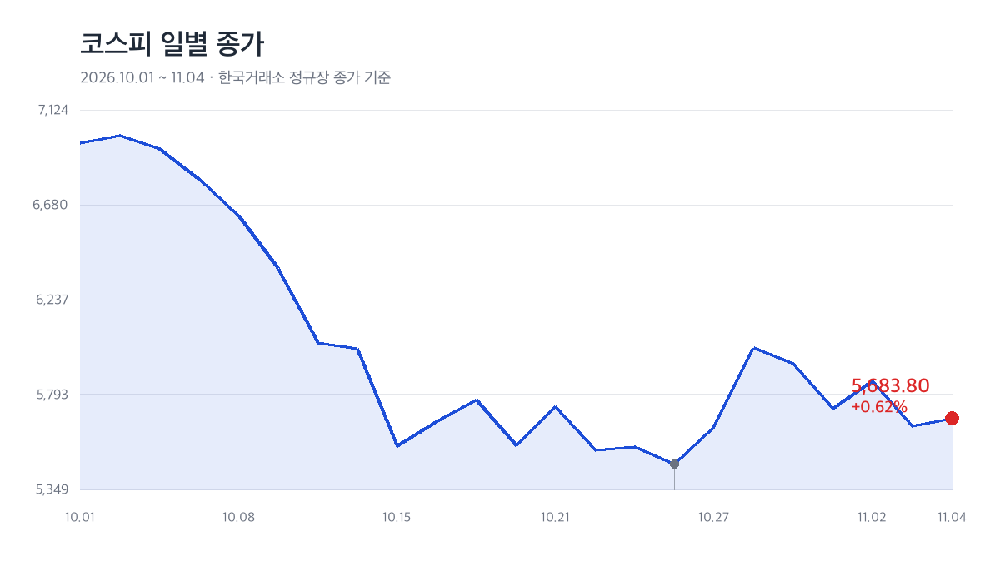

*코스피 일별 종가 (2026.10.01~11.04, 한국거래소 정규장 종가 기준)*

## 한 줄 요약

11월 4일(수) 코스피는 **5,683.80(+0.62%)**으로 마감했습니다. 전일 3.59% 급락분을 3분의 1가량 되돌린 셈입니다. 5,786.13으로 출발해 5,828.13까지 올랐다가 5,421.72까지 밀리며 하루 **406.41포인트**를 오갔습니다.

| 구분 | 종가 | 전일비 | 등락률 |
|:----|:----|:------|:------:|
| **코스피** | 5,683.80 | ▲ 35.01 | +0.62% |
| **코스닥** | 714.95 | ▲ 10.56 | +1.50% |
| 코스피200 | 889.25 | ▲ 3.58 | +0.40% |
| 코스피 등락 종목 | 상승 568 · 하락 303 | — | — |

## 외국인 2.5조 매도, 기관·개인이 받아냈다

유가증권시장에서 **외국인 약 2조 5,000억 원 순매도**(잠정 2조 5,031억 원)로 사흘 연속 팔았고, **기관 1조 144억 원**, **개인 1조 1,396억 원**이 받아냈습니다. 프로그램 매매는 1조 5,900억 원 순매도였습니다.

지수를 올린 건 반도체가 아니었습니다. 삼성전자 -1.14%, SK하이닉스 -0.29%로 대형주는 시가를 밑돌았고, 대신 삼성SDI +11.57%(545,000원), LG에너지솔루션 +3.99%, LG화학 +4.00%가 하단을 지탱했습니다.

코스닥은 장중 683.66까지 밀려 700선 아래를 찍었지만, **714.95(+1.50%)**로 되돌아섰습니다.

## 미국 중간선거가 만든 업종 온도차

간밤 나스닥 +0.83%, 필라델피아 반도체지수 +2.63%로 기술주는 반등했습니다. 그러나 민주당의 상·하원 장악 이후 시장은 두 갈래로 갈렸습니다. 태양광은 세액공제 복원 기대에 **한화솔루션 +20.13%**, HD현대에너지솔루션 +13.61%, 두산퓨얼셀 +12.39%가 급등했고, 2차전지는 **엘앤에프 +11.23%**(LG엔솔과 1조 원대 LFP 양극재 계약), 포스코퓨처엠 +8.92%가 뒤를 이었습니다. 반면 반도체·AI는 데이터센터 규제 우려로 상승이 제한됐습니다.

업종지수는 에너지장비 +11.23%, 전기제품 +7.36%, 게임 +6.41%가 강했고, 방송·엔터 -5.46%, 소프트웨어 -4.78%가 약했습니다.

## 오늘의 특징주

- **크래프톤 +15.45%** — 3,000억 원 자사주 매입·소각 공시.
- **한국항공우주 +10.79%** — 3분기 호실적과 4분기 납품 확대 전망.
- **LG생활건강 -11.64%**, **하이브 -11.16%** — 실적 발표 후 엇갈린 주가 반응.

## 남은 변수

원/달러 환율은 1,339.00원(-6.10원), 국고채 3년물은 3.71%로 내렸습니다. 반면 고객예탁금은 88조 2,413억 원으로 2조 2,216억 원 줄어 대기자금은 얇아졌습니다. 5,683선은 5일선(5,730선) 아래로, 외국인 매도 진정과 반도체로의 수급 확산 여부가 반등 지속성을 가를 것으로 보입니다.

*본 포스팅은 한국거래소 종가 데이터와 국내 언론 마감 보도를 바탕으로 작성했으며, 특정 종목의 매매를 권유하는 글이 아닙니다. 수급 수치는 집계 시점에 따라 잠정치와 차이가 있을 수 있습니다.*

#코스피 #코스닥 #한국증시 #외국인 #증시시황 #마감시황 #2차전지 #태양광
