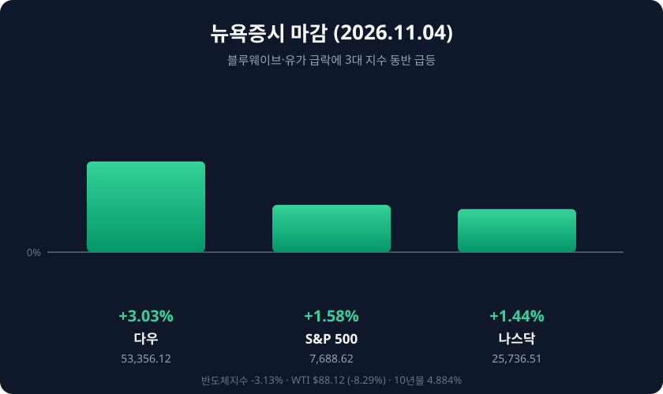

*2026년 11월 4일(현지시간) 뉴욕증시 주요 지수 등락률*

## 오늘의 증시 요약

**11월 4일(현지시간)** 뉴욕증시는 3대 지수가 일제히 급등했습니다. 다우존스30산업평균지수는 1,569.40포인트(3.03%) 오른 **5만3,356.12**, S&P500은 119.70포인트(1.58%) 상승한 **7,688.62**, 나스닥종합지수는 364.50포인트(1.44%) 오른 **2만5,736.51**에 마감했습니다. 다우 기준 2025년 4월 이후 가장 큰 하루 상승 폭입니다.

| 지수 | 종가 | 전일비 | 등락률 |
|:----|:----|:------|:------:|
| 다우존스 | 53,356.12 | +1,569.40 | +3.03% |
| S&P500 | 7,688.62 | +119.70 | +1.58% |
| 나스닥 | 25,736.51 | +364.50 | +1.44% |
| 필라델피아 반도체 | 10,268.65 | — | -3.13% |

## 상승을 만든 두 가지 재료

첫째는 **미국 중간선거 결과**입니다. 민주당이 상·하원을 모두 가져가는 '블루 웨이브'가 완성되면서, 트럼프 행정부의 급격한 정책 변화와 과도한 재정지출에 견제 장치가 생길 것이라는 기대가 커졌습니다. 도이체방크는 "극단적 정책이 억제되며 위험 프리미엄이 낮아질 것"이라고 평가했습니다.

둘째는 **국제유가 급락**입니다. 중간선거 패배의 원인으로 이란전이 지목되면서 종전 기대가 확산됐고, 브렌트유는 8.67% 내린 배럴당 **94.62달러**, WTI는 8.29% 내린 **88.12달러**로 두 달여 만의 최저치를 기록했습니다. 국채금리도 함께 내리며 10년물은 4.884%(-6.6bp), 2년물은 4.583%로 마감했습니다. 달러인덱스는 101.53(-0.33%), VIX는 16.61(-20.26%)까지 밀렸습니다.

## 업종별 온도 차

금리와 유가가 동시에 내려가자 경기민감주·소비주·주택주로 순환매가 붙었습니다. 레나르와 D.R.호튼, 펄트그룹이 8% 안팎, 홈디포가 6.5%대 올랐고 마이크로소프트 6.7%, 애플 5.3%, 알파벳 3.2%도 강했습니다.

AI 인프라 쪽은 반대로 움직였습니다. 데이터센터 확장 속도 둔화와 규제 강화 우려로 코어위브가 9.9% 급락했고, 마이크론 7%, 엔비디아 3.17% 하락하며 반도체지수는 6개월 만의 최저치로 밀렸습니다. 방산주도 약세였습니다.

## 국내 증시는 정반대

같은 재료가 한국에서는 반대로 작동했습니다. 11월 5일 코스피는 300.00포인트(5.28%) 내린 **5,383.80**, 코스닥은 36.54포인트(5.11%) 내린 **678.41**로 마감하며 매도 사이드카가 발동됐습니다. 외국인 순매도가 3조원을 넘었고 SK하이닉스는 9%대 급락했습니다. 미국발 데이터센터 투자 조정 우려가 메모리 업황에 직접 부담으로 작용한 셈입니다.

## 다음 일정과 관전 포인트

- **11월 6일**: 미국 10월 고용보고서(비농업 고용·실업률)
- **11월 18일(현지)**: 10월 FOMC 의사록 공개
- **12월 8~9일**: 연방공개시장위원회(FOMC) 정례회의

지수만 보면 강한 반등이지만 속내는 갈렸습니다. 반도체·데이터센터 종목이 이 상승 흐름에 동참하는지, 10년물 금리와 달러 약세가 하루짜리 반응으로 끝나지 않는지가 다음 거래일의 방향을 가를 변수입니다.

#뉴욕증시 #다우지수 #S&P500 #나스닥 #FOMC #유가 #블루웨이브 #미국중간선거 #반도체
