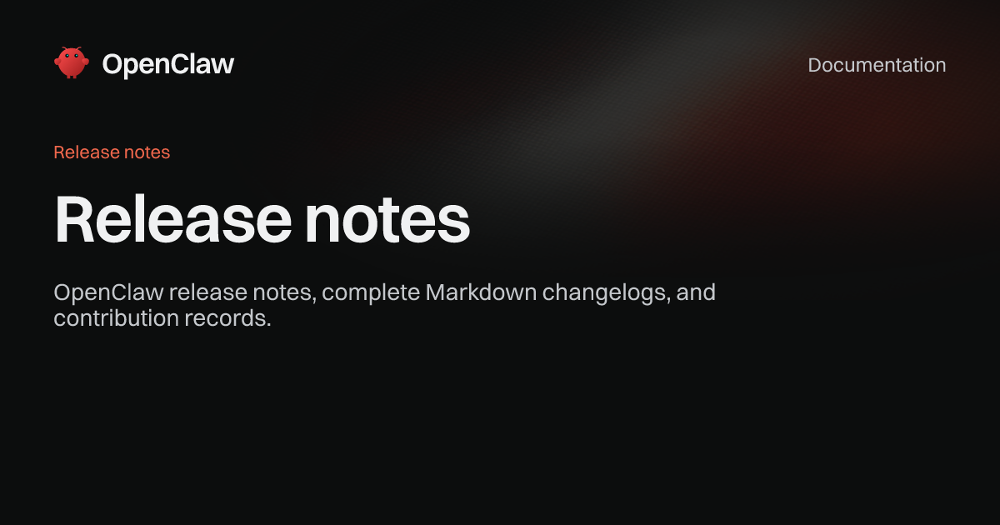
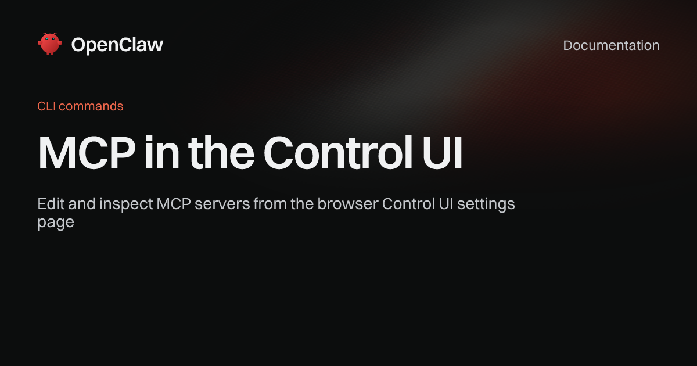
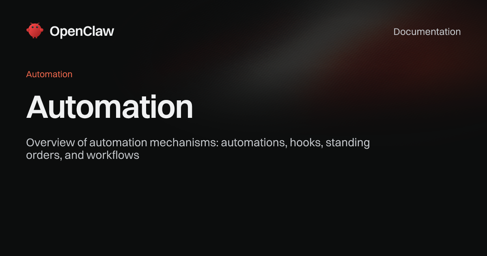

*OpenClaw 공식 문서 사이트(docs.openclaw.ai) 릴리스 섹션 대표 이미지. (출처: docs.openclaw.ai)*

> **📌 한줄 요약:** 2026년 11월 4일 13시 51분(KST), OpenClaw **`2026.11.5-beta.1`** 이 베타 채널에 올라왔습니다. 이번엔 UI 다듬는 수준이 아닙니다. **지식을 캡처해 재사용하는 Knowledge Scribes**, **SQLite를 넘어서는 PostgreSQL 데이터 플레인**, **대화 안에서 끝나는 PR 준비·리뷰·머지 상태 추적**이 한꺼번에 들어왔습니다. 자동화 파이프라인을 굴리는 쪽이라면 업그레이드 판단 전에 한 번은 읽어볼 만한 릴리스입니다.

---

## 이 글에서 다루는 것

- `2026.11.5-beta.1`의 공개 시점과 릴리스 성격(베타 vs 정식)
- 업무 자동화에 실제로 영향이 있는 8가지 변경점
- 솔직한 장점과 아쉬운 점
- 베타를 올리기 전에 확인해야 할 체크리스트

---

## 릴리스 개요 — 숫자와 채널부터

공식 릴리스 노트(GitHub Releases) 기준으로 정리하면 이렇습니다.

| 항목 | 내용 |
|:---|:---|
| 버전 | `2026.11.5-beta.1` |
| 채널 | **beta (pre-release)** — 정식 아님 |
| 공개 시점 | 2026-11-04 04:51 UTC (13:51 KST) |
| 배포 형태 | npm `openclaw@2026.11.5-beta.1` + 릴리스 검증 아티팩트 |
| 직전 정식 버전 | `2026.10.10` (2026-11-03 03:22 UTC) |
| 직전 보안 패치 | `2026.10.9` (2026-10-29) |

주의할 점은 **채널**입니다. `2026.10.10`이 정식(stable)이었던 것과 달리, 이번 건은 GitHub에서 `prerelease: true`로 표시된 베타입니다. 하이라이트 항목이 8개, 변경(Changes) 항목이 11개, 수정(Fixes) 항목이 11개 묶음으로 올라와 있어서 분량 자체는 정식 릴리스급이지만, 운영 환경에 바로 올리는 물건은 아닙니다.

정식 전환 시점은 이 글 작성 시점 기준으로 별도 공지가 확인되지 않았습니다. 보통 베타 넘버가 올라간 뒤 며칠에서 몇 주 안에 정식이 따라오는 흐름이었으니, 급하지 않다면 정식 릴리스를 기다리는 쪽이 안전합니다.

---

## ① Knowledge Scribes — "기억"이 아니라 "기록"을 붙였다

이번 릴리스에서 가장 눈에 띄는 신규 기능입니다. 에이전트·세션·Control UI 전반에 걸쳐 **지식 캡처와 재사용 가능한 스크라이브(scribe) 워크플로**를 1급 기능으로 넣었습니다.

쉽게 말하면 이렇습니다. 지금까지 에이전트의 기억(memory)은 대화에서 파생된 것을 저장하고 다시 꺼내 쓰는 방식에 가까웠습니다. Scribes는 그와 별개로, **"이 판단은 이렇게 내렸다"는 형태의 기록을 남기고 다음 작업에서 그대로 다시 불러 쓰는** 흐름을 제품 차원에서 지원합니다.

업무 자동화 관점에서 체감이 큰 지점은 세 가지입니다.

- 같은 판단을 매번 프롬프트로 다시 설명하지 않아도 됩니다.
- 기록이 세션이 아니라 에이전트 단위로 붙기 때문에, 다른 채널에서 시작한 작업에서도 같은 기준을 씁니다.
- Control UI에서 기록을 직접 열어보고 고칠 수 있습니다.

자동화를 오래 돌리면 결국 발목을 잡는 건 모델 성능이 아니라 **"이 작업은 원래 이렇게 하는 거다"라는 맥락의 증발**입니다. Scribes는 그 지점을 정면으로 건드린 기능이라, 개인적으로 이번 베타에서 가장 기대되는 부분입니다.

---

## ② PostgreSQL 데이터 플레인 — SQLite 한계를 넘는 선택지

두 번째 하이라이트는 인프라입니다. **PostgreSQL 기반 상태 저장, 마이그레이션 도구, 기존 배포본에 대한 호환성 검증**이 추가됐습니다.

기존 OpenClaw는 로컬 SQLite를 중심으로 상태를 들고 갔습니다. 개인용으로는 이만한 게 없지만, 세션이 쌓이고 자동화 잡이 늘고 여러 기기가 붙으면 파일 하나에 모든 게 얹히는 구조가 부담이 됩니다. 특히 백업·복구, 다중 인스턴스, 장기 이력 조회에서요.

이번 변경으로 기대할 수 있는 건 이렇습니다.

- 상태 저장소를 PostgreSQL로 옮길 수 있는 **공식 경로**가 생겼습니다.
- 기존 SQLite 배포본을 위한 **마이그레이션 도구**가 함께 제공됩니다.
- 기존 배포 환경을 위한 **호환성 커버리지**가 릴리스에 포함됐습니다.

다만 이건 "옵션 추가"에 가깝습니다. 기본값이 PostgreSQL로 바뀐 게 아니고, 굳이 DB 서버를 따로 띄울 이유가 없는 개인 사용자라면 그대로 SQLite를 쓰면 됩니다. 팀 단위로 여러 인스턴스를 굴리거나, 자동화 이력을 오래 보관해야 하는 경우에 실익이 큽니다.

**주의할 점은 마이그레이션입니다.** 베타에서 새로 들어온 도구인 만큼, 운영 중인 상태를 곧바로 옮기기보다는 스냅샷을 떠 두고 복제본에서 먼저 검증하는 순서가 안전합니다.

---

## ③ 대화에서 PR까지 — 코드 작업이 채팅 안에서 끝난다

세 번째는 **PR 준비 → 게시 → 리뷰 → 상태 추적**을 대화 흐름 안에서 끝내는 워크플로입니다.

지금까지도 에이전트에게 "이거 고쳐줘"라고 하면 코드를 고치고 커밋까지는 해줬습니다. 문제는 그다음이었습니다. 브랜치를 만들고, PR 본문을 쓰고, 리뷰 코멘트를 확인하고, CI 상태를 지켜보는 일은 결국 사람이 웹으로 넘어가서 해야 했습니다.

이번 변경은 그 구간을 대화 안으로 당겨옵니다. 자동화 파이프라인에 코드 수정 단계를 넣어둔 경우, "PR 올리고 리뷰 반영까지"를 하나의 잡으로 묶을 수 있게 되는 셈입니다.

솔직히 말하면 이건 잘 쓰는 사람과 그렇지 않은 사람의 차이가 큰 기능입니다. PR을 자동으로 찍어내는 걸 허용하면 리뷰 부담이 그대로 사람에게 몰립니다. **자동 생성은 하되 머지는 사람이** 하는 식으로 경계를 정해두는 걸 권합니다.

---

## ④ Control UI 전면 개편 — 모바일·데스크톱 내비게이션 재작성

*OpenClaw 공식 문서(docs.openclaw.ai)의 Control UI 관련 페이지 대표 이미지. (출처: docs.openclaw.ai)*

네 번째는 화면입니다. **모바일과 데스크톱 양쪽의 내비게이션, 레이아웃, 인터랙션을 갈아엎었습니다.** 릴리스 노트에는 관련 PR이 6개 묶여 있습니다.

기능 추가는 아니지만 체감은 큽니다. 자동화를 여러 개 돌리면 세션·잡·에이전트를 계속 오가야 하는데, 이 동선이 나빠지면 하루 종일 스트레스입니다. 반대로 동선이 정리되면 같은 일을 절반의 클릭으로 끝낼 수 있습니다.

이번 릴리스에는 접근성 수정도 함께 들어갔습니다. 키보드 이동, 포커스, 라벨링, 반응형 인터랙션에서 생기던 회귀(regression)를 잡았다고 명시돼 있습니다. 새 레이아웃을 깔면서 생긴 자잘한 문제를 같은 릴리스에서 수습한 모양새입니다.

참고로 첨부 미리보기에서 중단된 `data:` URL이 네이티브 fetch 크래시를 유발하던 문제도 함께 수정됐습니다. 파일 첨부를 자주 쓰는 환경이라면 체감되는 버그픽스입니다.

---

## ⑤ 크로스 디바이스·클라우드 실행 — 기기 사이 인계가 안전해졌다

다섯 번째는 실행 범위입니다. **연결된 기기(attached-device), 클라우드 배치(cloud-placement), 사이버 접근(cyber-access) 워크플로**가 확장됐고, 여기에 **더 안전한 권한 인계(capability handoff)** 가 붙었습니다.

요지는 "작업을 시작한 기기에서 끝내야 하는" 제약이 줄어든다는 것입니다. 데스크톱에서 시작한 작업을 다른 기기나 클라우드 쪽으로 넘겨 이어서 돌리는 흐름이 공식 기능으로 자리를 잡아가는 단계입니다.

여기서 실무적으로 중요한 건 기능 자체보다 **인계 경계**입니다. 권한이 따라 넘어가면 편하지만, 그만큼 사고 반경도 넓어집니다. 이번 릴리스가 "safer capability handoffs"를 따로 강조한 이유도 그 때문일 겁니다. 기기 간 실행을 켜둘 계획이라면 어떤 권한이 어디까지 넘어가는지 먼저 확인해두는 게 좋습니다.

---

## ⑥ 자동화가 "끊기지 않게" — 지속 스트림과 실행 컨텍스트

*OpenClaw 공식 문서(docs.openclaw.ai)의 자동화(Automation) 섹션 대표 이미지. (출처: docs.openclaw.ai)*

여섯 번째는 자동화 파이프라인을 직접 굴리는 쪽에 가장 와닿는 부분입니다. **예약 작업을 위한 지속 스트림(persistent streams)과 더 풍부한 실행 컨텍스트**가 추가됐습니다.

기존에는 스케줄된 작업이 돌 때 "무슨 맥락에서 왜 이 잡이 실행됐는지"가 얇았습니다. 이번 변경으로 실행 단위에 맥락이 더 붙고, 스트림이 끊기지 않게 유지됩니다. 오래 도는 잡, 중간에 재시작이 끼는 잡에서 결과 편차가 줄어드는 방향입니다.

관련해서 수정 항목도 눈에 띕니다. 스케줄러 실행과 저장된 실행 복구의 경계 사례를 잡았다고 명시돼 있습니다. 자동화에서 제일 무서운 건 실패가 아니라 **조용히 안 도는 것**인데, 그 구멍을 메우는 패치입니다.

---

## ⑦ 플러그인 경험과 결정·미디어 모델 라우팅

일곱 번째, 여덟 번째는 확장성입니다.

**플러그인**은 발견(discovery), 설치, 제작(authoring), 런타임 통합까지 네 축이 손봤습니다. 플러그인을 직접 만들어 쓰는 경우 런타임 통합 방식이 바뀐 부분이 있으니, 자체 플러그인이 있다면 베타에서 먼저 깨지는지 확인해야 합니다.

**결정·미디어 모델**은 의사결정 전용 라우팅과 미디어 처리 모델 지원이 추가됐고, **ClawRouter** 연동이 함께 들어갔습니다. 작업 종류에 따라 모델을 나눠 붙이는 구성이 한결 수월해집니다. 이미지·오디오·비디오 처리도 네이티브 미디어 영역에서 확장됐습니다.

---

## 솔직한 장점

- **방향이 명확합니다.** 이번 베타의 축은 "기록(Scribes) → 저장소(PostgreSQL) → 실행 범위(크로스 디바이스)"로 이어집니다. 기능을 늘린 게 아니라 구조를 바꾸는 중이라는 게 릴리스 노트에서 그대로 읽힙니다.
- **자동화 운영자에게 실익이 있는 항목이 많습니다.** 지속 스트림, 실행 컨텍스트, 스케줄러 복구 수정은 눈에 안 보이지만 매일 체감되는 종류입니다.
- **백업·업그레이드 안전성**이 별도 하이라이트로 올라와 있습니다. 상태 보존과 롤백 동작을 손봤다는 건, 그만큼 업그레이드 사고가 있었다는 뜻이기도 합니다. 미리 메워두는 쪽이 낫습니다.

## 아쉬운 점

- **베타입니다.** 하이라이트 8개가 한꺼번에 들어온 만큼, 조합에서 나오는 변수도 그만큼 많습니다. 운영 환경 즉시 적용은 권하지 않습니다.
- **PostgreSQL은 옵션의 문을 연 수준**입니다. 기존 배포본을 자동으로 옮겨주는 마법은 없고, 마이그레이션 도구를 직접 돌려야 합니다.
- **Control UI 개편은 호불호가 갈립니다.** 내비게이션이 바뀌면 손에 익은 동선이 한 번은 틀어집니다. 접근성 회귀 수정이 같이 들어온 걸 보면, 새 레이아웃 자체에서 생긴 문제도 있었던 것으로 보입니다.
- **문서가 아직 따라오지 못했습니다.** 이 글 작성 시점에 `2026.11.5` 전용 릴리스 문서 페이지는 열려 있지 않고, GitHub 릴리스 노트가 사실상 유일한 1차 자료입니다.

---

## 베타 올리기 전 체크리스트

1. **백업 먼저.** 이번 릴리스에 백업·복구·롤백 관련 수정이 대거 포함됐다는 건, 그 영역이 최근까지 흔들렸다는 신호로 읽는 게 맞습니다.
2. **복제본에서 먼저.** PostgreSQL 마이그레이션은 운영 상태에 바로 걸지 말고 스냅샷 복제본에서 검증하세요.
3. **자체 플러그인 호환 확인.** 플러그인 런타임 통합이 바뀌었습니다.
4. **Control UI 동선 재확인.** 자동화 잡을 자주 여는 편이라면 새 내비게이션에서 세션↔잡 이동이 어떻게 바뀌었는지 먼저 보세요.
5. **정식까지 기다릴지 결정.** 안정성이 우선이면 `2026.10.10` 정식에 머무는 게 합리적입니다.

---

## 정리 — 이런 분께 권합니다

- 자동화 잡을 여러 개 굴리면서 **실행 맥락이 얇아 답답했던 분**
- 세션이 쌓여 SQLite 상태 파일이 부담스러워진 **팀 단위 운영자**
- 코드 수정 자동화를 **PR 단계까지** 끌고 가고 싶은 분
- 반대로, 한 대의 기기에서 가볍게 쓰는 개인 사용자라면 **정식 릴리스까지 기다리는 쪽**이 낫습니다.

업무 자동화를 오래 굴려본 입장에서, 이번 베타의 핵심은 새 기능 개수가 아니라 **"기록과 상태를 어디에 두고 어떻게 넘길 것인가"** 를 제품이 직접 다루기 시작했다는 점입니다. 그 판단이 맞다면 `2026.11.5` 정식은 꽤 중요한 분기점이 될 겁니다.

> 참고: 본 글은 OpenClaw GitHub Releases의 `v2026.11.5-beta.1` 릴리스 노트(2026-11-04 공개)와 공식 문서 사이트를 근거로 작성했습니다. 베타 버전의 세부 동작은 정식 릴리스에서 달라질 수 있습니다.

*이미지 출처: OpenClaw 공식 문서 사이트(docs.openclaw.ai) 대표 이미지*
