7세 아이를 위한 수학 모험 게임, **넘버리아 대륙의 수학모험**을 구글 플레이스토어에 정식으로 출시했습니다.

처음 웹 프로토타입을 앱으로 포장했던 9월 11일부터 지금까지, 앱 버전 번호는 **31**까지 올라갔습니다. 이 글은 그 전체 과정을 한 편에 담은 완결편입니다 — 소리를 만들고, 모바일 화면을 고치고, 펫을 다시 설계하고, 안드로이드 앱으로 포장하고, 스토어의 얼굴을 만들고, 아동 정책과 서명 키를 준비하고, 마지막으로 **비공개 테스트와 한 번의 거절**을 지나 출시하기까지의 기록입니다.

- 📱 **플레이스토어:** [넘버리아 대륙: 수학모험 이야기](https://play.google.com/store/apps/details?id=com.jackeychankey.numberia)
- 🗓️ **정식 출시:** 2026년 10월 30일
- 🌐 **웹 버전:** [numberia.web.app](https://numberia.web.app/)

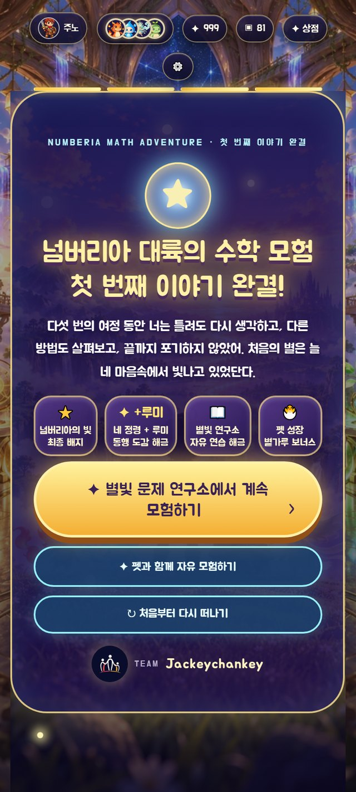
*다섯 에피소드를 모두 지나면 만나는 완결 화면. (이야기의 마지막 장면이라 스포일러에 민감하시면 건너뛰셔도 됩니다)*

## 넘버리아는 어떤 게임인가요

먼 하늘 위 '지혜의 별'이 대륙에 여섯 가지 빛을 보내던 어느 날, 작은 그림자 친구 **누블러**가 문제를 하나 틀리고 맙니다. "다들 나를 이상하게 보면 어떡하지?" — 너무 겁이 난 누블러의 마음이 안개가 되어 대륙에 퍼졌고, 몬스터들은 저주에 걸려 버립니다.

아이는 별 모양 마스코트 **델타**, 불의 정령 **이그니**와 함께 대륙을 여행하며 몬스터가 내는 수학 문제를 풀어 저주를 풀어 줍니다.

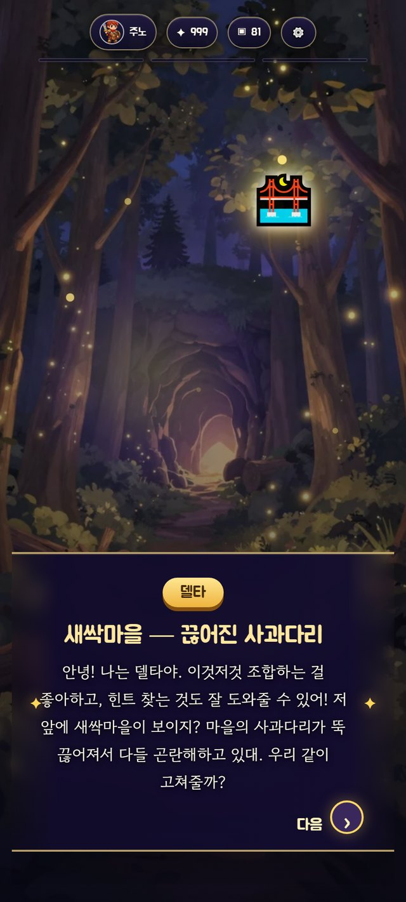
*새싹마을에서 델타를 처음 만나는 장면*

- 정답을 고르면 별빛이 반짝이며 바로 칭찬과 보상이 따라옵니다.
- **틀려도 괜찮습니다.** 차근차근 설명과 함께 다른 문제로 다시 도전할 수 있습니다.
- 모은 재료로 다리를 고치고 도구를 만드는 조합·미션이 중간중간 들어 있습니다.
- 문제를 풀며 모은 별가루로 **별빛 펫**을 키웁니다.

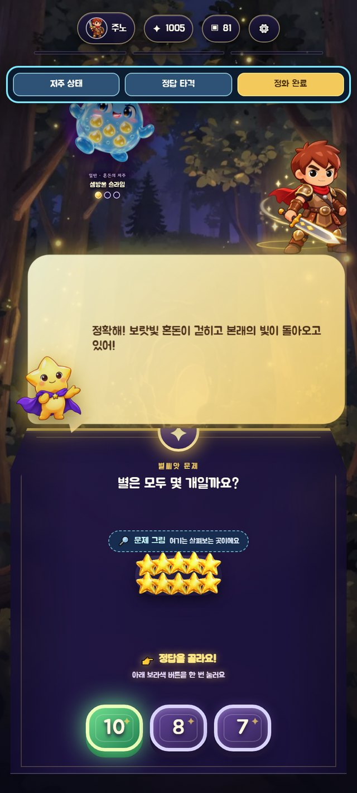

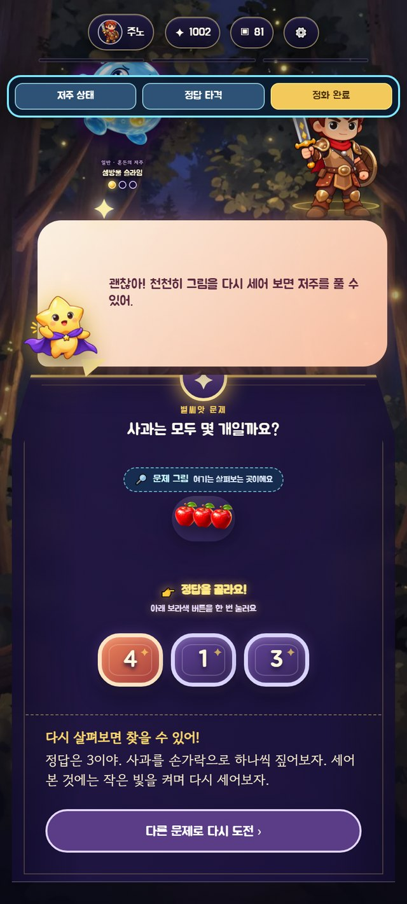

이 게임이 가장 하고 싶은 말은 사실 수학 문제가 아니라 이것입니다. **"틀려도 다시 해 보면 돼."** 마지막 여정에서 흐려진 '처음의 별'을 되살리는 것도, 정답을 아는 힘이 아니라 다시 해 보는 마음이었습니다.

## 숫자로 보는 첫 번째 여정

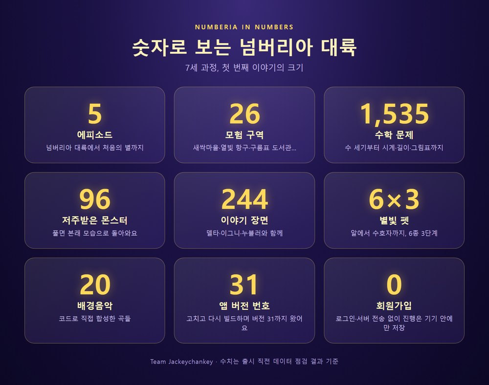

**에피소드 5개, 모험 구역 26곳, 수학 문제 1,535개, 몬스터 96종, 이야기 장면 244컷.** 수 세기에서 시작해 모으기·가르기, 크기 비교, 도형, 규칙 찾기, 열 개씩 묶는 자리값, 시계 읽기, 길이·무게 비교, 그림표 읽기, 똑같이 나누기까지 이어집니다.

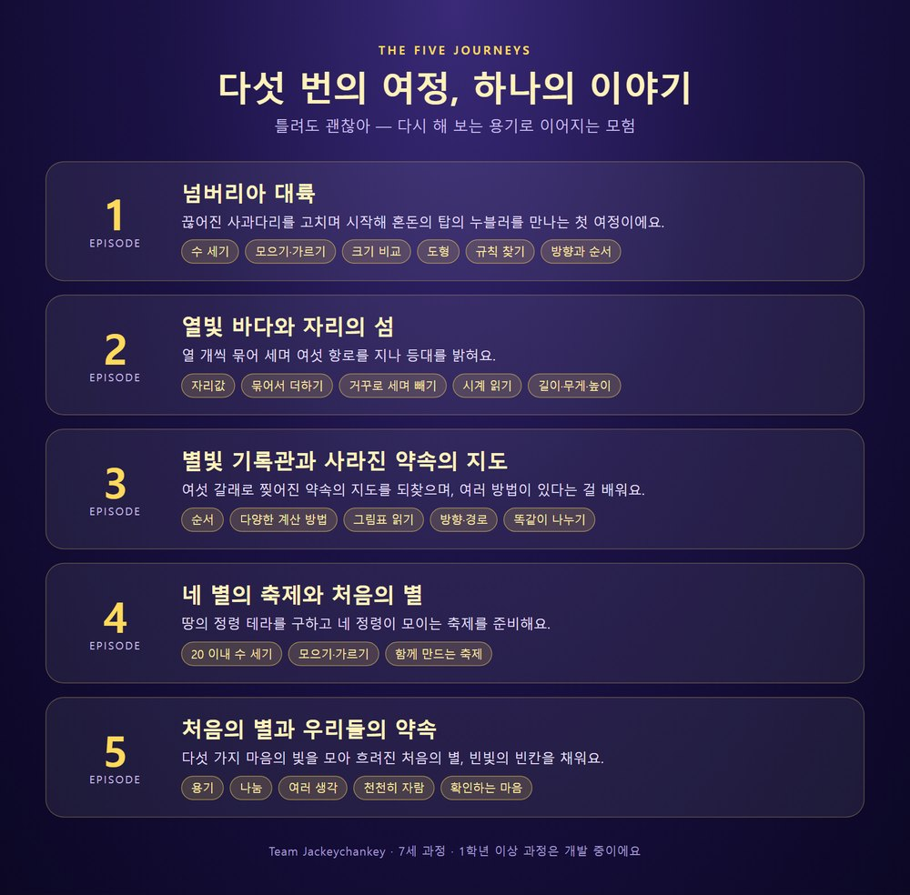

## 펫은 알에서 시작합니다

새싹마을을 무사히 고치면 델타가 수수께끼 알을 건넵니다. 알을 깨우면 6종의 별빛 펫 중 한 마리가 태어나고, 모험에서 모은 별가루로 3단계까지 천천히 자랍니다. 아직 만나지 못한 펫은 도감에 '???'로 숨어 있어서 새 친구를 만나는 두근거림이 남아 있습니다.

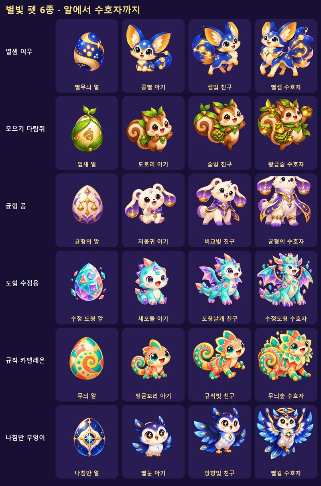

## 만들면서 부딪힌 것들

### ① 소리는 "생성"이 아니라 "합성"이었습니다

화면은 어느 정도 완성됐는데 켜 보면 너무 조용했습니다. AI 음악 생성 서비스를 쓰면 될 줄 알았지만, 실제로는 순수 Node.js 코드로 파형을 직접 그려 WAV를 만드는 방식이었습니다. 오실레이터로 사인파·사각파·삼각파를 만들고, ADSR 엔벨로프를 입히고, 로우패스 필터로 다듬었습니다.

첫 버전을 들려드린 반응은 **"귀가 아프다"** 였습니다. 그 뒤로 정말 여러 번 다시 만들었습니다. 음이 부풀어 오르는 소리가 "피리 같다"는 지적에 소리를 짧게 끊는 플럭 주법으로 바꾸고, BGM과 효과음의 최대 음량을 따로 관리하고, 템포를 68~92bpm에서 88~106bpm으로 올렸습니다.

가장 황당했던 순간도 있습니다. "소리를 껐는데도 계속 들린다"는 제보를 받고 한참 헤맸는데, 원인은 **미리듣기용으로 띄워둔 브라우저 탭**이었습니다. 게임에서는 이미 꺼져 있었는데 테스트 탭이 계속 재생하고 있었던 것입니다.

### ② 스마트폰 화면에서 140페이지가 잘려 있었습니다

"83페이지에 이미지가 잘려 나온다"는 제보로 시작해, 결국 **140개 화면을 자동으로 넘기며 화면 높이를 넘치는 곳을 찾는 스크립트**를 만들었습니다. 결과는 예상보다 심각했습니다.

- 스테이지 클리어 화면의 대사창이 화면의 **37%**를 차지하고 있었습니다 (20%로 축소).
- 전투 화면은 문제 텍스트 길이가 매번 달라져 어떤 문제가 뽑히느냐에 따라 넘치기도 했습니다.
- 홈 화면의 23픽셀 초과는 세 번 헛다리를 짚은 끝에 범인이 **음소거 버튼**임을 찾았습니다. 스타일을 하나도 주지 않아 기본 버튼 크기만큼 화면을 밀어내고 있었습니다.

총 140페이지 + 전투 화면 29곳을 각 4번씩, **116번 재검증**해 스크롤이 필요한 화면을 0개로 만들었습니다.

### ③ 펫을 처음부터 다시 설계했습니다

아이가 게임을 시작하자마자 펫을 살 수 있으니 등장 타이밍이 어색했습니다. 그래서 **새싹마을 클리어 직후** 전용 화면을 만들어 델타가 수수께끼 알을 건네도록 바꿨습니다. 펫은 상점 랜덤 뽑기로, 추가 뽑기는 하루 한 번으로 제한했고, 별가루는 성장에만 쓰이게 정리했습니다. 아직 못 만난 펫은 이름·종족·그림까지 전부 '???'로 숨겨 스포일러를 없앴습니다.

### ④ 안드로이드 앱으로 만드는 길이 가장 험했습니다

Capacitor로 웹 코드를 앱에 담는 것까지는 빨랐지만, 이 컴퓨터에는 빌드 도구가 전혀 없었습니다. Android Studio에 딸려온 자바가 너무 최신이라 빌드 도구가 거부했고, 윈도우 경로의 역슬래시가 설정 파일에서 특수문자로 해석돼 컴파일이 실패했습니다. 가상 기기는 하드웨어 가상화가 꺼져 있어 부팅조차 되지 않아, 실제 스마트폰을 USB로 연결해 테스트했습니다.

### ⑤ 스토어의 얼굴은 새로 그리지 않았습니다

아이콘·배너·런처 아이콘은 게임 속 마스코트 **델타**를 그대로 활용하고, 코드로 그라디언트 배경과 별 장식을 얹었습니다. 스크린샷은 개발자 도구로 넘기지 않고 **실제 폰에서 진짜 플레이하며** 캡처했습니다. 개발자 도구가 함께 찍히면 지저분해지기 때문입니다.

### ⑥ 아동용 앱은 규칙이 다릅니다

7세 대상 앱은 패밀리 정책을 적용받습니다. 타겟 연령층은 6~8세 하나만 선택하고, 광고는 아동용으로 인증된 네트워크만 써야 하며 맞춤형 광고는 꺼야 합니다. 이 게임은 회원가입·로그인·서버 전송·추적 코드가 없어서 데이터 보안 항목도 단순하게 정리됐습니다.

그리고 **평생 서명 키**를 만들었습니다. 한 번 만들면 이 앱의 신분증 같은 파일이라, 잃어버리면 이후 업데이트가 막힐 수 있습니다. 만든 즉시 키 파일과 비밀번호를 따로 백업했습니다.

## 출시까지의 길

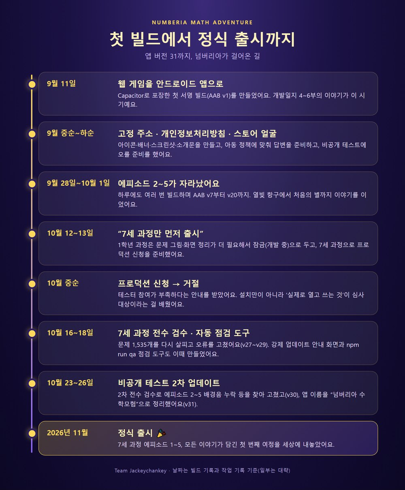

| 시기 | 사건 |
|---|---|
| 9월 11일 | 첫 서명 빌드(AAB v1) 생성 |
| 9월 14~17일 | 고정 주소(Firebase 호스팅), 저장 슬롯 3개 |
| 9월 중순~하순 | 개인정보처리방침·아이콘·배너·스크린샷·소개문, 비공개 테스트 준비 |
| 9월 28일~10월 1일 | 에피소드 2~5 확장 (v7~v20) |
| 10월 12일 | 1학년 과정 전수 점검·수정 (v21~v24) |
| 10월 13일 | **7세 과정만 먼저 출시, 1학년은 잠금** 결정 (v25~v26) |
| 10월 중순 | 프로덕션 신청 → **거절** (테스터 참여 부족) |
| 10월 16일 | 7세 과정 전수 검수·수정 (v27) |
| 10월 18일 | 조사·화면 점검 수정, 강제 업데이트(v29), **점검 도구 제작** |
| 10월 23일 | 2차 전수 검수 — 배경음 누락·조사·대사 화면 (v30) |
| 10월 26일 | 앱 이름 '넘버리아 수학모험'으로 변경 (v31) |
| **10월 30일** | **정식 출시** |

### 9월 말 — 하루에도 몇 번씩 빌드하던 시기

에피소드 2~5의 이야기와 문제가 폭발적으로 자랐습니다. 열빛 항구, 묶음시장, 되돌림 철도, 시계꽃 정원… 구역이 늘 때마다 앱도 다시 빌드했습니다. 9월 28일부터 10월 1일 사이에만 버전이 7에서 20까지 올라갔습니다.

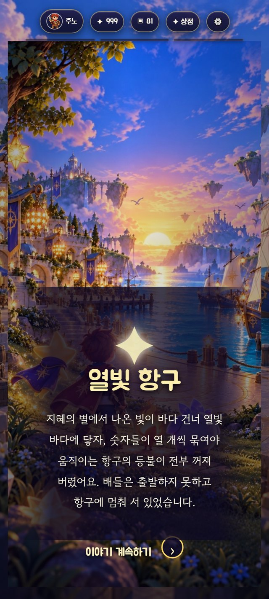

### 10월 중순 — "7세 과정만 먼저 내보내자"

1학년 과정도 만들고 있었지만, 점검해 보니 문제 그림이 빠졌거나 화면이 까맣게 나오는 곳, 그림이 너무 작은 곳이 남아 있었습니다. 그래서 **1학년 과정은 '개발 중이에요'로 잠가 두고, 7세 과정만 먼저 출시**하기로 했습니다. 과정 선택 화면에 잠긴 카드가 그대로 보이도록 해서 다음 과정이 준비되고 있다는 걸 알 수 있게 했습니다.

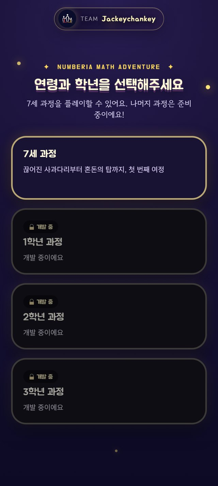

## 비공개 테스트, 그리고 한 번의 거절

새로 만든 개인 개발자 계정은 정식 출시 전에 **테스터 12명이 14일 동안 비공개 테스트에 참여**해야 합니다. 이 요건을 채우고 프로덕션 신청까지 올렸는데, 돌아온 답은 **거절**이었습니다. 이유는 한 줄로 정리됩니다. **테스터들의 참여가 부족하다는 것.**

처음엔 억울했습니다. 숫자는 채웠는데. 하지만 곰곰이 생각해 보니 맞는 지적이었습니다. 설치만 해 두고 앱을 열지 않은 테스터는 '참여'가 아니었고, 테스트 기간에 의견을 받아 고친 흔적(업데이트)도 충분하지 않았습니다.

여기서 배운 것을 정리하면 이렇습니다.

1. **12명 × 14일은 '설치'가 아니라 '참여'입니다.** 앱을 실제로 열고 써야 합니다.
2. **테스트 중에도 계속 업데이트합니다.** 의견을 받아 고친 버전을 테스트 트랙에 올린 기록 자체가 신뢰가 됩니다.
3. 테스터를 모을 때부터 **'며칠에 걸쳐 여러 번 열어 보는 사람'** 을 모으는 게 중요합니다.

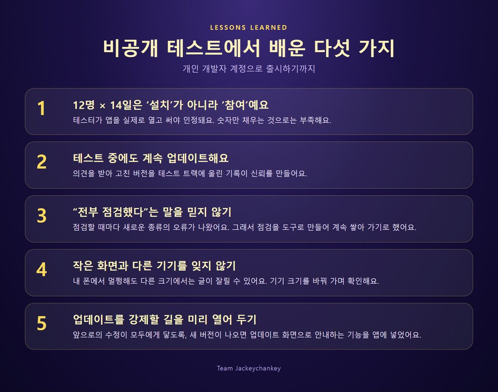

그래서 테스터를 다시 모집하고, 그 기간 동안 **전수 검수 → 수정 → 새 버전 업로드**를 반복했습니다.

## "전부 점검했다"는 말은 믿을 수 없었습니다

매번 "전수 검수했습니다"라고 했는데, 점검할 때마다 **전에 못 봤던 종류의 오류**가 새로 나왔습니다.

- **"정답은 3예요."** 문제를 틀렸을 때 나오는 힌트 문장이 정답 1,508개 중 약 950개에서 받침과 맞지 않았습니다. ("3"은 '삼'이라 받침이 있어서 "3이에요"가 맞습니다.) 문제 데이터의 조사는 고쳤는데, 힌트 문장을 **코드가 조립하는 부분**은 놓쳤습니다.
- **"누블러가 말했습니다"라고 말하는 누블러.** 대사창에 캐릭터 이름표가 붙은 해설 장면인데, 글 속에서는 자기 이름을 3인칭으로 부르고 있었습니다.
- **에피소드 2~5의 대부분이 무음이었습니다.** 구역마다 배경음 파일이 없어서, 보스전·승리 장면 말고는 소리가 나지 않았습니다. 눈으로는 절대 보이지 않고, 어떤 파일을 불러오려다 못 찾았는지를 기록해 보고서야 발견했습니다.
- **작은 폰에서만 잘리는 대사.** 큰 화면에서는 멀쩡한데, 높이가 낮은 화면에서는 긴 해설이 잘리고 '계속하기' 버튼이 화면 밖으로 밀려났습니다.

근본 원인은 분명했습니다. 점검을 매번 그때그때 떠오른 관점으로 새로 만들고, 끝나면 지워 버렸습니다. 그래서 **점검을 도구로 남기기로** 했습니다.

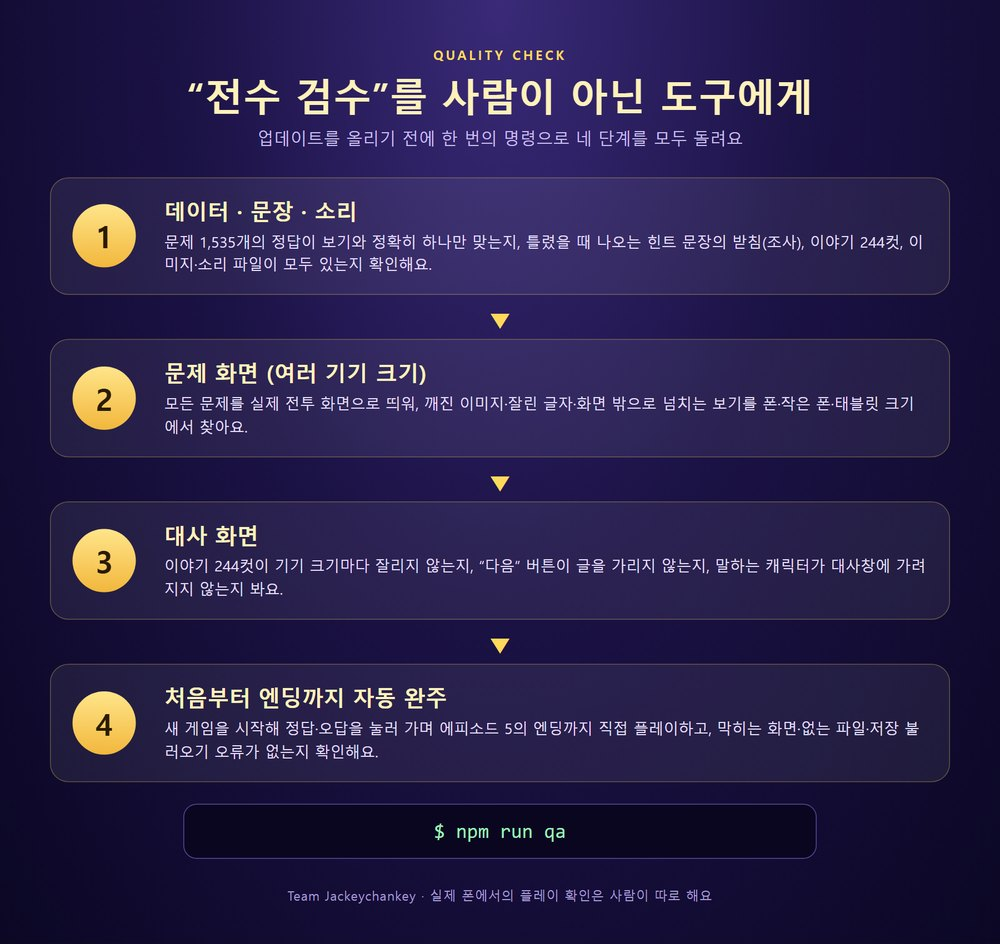

이제 업데이트를 올리기 전에 `npm run qa` 한 줄이면,

1. 문제 1,535개의 정답·힌트 문장·조사·소리 파일을 확인하고
2. 모든 문제를 폰·작은 폰·태블릿 크기로 띄워 깨짐을 찾고
3. 이야기 244컷이 기기 크기마다 잘리지 않는지 보고
4. 새 게임을 시작해 **엔딩까지 직접 플레이**하면서 막히는 곳·없는 파일을 찾습니다.

한 번에 보는 양이 문제 화면 6,140건, 대사 244컷 × 5가지 크기, 이미지 약 5만 장입니다.

물론 이 도구가 모든 걸 잡아 주지는 않습니다. 문장이 자연스러운지, 실제 폰에서의 터치감과 소리 같은 건 여전히 사람이 직접 봐야 합니다. 대신 **한 번 겪은 실수는 다시 겪지 않도록** 점검 항목에 계속 추가하고 있습니다.

## 업데이트를 강제할 수 있게

테스터에게 계속 새 버전을 배포하다 보니 "옛날 버전을 쓰는 사람에게도 수정이 닿으려면?" 하는 고민이 생겼습니다. 그래서 앱을 켤 때 **플레이스토어에 새 버전이 있으면 안내 화면을 띄우고, 업데이트 전에는 게임으로 들어가지 못하게** 하는 기능을 넣었습니다. 플레이 도중에는 막지 않습니다 — 진행을 직접 저장하는 방식이라, 갑자기 막으면 저장하지 못한 진행이 사라질 수 있기 때문입니다.

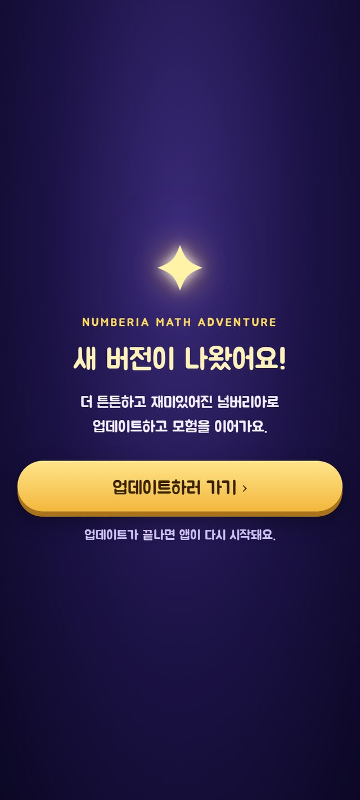

## 앱 이름에 '수학모험'을 넣기까지

스마트폰 앱 목록에는 처음에 "넘버리아 대륙"만 표시됐습니다. 수학 게임이라는 게 안 보이니 아쉬웠습니다. 그렇다고 긴 이름을 그대로 쓰면 목록에서 뒷부분이 잘립니다. 그래서 **목록에 보이는 이름은 "넘버리아 수학모험", 스토어 제목은 더 길게** 쓰는 것으로 정리했습니다. 앱 이름은 하나가 아니라 '목록에 보이는 이름'과 '스토어에 보이는 이름'이 따로 있다는 걸 이번에 처음 제대로 알았습니다.

## 이 게임은 AI와 함께 만들었습니다

코드 작성과 검수 자동화는 **Claude Code**(Anthropic)와 함께, 게임 속 그림은 이미지 생성 AI(**Codex**)에 지시서를 써서 만들었습니다. 사람은 "무엇을 만들지, 아이에게 어떤 이야기를 건넬지"를 정하고, AI는 그걸 빠르게 형태로 만들었습니다.

다만 **AI가 "다 점검했다"고 말해도 그대로 믿으면 안 된다**는 것도 이번에 배웠습니다. 그래서 점검을 도구로 남겨 두었습니다.

**기술 스택:** React · Capacitor · Firebase Hosting · Node.js(사운드 합성) · Android SDK
**앱 버전:** versionCode 31 · AAB 약 146MB · 저장 슬롯 3개 · 배경음악 20곡 · 효과음 21종

## 앞으로

- 지금은 **7세 과정**이 열려 있고, 1학년 이상 과정은 개발 중입니다. 준비되면 업데이트로 엽니다.
- 에피소드 2~5는 아직 구역 전용 배경음이 없어서 다른 곡으로 대신하고 있습니다. 곡을 더 채워 넣을 계획입니다.
- 테스트와 후기를 받으며 계속 다듬어 갑니다.

혼자 시작한 작은 프로토타입이 31번의 빌드를 거쳐 아이들이 직접 손에 쥘 수 있는 앱이 되었습니다.

아이와 함께 넘버리아 대륙을 여행해 보세요. 틀려도 괜찮은 모험이 기다리고 있습니다. 🌟

- 📱 **플레이스토어:** [넘버리아 대륙: 수학모험 이야기](https://play.google.com/store/apps/details?id=com.jackeychankey.numberia)
- 🌐 **웹 버전:** [numberia.web.app](https://numberia.web.app/)
- 💌 **후기·의견:** [tlawhdwn1@naver.com](mailto:tlawhdwn1@naver.com)
