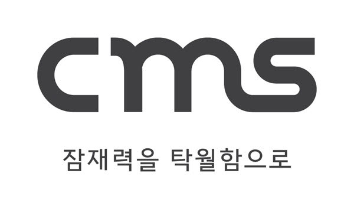
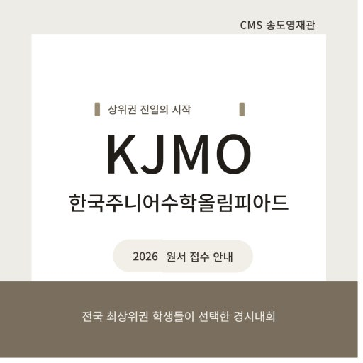

# [속보] 크레버스 CMS영재관, 2026 KJMO 입상자 424명 — 전년 대비 43% 증가

교육기업 **크레버스(CREVERSE)** 가 운영하는 **CMS영재관**이 **2026 한국주니어수학올림피아드(KJMO)** 에서 수강생 **424명**을 입상시키며 전년 대비 **약 43%** 늘어난 실적을 냈습니다. 2026년 11월 5일 발표되고 이데일리가 11월 6일 오후 2시 8분 보도한 내용으로, 같은 주제의 공지가 크레버스 공식 홈페이지 공지사항에도 **"[CMS영재관] 2026 KJMO 424명 수상!"** 이라는 제목으로 올라와 있습니다.

*▲ 2026 KJMO 입상 실적을 발표한 크레버스 CMS영재관 (이미지: 이데일리 보도자료, CMS 제공)*

사고력수학 시장에서 경시대회 성적은 단순한 자랑거리가 아닙니다. 초등 고학년부터 중등까지 이어지는 **경시·심화 트랙의 학습 성과를 가장 객관적으로 보여주는 지표**이자, 학부모가 학원 선택을 할 때 실제로 확인하는 숫자입니다. 올해 CMS의 숫자는 그 지표에서 뚜렷한 반등을 만들었습니다.

## 1. 숫자로 본 2026 KJMO 성적

입상 규모는 **424명**입니다. 지난해 297명과 비교하면 **127명 늘어난 규모로 약 43% 증가**했습니다. 등급별로는 금상 30명, 은상 56명, 동상 101명, 장려상 237명으로 집계됐고, **동상 이상 수상자는 187명**입니다. 여기에 **전국 1위 수상자**도 배출했습니다.

| 구분 | 2026 KJMO 실적 |
|:---|:---|
| 총 입상자 | **424명** (전년 297명 → +127명, 약 43%↑) |
| 금상 | 30명 |
| 은상 | 56명 |
| 동상 | 101명 |
| 장려상 | 237명 |
| 동상 이상 | **187명** |
| 특이 실적 | **전국 1위 수상자 배출** |
| 집계 기준 | 2026년 10월 20일 / CMS 3개월 이상 수강생 |

주의해서 볼 부분은 **집계 기준일**입니다. 2026년 10월 20일 기준, CMS에서 **3개월 이상 수강한 학생**만 포함한 숫자입니다. 단기 특강생이나 등록 직후 응시생이 섞이지 않았다는 뜻이어서, 실적의 밀도는 비교적 높게 읽힙니다.

## 2. 4년 치 추이 — 3년 연속 증가에서 '점프'로

올해 숫자가 의미 있는 이유는 **증가의 기울기**가 달라졌기 때문입니다. 2023년 242명에서 2024년 285명, 2025년 297명으로 완만하게 늘던 흐름이 올해 424명으로 한 번에 뛰었습니다.

| 연도 | KJMO 입상자 | 전년 대비 |
|:---|:---|:---|
| 2023 | 242명 | — |
| 2024 | 285명 | +43명 (약 18%) |
| 2025 | 297명 | +12명 (약 4%) |
| 2026 | **424명** | **+127명 (약 43%)** |

2024년과 2025년 증가 폭이 각각 43명, 12명이었던 것과 비교하면, 올해 증가분 127명은 이전 두 해를 합친 것보다 큽니다. 경시 트랙을 운영하는 입장에서 이런 계단식 상승은 **특정 학년의 우연한 유입**보다 **과정 자체가 정착했을 때** 나타나는 패턴에 가깝습니다.

## 3. KJMO는 어떤 시험인가

KJMO는 **대한수학회가 주최**하는 수학 경시대회입니다. 해당 연도에 **만 13세가 되는 중학교 1학년 이하** 학생이 대상이며, 출제 범위는 **초등학교 전 과정과 중학교 1학년 과정**입니다. **120분 동안 단답형 20문항**을 푸는 방식으로, 서술형이 아닌 단답형이라 계산 정확도와 시간 배분이 당락을 가릅니다.

2026년 대회는 **8월 29일**에 치러졌습니다. 초등 고학년이 중1 과정까지 포함한 범위를 20문항으로 압축해 풀어야 하므로, 기본 개념을 아는 것만으로는 부족하고 **유형별 속도 훈련**이 필수인 시험입니다. 그래서 KJMO 성적은 곧 그 학원의 심화·경시 커리큘럼이 실제로 작동하는지를 보여주는 지표로 읽힙니다.

## 4. 같은 해 KMO에서도 348명 — 금상의 39%가 CMS

KJMO 못지않게 눈에 띄는 것은 상위 대회 실적입니다. 지난 **5월에 열린 2026 한국수학올림피아드(KMO)** 에서도 **CMS 수강생 348명이 입상**했습니다. 2026년 7월 9일 기준 집계입니다.

더 주목할 부분은 비중입니다. CMS에 따르면 **전체 금상 수상자의 39%, 은상 수상자의 41%가 CMS 수강생**으로 집계됐습니다. 상위 등급으로 올라갈수록 특정 교육기관의 점유율이 높아진다는 것은, 그 단계의 학습 설계가 얼마나 정교하게 세분화돼 있는지를 보여주는 대목입니다.

| 대회 | 시기 | CMS 입상자 | 비고 |
|:---|:---|:---|:---|
| 2026 KMO | 2026년 5월 | 348명 | 금상의 39%, 은상의 41% (7/9 기준) |
| 2026 KJMO | 2026년 8월 29일 | 424명 | 금상 30명, 전국 1위 배출 (10/20 기준) |

KJMO가 초등~중1 대상의 관문이라면, KMO는 그 위 단계입니다. 두 대회에서 동시에 규모를 만들었다는 점이 올해 실적의 특징입니다.

## 5. 실적을 만든 다섯 갈래 과정

CMS는 초등 수학 기초부터 경시 심화까지 **다섯 가지 교과 프로그램**을 단계별로 운영합니다. 이 구조를 보면 424명이라는 숫자가 어디서 나왔는지 이해가 됩니다.

| 과정 | 성격 |
|:---|:---|
| **MATHMILE(매쓰마일)** | 초등 수학 기초 — 개념 이해·문제 적용·서술 능력 |
| **FIT** | 오답·오개념 교정, 유형별 성취도 점검, 반복 복습 |
| **GS(그랜드슬램)** | 심화·경시 대비 — 심화 교재, 경시 문항, 서술형 풀이, 전국 단위 모의고사 |
| **GS TOP** | GS 상위 과정 |
| **PL** | 학생별 학습 수준·목표에 따른 개별 진도 관리 |

여기에 **초등 사고력 수학 → KJMO → KMO**로 이어지는 경시 학습 루트가 별도로 있습니다. 경시 기본 이론과 중등 수학 응용·심화, KJMO 기출 학습을 거쳐 **KMO 1차 단답형과 2차 서술형 대비**로 연결되는 구조입니다. 단답형(KJMO)에서 서술형(KMO 2차)으로 넘어가는 구간을 따로 설계해 둔 것이 핵심입니다.

*▲ CMS영재관이 공식 채널에 게시한 2026 KJMO 관련 카드뉴스 이미지 (이미지: CMS영재관 공식 채널)*

## 6. 학부모가 체크할 세 가지

경시 실적 발표를 볼 때 숫자만 보면 판단을 그르치기 쉽습니다. 실사용 관점에서 확인할 지점은 세 가지입니다.

**첫째, 집계 기준을 확인해야 합니다.** 이번 실적은 10월 20일 기준, 3개월 이상 수강생만 포함했습니다. 반대로 "응시생 전원" 또는 "단기 특강 포함"으로 집계한 숫자와는 비교가 되지 않습니다. 학원 실적을 비교할 때는 항상 **분모와 집계 시점**을 먼저 봐야 합니다.

**둘째, 우리 아이의 현재 단계가 어디인지가 먼저입니다.** KJMO는 초등 전 과정과 중1 과정을 포함합니다. 기초 개념이 흔들리는 단계에서 경시반부터 시작하면 오히려 흥미를 잃기 쉽습니다. MATHMILE·FIT 같은 기초·교정 과정을 거쳐 GS·GS TOP으로 올라가는 순서가 일반적입니다.

**셋째, 대회 일정과 학습 계획을 역산해야 합니다.** 2026 KJMO는 8월 29일에 치러졌습니다. 여름방학이 사실상 마지막 준비 구간이었다는 뜻입니다. 다음 대회를 목표로 한다면 **봄학기부터 기출 유형을 돌리는 계획**이 필요합니다.

## 7. 겨울학기 개강과 세미나

참고로 CMS는 **11월 30일부터 대부분의 센터에서 겨울학기를 개강**합니다. 개강일은 센터와 프로그램에 따라 다르며, 각 센터에서는 학부모 대상 **'인뎁스 세미나'** 도 함께 열립니다. 세미나에서는 주요 교육 이슈와 자녀의 학습 유형 분석 방법, 학생별 교육과정을 안내할 예정입니다. 정확한 일정은 CMS영재관 공식 채널과 지역 센터에서 확인할 수 있습니다.

## 정리

2026 KJMO에서 CMS영재관은 **424명 입상, 전년 대비 43% 증가, 전국 1위 배출**이라는 성적표를 냈습니다. 2023년 242명 이후 3년 연속 증가가 올해 큰 폭의 상승으로 이어졌고, 같은 해 KMO에서도 348명이 입상하며 금상의 39%를 차지했습니다.

사고력수학 브랜드들이 저마다 실적을 내놓는 시기입니다. 숫자를 볼 때는 **집계 기준과 분모**, 그리고 **우리 아이가 어느 단계에 있는지**를 함께 놓고 판단하는 것이 안전합니다.

---

**출처**
- 이데일리, 「크레버스 CMS영재관, 2026 KJMO 입상자 424명 배출… 전년 대비 43% 증가」, 2026.11.06 14:08 — [기사 보기](https://www.edaily.co.kr/News/Read?newsId=05208646645643096&mediaCodeNo=257)
- 크레버스 공식 홈페이지 공지사항 「[CMS영재관] 2026 KJMO 424명 수상!」 (2026.11 확인) — [공지 보기](https://creverse.com/)

#크레버스 #CMS영재관 #KJMO #한국주니어수학올림피아드 #KMO #사고력수학 #초등수학 #경시대회 #자녀교육
