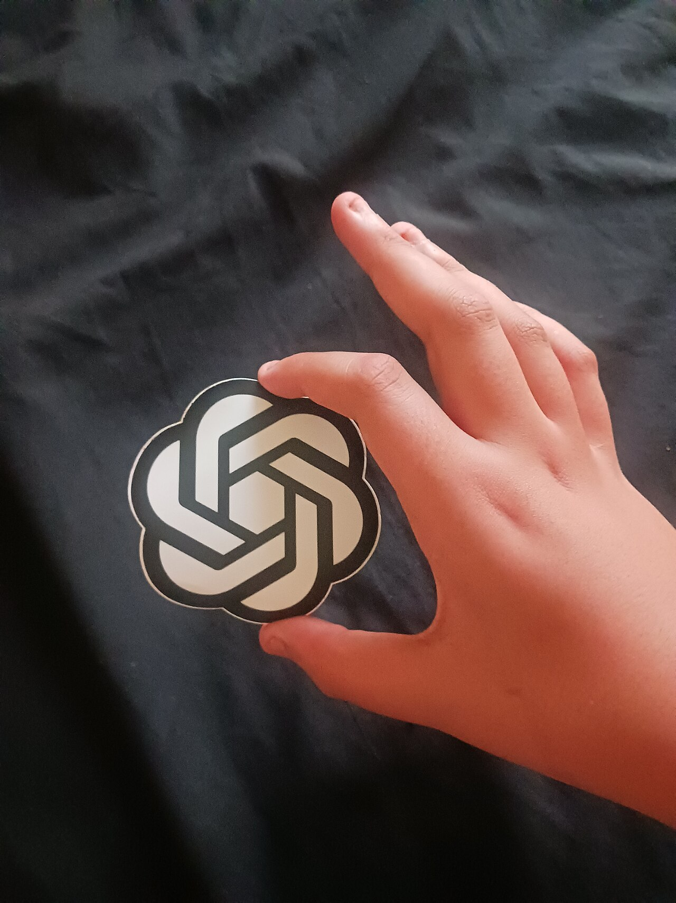

> **📌 한줄 요약:** 2026년 **11월 4일**, OpenAI가 이미지 모델 **Images 2.6**을 **ChatGPT·Codex·API**에 전 세계 동시 출시했습니다. 핵심은 네 가지입니다. ① 생성 속도 **50% 향상**(API에서 품질 low 설정 시 Flare 기준 **최소 6초**), ② **GIF 애니메이션 출력** — 브랜드 마스코트·리액션·밈·애니메이션 스토리보드까지, ③ **마크업(annotation) 기반 정밀 편집**과 **SVG 내보내기**가 API로 확장, ④ 렌더링 전 **계획량(complexity)**을 low·medium·high로 조절하는 파라미터 추가. API 모델은 **GPT-Image-2.6 Flare**(속도·레이아웃)와 **Sunburst**(디테일·편집 일관성) 두 종류이고, **가격은 2.5와 동일**합니다(이미지 출력 100만 토큰당 **$30**, 텍스트 입력 $5, 이미지 입력 $8).

*OpenAI 2025 공식 워드마크 (출처: Wikimedia Commons, 퍼블릭 도메인 / OpenAI 브랜드 가이드)*

배너 하나 수정하려고 프롬프트를 다시 돌렸더니 인물 얼굴과 로고 색이 같이 바뀌어서, 결국 새로 뽑는 쪽을 택하는 경우가 많습니다. 이미지 생성 모델을 실무에 붙여 쓰는 쪽에서 가장 자주 부딪히는 지점이 바로 이 **"고친 부분만 바뀌어야 한다"** 는 조건입니다. 이번 Images 2.6은 그 조건을 API 레벨의 기능(마크업·complexity)으로 끌어올렸고, 동시에 **정지 이미지에 움직임을 붙이는 GIF 출력**까지 같은 엔드포인트에 넣었습니다.

이 글은 **무엇이 바뀌었는지 → 기능별 상세 → 가격과 제약 → 사용자·개발자에게 미치는 영향 → 전망** 순서로 정리했습니다. 모든 수치와 기능 설명은 OpenAI 공식 발표문과 API 문서(이미지 생성 가이드·가격표)를 기준으로 했습니다.

## 이 글을 읽으면 알 수 있는 것

- Images 2.6의 **4가지 핵심 변화** — 속도 50%, GIF, 마크업 편집·SVG, complexity
- **Flare vs Sunburst** — 두 API 모델을 어떤 작업에 골라야 하는지
- GIF 출력의 **실제 스펙과 한계** (프레임 수·재생 시간·미지원 기능)
- **가격표 숫자**와 2.5 대비 달라진 점(그리고 달라지지 않은 점)
- 일반 사용자·개발자·업무 자동화 파이프라인에 각각 어떤 영향이 있는지

## 이슈 요약 — 한 장으로 정리

| 항목 | 내용 |
|:--|:--|
| 무엇을 | 이미지 모델 **Images 2.6** 출시 (ChatGPT·Codex·API 동시) |
| 언제 | **2026년 11월 4일** (공식 발표) |
| 대상 | ChatGPT **전 구독 요금제**, 데스크톱·모바일·웹 / API는 Flare·Sunburst |
| 핵심 변화 | 생성 **50% 빠름**, **GIF** 출력, **마크업 편집**, **SVG** 내보내기, **complexity** 파라미터 |
| API 모델 | `gpt-image-2.6-flare`, `gpt-image-2.6-sunburst` |
| 가격 | **2.5와 동일** — 이미지 출력 $30 / 이미지 입력 $8 / 텍스트 입력 $5 (100만 토큰당) |
| 규모 | ChatGPT·Codex·API 합산 **주당 약 40억 장**, 하루 **5억 장 이상** 생성 |
| 문서 | 기능은 API 가이드, 안전성 평가는 별도 시스템 카드로 공개 |

표에서 눈에 띄는 지점은 **가격이 올라가지 않았다**는 사실입니다. 보통 세대가 바뀌면 출력 단가가 조정되는데, 이번에는 2.5의 단가표를 그대로 유지한 채 기능과 속도만 올렸습니다. 경쟁 모델들이 촘촘히 붙어 있는 이미지 생성 시장에서 가격을 무기로 쓰지 않겠다는 선택으로 읽힙니다.

## 상세 분석 — ① 속도와 Flare·Sunburst 투트랙

OpenAI는 이번 버전이 **기존 대비 50% 빠르게** 이미지를 만든다고 밝혔습니다. API 기준으로는 품질을 `low`로 두고 **Flare**를 쓰면 **6초대**에 한 장이 나옵니다. 반대로 인쇄물·포스터처럼 밀도 높은 결과물이 필요하면 **Sunburst**를 medium·high 품질로 쓰는 구성입니다.

| 모델 | 성격 | 강점 | 어울리는 작업 |
|:--|:--|:--|:--|
| **GPT-Image-2.6 Flare** | 속도형 | 빠른 반복, 낮은 지연 | 초안·대량 변형·포스터/제품컷 **레이아웃** 개선 |
| **GPT-Image-2.6 Sunburst** | 정밀형 | 디테일, 편집 간 **일관성** | 텍스트가 많은 레이아웃, 브랜드 컷, 반복 수정 |

Flare·Sunburst라는 투트랙 자체는 2.5에서 도입된 구조입니다. 이번에 달라진 것은 같은 투트랙 위에서 **속도와 편집 제어가 함께 올라갔다**는 점입니다. 실무에서는 "초안은 Flare, 최종은 Sunburst"처럼 **한 작업 안에서 두 모델을 섞어 쓰는 방식**이 자연스러워집니다.

## 상세 분석 — ② GIF: 정지 이미지에 '루프'를 붙이는 API

이번 버전의 가장 눈에 띄는 변화는 **GIF 애니메이션 출력**입니다. ChatGPT에서 브랜드 마스코트를 움직이거나, 제품 컷을 반복 재생되는 루프로 만들거나, 제작 전 **애니메이션 스토리보드**로 캐릭터 동작을 확인하는 용도로 쓰입니다. 손으로 그린 러프 스케치를 움직이는 캐릭터로 바꾸는 예시도 발표문에 포함됐습니다.

API에서는 `output_format`을 `gif`로 지정하고, 두 개의 파라미터로 결과를 조절합니다.

| 파라미터 | 범위 | 기본값 | 설명 |
|:--|:--|:--|:--|
| `frame_count` | 2~16 프레임 | 9 | 애니메이션 프레임 수 |
| `frame_duration_ms` | 20~2,000ms (10ms 단위) | 200 | 프레임당 재생 시간 |

여기서 중요한 제약이 있습니다. **GIF 출력은 스트리밍·부분 이미지·`output_compression`을 지원하지 않습니다.** 즉 "일단 일부라도 빨리 받아보는" 방식이 안 되고, 완성본을 한 번에 받아야 합니다. 최대 16프레임이라는 상한도 분명히 짚어야 합니다. **영상 생성 모델의 대체재가 아니라, SNS·메신저·랜딩페이지에서 바로 재생되는 짧은 루프를 만드는 도구**로 보는 게 정확합니다.

*OpenAI 아이콘을 든 사용자 (출처: Wikimedia Commons, CC BY 4.0 / FoxTPNL)*

## 상세 분석 — ③ 마크업 편집·SVG·complexity

API 쪽 변화는 "생성"보다 **"수정과 후속 작업"** 에 초점이 맞춰져 있습니다.

- **마크업 기반 편집** — ChatGPT에서 쓰이던 이미지 마크업이 API로 확장됐습니다. 투명 PNG로 표시 레이어를 만들어 바꿀 위치를 지정하고, 프롬프트에 변경 내용을 적으면 해당 영역만 수정됩니다. `POST /v1/images/edits`에서 동작하며, 2.5와 2.6 모델 모두 지원합니다. 표시 레이어와 원본 이미지의 가로·세로 크기가 같아야 하고, 레이어는 반드시 투명 픽셀을 포함해야 합니다.
- **SVG 내보내기** — `output_format: "svg"`로 벡터 결과를 받습니다. 아이콘·일러스트처럼 경로와 색을 편집해야 하는 결과물에 맞습니다. 다만 **`n`은 1만 허용**되고, 스트리밍·부분 이미지·압축 옵션은 지원하지 않습니다. **편집(edits) 엔드포인트에서는 SVG 출력이 안 되고**, SVG를 다시 입력 이미지로 넣는 것도 지원되지 않습니다. 결과물은 스크립트·외부 리소스·내장 래스터가 없는 **정적 벡터 문서**입니다.
- **complexity 파라미터** — 모델이 그리기 전에 **얼마나 계획을 세울지**를 `low`·`medium`·`high`로 조절합니다. 생략하면 두 모델 모두 `high`가 기본입니다. 배경이나 간판만 바꾸는 단순 편집은 `low`가 빠르고, 텍스트가 많고 오브젝트 관계가 복잡한 장면은 `high`가 유리합니다. 대신 복잡도를 올리면 **지연 시간이 늘고 원치 않는 변화가 생길 수 있다**고 문서가 명시합니다. **complexity 조정에는 별도 요금이 없습니다.**

정리하면 이번 업데이트의 성격은 "더 예쁜 그림"이 아니라 **이미지 생성이 파이프라인 안으로 들어오는 것**입니다. 마크업은 수정 요청을 텍스트 설명에서 좌표 지정으로 바꾸고, SVG는 결과물을 디자인 도구로 넘기고, complexity는 지연과 품질의 트레이드오프를 코드로 조절하게 합니다.

## 상세 분석 — ④ 가격: 2.5와 같은 단가표

공식 가격표(100만 토큰당)는 다음과 같습니다.

| 모델 | 입력(이미지) | 입력(텍스트) | 출력 | 캐시 입력(이미지) |
|:--|--:|--:|--:|--:|
| `gpt-image-2.6-sunburst` | $8.00 | $5.00 | $30.00 | $2.00 |
| `gpt-image-2.6-flare` | $8.00 | $5.00 | $30.00 | $2.00 |
| `gpt-image-2.5-sunburst` | $8.00 | $5.00 | $30.00 | $2.00 |
| `gpt-image-2.5-flare` | $8.00 | $5.00 | $30.00 | $2.00 |

2.5와 **완전히 같은 단가**입니다. 여기에 하나 더 눈여겨볼 항목이 **Batch 티어**입니다. 가격표의 Batch 탭에는 `gpt-image-2`와 2.5 모델이 이미지 입력 $4, 출력 $15(정가의 절반)로 적혀 있는데, 이번에 확인한 시점 기준으로 **2.6 모델은 Batch 항목에 아직 올라와 있지 않습니다.** 즉 2.6은 "가격 인하"가 아니라 **"같은 가격에 기능 추가"** 로 요약되고, 대량·비동기 처리를 최저 단가로 돌리는 용도라면 여전히 2 세대나 2.5의 Batch가 선택지로 남습니다.

해상도와 규격도 함께 봐야 합니다. 커스텀 크기는 `1536x864`처럼 `가로x세로` 문자열로 지정하며, **가로·세로 모두 16의 배수**, 종횡비 **1:3~3:1**, 한 변 최대 **3,840px**, 총 픽셀 **655,360~8,294,400(4K)** 범위입니다. **2,560x1,440을 넘는 해상도는 실험적(experimental)** 이라는 단서가 붙습니다. 투명 배경은 `background: "transparent"`와 함께 `png` 또는 `webp`를 써야 합니다.

## 영향 — 사용자·개발자·업무 자동화

**일반 사용자.** Images 2.6은 ChatGPT **전 구독 요금제**에 데스크톱·모바일·웹으로 풀렸습니다. 별도 설정 없이 기존 대화에서 그대로 쓸 수 있고, 체감되는 변화는 두 가지입니다. 생성 대기가 짧아진 점, 그리고 "이 부분만 바꿔줘"라고 요청했을 때 나머지가 덜 흔들리는 점입니다. GIF는 SNS용 짧은 루프나 밈을 만들 때 실용적입니다.

**개발자.** 세 가지가 실무적으로 큽니다. 첫째, **complexity로 지연과 품질을 분리해서 조절**할 수 있습니다. 사용자에게 빠른 미리보기를 보여주고 최종본은 높은 복잡도로 뽑는 2단계 구성이 가능합니다. 둘째, **SVG 출력**으로 아이콘·일러스트를 편집 가능한 자산으로 받아 디자인·퍼블리싱 단계에 바로 넘길 수 있습니다. 셋째, **마크업 편집**으로 "로고 위치만 옮기기" 같은 반복 수정을 프롬프트 재작성 없이 처리할 수 있습니다.

**업무 자동화.** 이미지가 들어가는 업무 흐름은 대체로 ①생성 → ②수정 → ③포맷 변환 → ④검수의 4단계입니다. 이번 업데이트는 ②와 ③을 API 안으로 끌어들였습니다. 예를 들어 상품컷 배경 교체(마크업+complexity low), 배너 문구 영역만 수정(마크업), 아이콘 세트를 SVG로 추출(벡터 출력), SNS용 루프 GIF 생성(프레임 파라미터) 같은 단계가 한 파이프라인에서 처리됩니다. 다만 **검수 단계는 줄지 않습니다.** 생성량이 주당 40억 장 규모로 커진 만큼, 사람이 확인해야 할 지점을 어떻게 좁힐지가 자동화 설계의 핵심이 됩니다.

## 한계와 주의점

- **GIF는 짧은 루프 전용** — 최대 16프레임, 프레임당 20~2,000ms. 스트리밍·부분 이미지·압축 옵션 미지원. 긴 영상이 필요하면 영상 모델을 써야 합니다.
- **SVG는 정적 벡터** — 편집 엔드포인트에서 출력 불가, `n=1`만 허용, SVG를 입력 이미지로 재투입하는 것도 불가. 스크립트·외부 리소스·내장 래스터 없음.
- **고해상도는 아직 실험적** — 2,560x1,440 초과 구간은 실험 단계로 표시돼 있습니다. 인쇄용 대형 출력은 별도 검증이 필요합니다.
- **텍스트·브랜드 일관성은 여전히 검수 대상** — 편집 일관성이 좋아졌다는 설명은 2.5 대비 상대적 개선입니다. 로고·폰트·법정 고지 문구처럼 정확도가 중요한 요소는 사람이 확인해야 합니다.
- **저작권·초상권·표시 의무** — GIF와 마크업 편집으로 특정 인물·캐릭터·브랜드 자산을 다루는 경우, 사용 권한과 AI 생성물 표시 정책을 함께 확인해야 합니다. 안전성 평가와 보호 장치는 별도 시스템 카드로 공개돼 있습니다.

## 전망 — 8주 주기로 좁혀진 이미지 모델 릴리스

2.5가 9월 8일, 2.6이 11월 4일이니 **약 8주** 간격입니다. 텍스트 모델이 6.x대로 올라서며 릴리스 주기가 짧아진 것과 같은 흐름이 이미지 쪽에도 나타난 셈입니다. 앞으로 볼 지점은 세 가지입니다.

1. **GIF의 확장** — 프레임 수·길이 제한이 풀리면 정지 이미지·GIF·영상의 경계가 흐려집니다. 반대로 지금의 제한이 유지되면 GIF는 SNS용 루프에 머뭅니다.
2. **편집 API의 정교화** — 마크업과 complexity가 결합하면 "여기만, 이 정도 계획으로" 수준의 제어가 가능해집니다. 에이전트가 이미지 수정을 스스로 반복하는 구조와 궁합이 좋습니다.
3. **가격 경쟁** — 2.6이 2.5와 같은 단가를 유지한 것은 경쟁 모델을 의식한 선택으로 보입니다. 다음 세대에서 단가가 내려갈지, 아니면 상위 티어가 분리될지가 관전 포인트입니다.

## 정리 — 이런 경우에 특히 유용합니다

- 배너·상품컷을 **자주 고치지만 나머지는 그대로 두고 싶은** 경우
- 아이콘·일러스트를 **편집 가능한 벡터**로 받아 디자인 작업에 넘겨야 하는 경우
- SNS·메신저용 **짧은 루프 이미지**가 필요하지만 영상 제작까지는 부담스러운 경우
- 이미지 생성 단계를 **업무 파이프라인에 넣고**, 지연·비용·품질을 코드로 조절하려는 경우

반대로 인쇄용 초고해상도 결과물이나 긴 영상이 목적이라면 이번 업데이트보다 다른 도구를 먼저 검토하는 편이 낫습니다. 같은 가격에 기능이 늘어난 업데이트이니, 이미 2.5를 쓰고 있는 파이프라인이라면 **모델 ID만 바꿔 A/B 비교**부터 해보는 것이 가장 빠른 판단 방법입니다.
