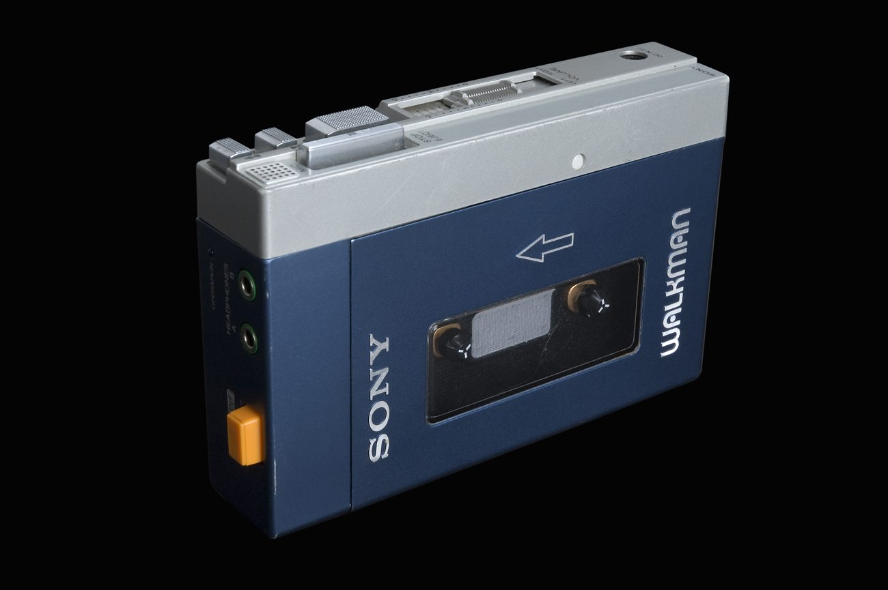
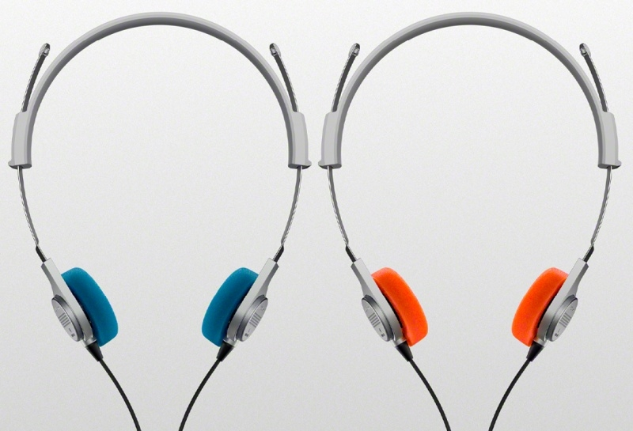
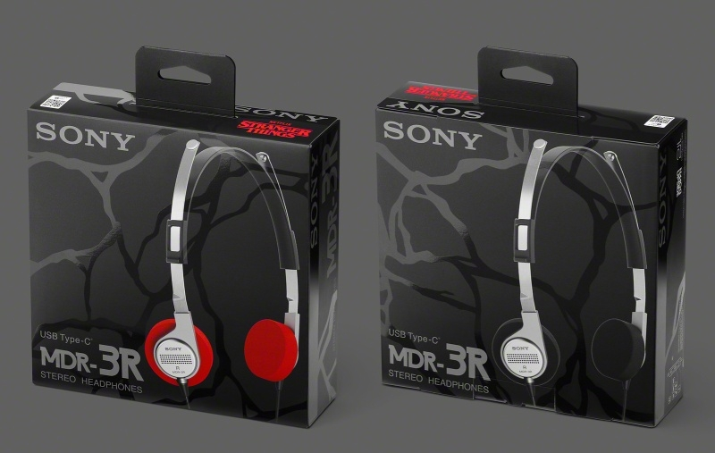

*소니 MDR-3R — 1979년 워크맨 TPS-L2에 동봉됐던 MDR-3의 디자인을 그대로 계승한 USB-C 유선 헤드폰입니다 (출처: Sony)*

> **📌 한줄 요약:** 소니가 **1979년 워크맨 TPS-L2와 함께 나온 MDR-3**를 현대식으로 다시 만들었습니다. 이름은 **MDR-3R**, 가격은 **8만 9,000원(미국 60달러·영국 49파운드)** 입니다. **23mm 드라이버와 38g 오픈형 구조**는 원형 그대로이고, 바뀐 건 **3.5mm 대신 USB-C 단자**, **마이크·3버튼 인라인 리모컨**, **블루·오렌지 이어패드 2세트 기본 제공**입니다. 블루투스도 배터리도 노이즈캔슬링도 없습니다. 그런데도 화제인 이유는 **유선으로 돌아가는 흐름**과 **8만 원대 가격**이 맞물렸기 때문입니다.

---

## 이 글에서 확인할 수 있는 것

- 1979년 MDR-3가 지금 다시 나온 배경
- 원형에서 그대로 가져온 부분과 2026년식으로 바뀐 부분
- 23mm 오픈형 드라이버가 실제로 어떤 소리·착용감을 만드는지
- USB-C 유선과 3.5mm 유선, 무선 노이즈캔슬링의 실사용 차이
- 스트레인저 싱스 에디션과 국내외 가격 정리
- 사면 좋은 경우와 오히려 손해인 경우
- 솔직히 아쉬운 점 4가지

---

## 1. 50년 된 헤드폰이 2026년에 다시 나온 이유

1979년 소니가 휴대용 카세트 플레이어 **TPS-L2**를 내놓았을 때, 상자 안에는 **MDR-3**라는 헤드폰이 같이 들어 있었습니다. 지금 기준으로 보면 아주 단순한 온이어(귀에 얹는) 타입이지만, 당시에는 **"음악을 밖으로 들고 나간다"** 는 개념 자체가 이 조합으로 완성됐습니다.

소니가 이번에 내놓은 **MDR-3R**은 그 헤드폰을 그대로 복각한 제품입니다. 이름 끝의 R은 '리바이벌(revival)' 성격을 담은 것으로 보입니다. 소니코리아는 **11월 6일** 국내 출시를 알렸고, 가격은 **8만 9,000원**입니다.

이 제품이 단순한 복고 마케팅으로 끝나지 않는 이유는 시장 흐름과 맞물려 있기 때문입니다.

- **유선으로 돌아가는 수요** — 무선 이어폰의 배터리 수명·분실·페어링 스트레스에서 벗어나려는 사용자가 늘었습니다.
- **레트로 디자인 선호** — 카세트, 필름 카메라, 기계식 키보드처럼 '아날로그 감성'이 젊은 층에서 다시 소비되고 있습니다.
- **가격** — 8만 원대는 소니 무선 헤드폰 라인업의 절반 이하입니다.

즉 **"감성 + 실용 + 가격"** 세 가지가 겹친 제품입니다. 복각 제품은 보통 비싸게 나오는데, 이건 오히려 저가형 무선 이어폰과 비슷한 가격대라는 점이 이례적입니다.

*MDR-3R의 원형이 된 1979년산 소니 워크맨 TPS-L2. 이 플레이어에 MDR-3 헤드폰이 동봉됐습니다 (출처: Wikimedia Commons, Anna Gerdén / Tekniska museet, CC BY-SA 3.0)*

---

## 2. 그대로 둔 것과 바꾼 것

복각 제품을 볼 때 가장 중요한 건 **"어디까지 원형이고, 어디부터 신형인가"** 입니다. MDR-3R은 이 경계가 꽤 명확합니다.

| 항목 | 내용 |
|:---|:---|
| 형태 | 온이어(귀에 얹는) 오픈형 |
| 드라이버 | 23mm 다이내믹 (원형 MDR-3와 동일 사양) |
| 무게 | 약 38g |
| 연결 | USB-C 유선 (3.5mm 단자 없음) |
| 조작 | 케이블 인라인 3버튼 리모컨 + 내장 마이크 |
| 이어패드 | 아이코닉 블루·오렌지 2세트 동봉, 교체 가능 |
| 소재 | 플라스틱의 약 25% 재활용 소재, 포장재 플라스틱 미사용 |
| 무선 기능 | 없음 (블루투스·배터리·노이즈캔슬링 모두 미탑재) |
| 방수 | 공식 IP 등급 없음 |
| 국내 가격 | 8만 9,000원 |

### 그대로 가져온 것
원형 도면을 기준으로 **23mm 드라이버를 그대로 재설계**했습니다. 소니 설명에 따르면 원래의 음색 성향을 유지하면서 **주파수 범위를 넓히고 저역을 다듬는** 방향으로 손봤습니다. 하우징에 뚫린 **'사운드 홀'** 도 그대로여서, 이 제품은 최신 제품인데도 **개방형(오픈백)** 입니다. 패키지와 사용 설명서 디자인까지 초기 모델을 따랐다는 점도 복각 제품으로서는 상당히 공을 들인 부분입니다.

### 바꾼 것
가장 큰 변화는 단자입니다. **3.5mm 이어폰 잭이 사라지고 USB-C 케이블이 달렸습니다.** 케이블에는 **마이크와 3버튼 리모컨**이 들어가서 재생·일시정지, 곡 넘김, 볼륨 조절, 통화, 음성 비서 호출까지 됩니다. 요즘 스마트폰에 3.5mm 단자가 없는 상황을 생각하면 합리적인 선택입니다.

*38g의 가는 메탈 밴드와 각진 힌지 구조까지 원형의 실루엣을 유지했습니다 (출처: Sony)*

---

## 3. 23mm 오픈형, 실제로 어떤 소리인가

숫자만 보면 23mm는 요즘 무선 이어폰의 10~11mm 드라이버보다 큽니다. 하지만 **크기가 소리의 질을 결정하지는 않습니다.** 온이어 오픈형이라는 구조 자체가 결과를 크게 좌우합니다.

**① 공간감은 유리하고, 저음은 불리합니다.**
귀를 완전히 막지 않으니 무대가 넓게 느껴지고 보컬이 답답하지 않습니다. 대신 밀폐형처럼 귀를 압박해 저음을 밀어넣는 구조가 아니라서, **웅장한 저역이 필요한 장르에서는 힘이 빠져 보일 수 있습니다.** 소니도 저역을 보강했다고는 하지만, 물리적으로 밀폐형과 같은 양감을 내기는 어렵습니다.

**② 소리가 밖으로 샙니다.**
오픈형의 숙명입니다. 소니는 누음이 "심하지는 않다"는 입장이지만, **조용한 사무실이나 도서관, 만원 지하철**에서는 옆 사람이 들을 수 있습니다. 반대로 **주변 소리가 그대로 들려오기** 때문에 길을 걸으면서 음악을 들을 때는 오히려 안전한 면이 있습니다.

**③ 38g은 확실한 강점입니다.**
무선 온이어 헤드폰이 보통 150~250g인 것과 비교하면 **4분의 1 수준**입니다. 안경을 쓰거나 머리카락이 많아 정수리 압박이 신경 쓰이는 경우, 이 무게 차이는 오래 쓸수록 크게 체감됩니다. 다만 밴드가 얇은 만큼 **머리 크기에 따라 압박 위치가 달라질 수 있습니다.**

*이어컵 안쪽의 사운드 홀 구조. 원형처럼 귀를 덮지 않는 오픈형 방식입니다 (출처: Sony)*

---

## 4. USB-C 유선 vs 3.5mm 유선 vs 무선, 무엇이 다른가

"요즘 무선 쓰는데 굳이 유선?"이라는 질문이 가장 많이 나옵니다. 세 방식의 차이를 실사용 기준으로 정리하면 이렇습니다.

| 구분 | MDR-3R (USB-C 유선) | 3.5mm 유선 | 무선 (블루투스) |
|:---|:---|:---|:---|
| 충전 | 불필요 | 불필요 | 필요 (기기별 5~40시간) |
| 페어링 | 불필요 | 불필요 | 최초 1회 필요 |
| 지연 | 없음 | 없음 | 코덱·기기별 편차 |
| 음질 상한 | 케이블·기기 DAC에 좌우 | 케이블·기기 DAC에 좌우 | 코덱 대역폭에 좌우 |
| 호환 | USB-C 단자 기기 | 3.5mm 단자 기기 | 블루투스 기기 |
| 이동 중 편의 | 케이블 있음 | 케이블 있음 | 가장 편함 |
| 노이즈캔슬링 | 없음 | 없음 | 기기별 지원 |

### USB-C 유선의 장점
- **충전을 신경 쓰지 않습니다.** 아침에 배터리 확인할 일이 없습니다.
- **페어링이 없습니다.** 꽂으면 바로 소리가 납니다.
- **지연이 사실상 없습니다.** 영상 편집, 리듬 게임, 악기 모니터링처럼 타이밍이 중요한 작업에서 유리합니다.

### USB-C 유선의 제약
- **3.5mm 단자 기기에는 못 씁니다.** 데스크톱 PC의 오디오 잭, 일부 카메라, 구형 MP3 플레이어, 항공기 좌석 오디오에는 그대로 꽂을 수 없습니다. 별도 USB-C 오디오 출력이 있는 기기여야 합니다.
- **라이트닝 단자 아이폰에는 직결되지 않습니다.** USB-C로 바뀐 아이폰 15 이후 모델부터 바로 쓸 수 있습니다.
- **USB-C 포트가 하나뿐인 노트북**에서는 충전과 동시에 쓰기 어렵습니다.

한 가지 더 짚으면, USB-C 유선 헤드폰은 **기기 쪽 오디오 출력 방식에 영향을 받습니다.** 같은 제품이라도 연결한 스마트폰·노트북에 따라 음량 상한과 음색이 달라질 수 있어서, 매장에서 자신의 기기로 들어보는 편이 안전합니다.

---

## 5. 스트레인저 싱스 에디션과 가격

소니는 일반판과 별도로 **스트레인저 싱스 리미티드 에디션**도 내놓습니다. 블랙 밴드에 로고를 각인하고, 이어패드를 레드·블랙 조합으로 바꾼 모델입니다. 드라마 속 캐릭터와 '업사이드 다운' 분위기에서 착안했다는 설명입니다.

가격은 다음과 같습니다.

| 모델 | 국내 가격 | 해외 가격 |
|:---|:---|:---|
| MDR-3R 일반판 | 8만 9,000원 | 60달러 / 59유로 / 49파운드 / 89.95호주달러 |
| MDR-3R 스트레인저 싱스 에디션 | 국내 출시 미정 | 80달러 / 69유로 / 59파운드 / 99.95호주달러 |

일반판과 에디션의 차이는 **색상과 각인뿐**이고, 드라이버·구조·케이블은 같습니다. 국내에서는 일반판이 먼저 풀리고, 에디션은 추후 결정될 가능성이 큽니다. 해외 직구를 고려한다면 배송비와 관부가세를 포함해 계산해야 합니다. 8만 원대 제품은 **미국 200달러 면세 한도** 안에 들어가지만, 유럽발 구매는 부가세가 붙을 수 있습니다.

*이어패드를 교체해 색을 바꿀 수 있고, 스트레인저 싱스 에디션은 블랙·레드 조합으로 나옵니다 (출처: Sony)*

---

## 6. 이런 경우 추천, 이런 경우 비추천

### 추천하는 경우
- **무선 이어폰 배터리와 분실에 지친 경우** — 충전·페어링이 없는 유선은 관리 포인트가 거의 없습니다.
- **영상 편집·게임·악기 연주처럼 지연이 민감한 작업** — 유선의 가장 확실한 장점입니다.
- **온이어 착용이 편한 경우** — 커널형 이어폰이 귀에 안 맞거나, 오래 끼면 아픈 사람에게 38g 온이어는 부담이 적습니다.
- **레트로 디자인을 좋아하는 경우** — 이 제품의 절반은 디자인 값입니다. 그 감성이 값어치 있다면 8만 9,000원은 합리적입니다.

### 비추천하는 경우
- **출퇴근 지하철·비행기에서 음악에 집중하고 싶은 경우** — 노이즈캔슬링이 없고 오픈형이라 주변 소리가 그대로 들어옵니다.
- **저음 위주의 음악을 크게 듣는 경우** — 밀폐형 무선 헤드폰과 비교하면 양감이 부족합니다.
- **통화 품질이 중요한 경우** — 마이크가 있지만 케이블형 온이어의 통화 성능은 무선 이어폰의 빔포밍 마이크와 다릅니다. 조용한 실내 통화 정도로 기대하는 편이 맞습니다.
- **USB-C 오디오 출력이 없는 기기만 쓰는 경우** — 3.5mm 잭밖에 없는 환경이라면 어댑터가 필요합니다.

---

## 7. 솔직히 아쉬운 점

**① 3.5mm 단자가 아예 없다.**
복각 제품이라면 오히려 3.5mm가 어울립니다. USB-C만 지원하면서 **"유선의 보편성"** 이라는 장점을 일부 포기한 셈입니다. USB-Cto 3.5mm 젠더를 물리면 되지만, 그 순간 케이블이 하나 더 늘어납니다.

**② 오픈형은 장소를 가린다.**
소니가 "누음이 심하지 않다"고 해도, 실제로는 **조용한 환경에서 옆 사람이 들을 수 있는 수준**입니다. 카페·도서관·야간 기차에서는 볼륨을 낮추게 됩니다.

**③ 노이즈캔슬링 부재는 가격으로 납득해야 한다.**
8만 9,000원에 ANC를 기대하는 건 무리입니다. 다만 같은 가격대의 무선 이어폰에는 ANC가 들어가는 경우가 많아서, **"무선 + ANC + 충전"을 원한다면 이 제품은 답이 아닙니다.**

**④ 이어패드 교체는 되지만 소모품이다.**
폼 패드는 시간이 지나면 눌리고 땀이 배기 쉽습니다. 교체용 패드를 별도로 구할 수 있는지는 국내 출시 시점에 확인이 필요합니다. 2세트가 기본 포함된 건 이 부분을 고려한 구성으로 보입니다.

---

## 8. 총평 — 8만 9천 원에 '감성'과 '무충전'을 함께 사는 선택

MDR-3R은 성능으로 승부하는 제품이 아닙니다. **1979년의 디자인을 지금 신발에 맞게 다시 깔아놓은 제품**이고, 그 대가로 **충전·페어링·배터리 걱정이 없는 유선**이라는 실용성을 얻습니다.

정리하면 이렇습니다.

- **디자인과 감성, 무충전 편의**를 8만 원대로 사고 싶다 → 만족도가 높은 선택
- **노이즈캔슬링, 저음, 통화 품질**이 중요하다 → 다른 제품을 봐야 함
- **3.5mm 기기와 함께 쓰고 싶다** → 어댑터 필요, 또는 다른 유선 모델 검토

가성비 좋은 유선 헤드폰을 찾으면서 **"무선 이어폰은 질렸다"** 는 생각이 드는 분들께 추천할 만합니다. 반대로 매일 만원 지하철에서 음악에 파묻히고 싶은 분들께는 권하지 않습니다.

---

## 자주 묻는 질문

**Q. 아이폰에서 바로 쓸 수 있나요?**
USB-C 단자가 있는 아이폰 15 이후 모델은 바로 쓸 수 있습니다. 라이트닝 단자 모델은 별도 어댑터가 필요합니다.

**Q. 블루투스도 되나요?**
되지 않습니다. 순수 유선 제품입니다. 충전과 페어링이 없다는 뜻이기도 합니다.

**Q. 소리는 무선 헤드폰보다 좋은가요?**
같은 가격대의 무선 제품과 비교하면 유리한 부분이 있지만, 절대적인 음질은 착용 상태와 연결 기기에 크게 좌우됩니다. 오픈형 특성상 저음은 밀폐형보다 적습니다.

**Q. 이어패드는 어떻게 교체하나요?**
블루와 오렌지 두 세트가 기본 제공되고, 취향에 따라 바꿔 끼우는 방식입니다. 패키지와 설명서도 원형 디자인을 따랐습니다.

**Q. 국내 출시일은?**
소니코리아가 2026년 11월 6일 출시를 발표했고, 가격은 8만 9,000원입니다. 스트레인저 싱스 에디션의 국내 출시 여부는 아직 공지되지 않았습니다.

---

*참고: 소니코리아 보도자료(2026.11.6), Sony 공식 제품 정보, What Hi-Fi?(2026.11.5), 디지털데일리·머니투데이 보도*
