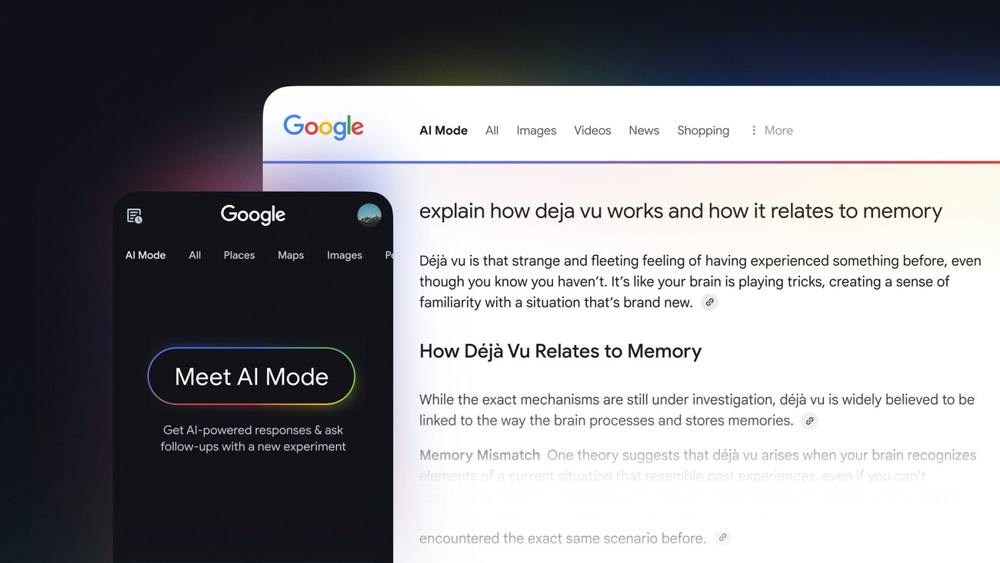
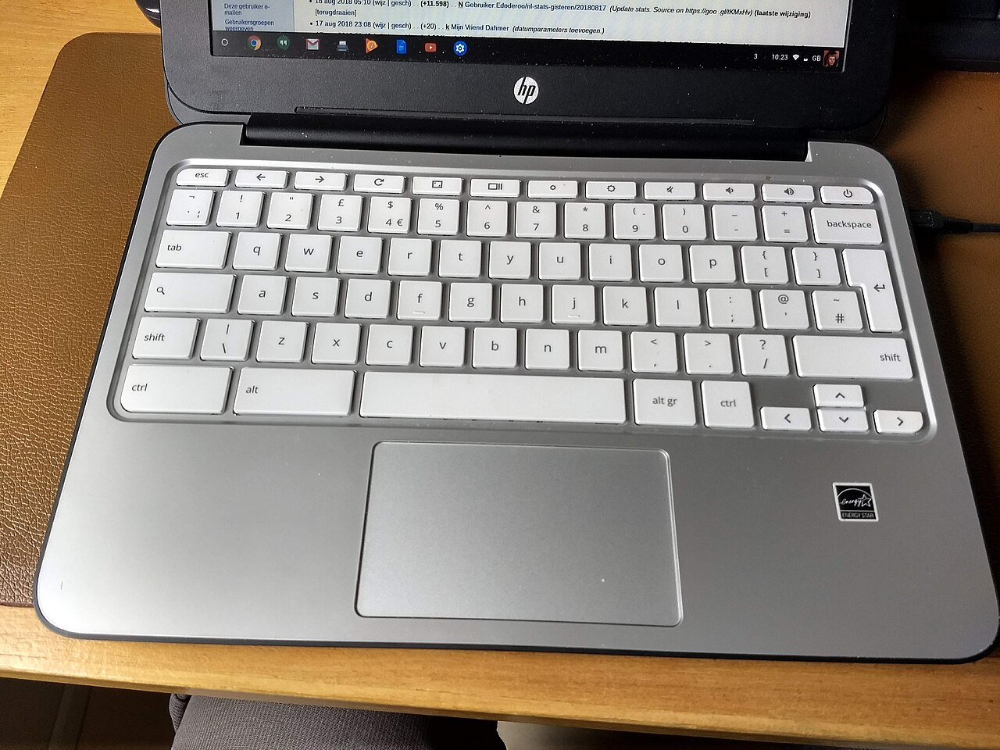

*구글 검색의 AI 모드(AI Mode) 공식 소개 이미지 (출처: Google 공식 블로그)*

> **📌 한 줄 요약:** 2026년 11월 2일(현지), 미국 캘리포니아 법원에 **구글의 AI 검색 기능을 겨냥한 과실 소송**이 접수됐습니다. 핵심은 "학교가 Gemini 앱과 ChatGPT는 막았는데, **구글 검색 안의 AI 모드는 그대로 열려 있었다**"는 점입니다. 생성형 AI를 앱 단위로 차단하는 통제 방식이 실제로는 **검색이라는 우회로**를 남긴다는 사실이 법정 다툼의 쟁점이 됐습니다. 학교든 회사든 "AI 차단" 정책을 세워 둔 조직이라면, 자기 환경에서 같은 구멍이 있는지 확인해 볼 시점입니다.

---

## 무슨 일이 있었나 — 11월 2일 접수된 소장

AFP 통신 보도에 따르면, 13세 여학생의 부모가 2026년 11월 2일(월) 미국 캘리포니아주 법원에 구글을 상대로 소송을 냈습니다. 원고 측 주장의 골자는 이렇습니다.

- 학생은 **학교가 지급한 크롬북**으로 구글 검색을 사용했습니다.
- 학교는 **Gemini 앱과 ChatGPT를 차단**해 둔 상태였습니다.
- 그런데 구글 검색에는 **AI 모드(AI Mode)** 와 AI 개요 같은 생성형 기능이 이미 통합돼 있었고, 이 경로는 막혀 있지 않았습니다.
- 소장은 해당 학생이 정신질환 병력이 없었는데도 검색의 AI 기능을 쓰기 시작한 뒤 **몇 달 만에 심각한 심리적 위기**로 들어갔다고 서술합니다.
- 올해 3월 17일, 학교의 모니터링 소프트웨어가 **'Funeral(장례)'이라는 제목의 문서**를 감지해 부모에게 알렸고, 이후 가족이 개입했다고 합니다.

원고 측 변호인 앤드루 리델(Andrew Liddell)은 AFP에 "구글이 검색에서 AI 모드를 제거하거나, 모든 학생이 AI와 상호작용할 때 항상 안전하다고 보장할 때까지 **학교는 검색을 꺼 두고 계속 꺼 둬야 한다**"는 입장을 밝혔습니다.

> ⚠️ 이 글은 자해·자살과 관련된 민감한 사안을 다룹니다. 사건의 세부 정황은 법정에서 다퉈질 주장 단계이며, 확정된 사실이 아닙니다. 지금 힘든 상황이라면 자살예방상담 **109**(24시간) 또는 정신건강 위기상담 **1577-0199**로 연락할 수 있습니다.

---

## 소장이 파고든 '구조' — 앱은 막았는데 검색은 열려 있었다

이 사건에서 기술적으로 중요한 지점은 **차단의 단위**입니다.

학교 IT 관리자는 보통 "허용 앱 목록"으로 정책을 세웁니다. Gemini 앱은 목록에서 빼면 끝입니다. 그런데 구글 검색은 수업에 필요하니 허용해야 하고, 그 검색 안에는 이미 다음 기능들이 들어가 있습니다.

| 표면 | 차단 난이도 | 실제 통제 지점 |
|:--|:--|:--|
| Gemini 앱·웹 | 낮음 (앱 차단) | 관리 콘솔에서 서비스 OFF |
| Gemini in Classroom | 낮음 | 관리자 설정 |
| **검색의 AI 모드·AI 개요** | **높음** | 검색 자체를 끄지 않는 한 분리 불가 |
| 서드파티 챗봇(ChatGPT 등) | 중간 | URL 필터링 |

*학교에 보급되는 대표적인 크롬북 기기(HP 11 G2 Chromebook). 사진: Edoderoo, CC BY-SA 4.0, Wikimedia Commons*

구글 역시 이 구조를 부정하지 않습니다. 11월 초 영국 가디언은 "구글은 AI 없이 검색을 쓰는 방법이 없다고 말한다"는 제목으로, **검색과 생성형 AI가 이미 분리되지 않는 상태**라는 구글의 설명을 전했습니다. 지난 11월 3일 구글이 K-12 대상 AI 도구를 기본 OFF로 전환하면서 "AI를 전면 금지하는 학교는 학생 계정의 검색 접근도 잃게 된다"고 안내한 것도 같은 맥락입니다. 즉 **AI를 끄는 선택지와 검색을 유지하는 선택지가 물리적으로 분리돼 있지 않다**는 것이 이번 소송의 출발점입니다.

---

## 구글의 입장

구글 대변인 호세 카스타네다는 AFP에 "소장의 주장을 검토하고 있으며 **매우 심각하게 받아들이고 있다**"고 밝혔습니다. 아울러 구글은 AI 모드에 **자해 관련 안전장치와 이를 우회하려는 시도에 대한 대응 장치**가 마련돼 있다고 설명했습니다.

정리하면 양측의 프레임은 이렇게 갈립니다.

- **원고 측:** 안전장치가 "있다"는 것과 "작동한다"는 것은 다르다. 최소한 학교 환경에서는 검증되지 않았다.
- **구글 측:** 정책과 가드레일이 존재하며, 개별 사안은 법적으로 다퉈질 문제다.

법원이 판단할 지점은 결국 두 가지로 좁혀질 가능성이 큽니다. **① 학교에 배포된 제품에서 AI 노출을 관리자가 실제로 통제할 수 있었는가**, **② 안전장치가 합리적인 수준으로 설계·작동했는가**.

---

## 왜 이 소송이 '이슈급'인가 — 첫 사례라는 점

이 사건이 단순한 개별 사고가 아닌 이유는 **소송의 형태**에 있습니다.

| 구분 | 기존 AI 관련 소송 | 이번 소송 |
|:--|:--|:--|
| 피고 제품 | 챗봇 앱(자체 대화형 서비스) | **검색에 내장된 AI 기능** |
| 접근 경로 | 학생이 직접 앱 설치·가입 | **학교 지급 기기 + 허용된 검색** |
| 쟁점 | 챗봇의 유해 발언 | **관리자가 끌 수 있었는가(통제 가능성)** |
| 의미 | 서비스 정책 문제 | **배포·관리 도구의 설계 문제** |

AFP는 이 소송을 "학교 지급 크롬북을 통해 접근한 AI 검색 기능과 관련해 구글의 과실을 주장한 **첫 사례**"로 보고 있습니다. 앞서 오픈AI는 16세 학생 사망 사건 등으로 소송을 겪었고, 지난 1월에는 구글과 캐릭터.AI가 10대 가족들이 낸 소송들을 합의로 정리한 바 있습니다. 이번 사건은 그 흐름이 **'앱'에서 '검색 인프라'로 확장되는 신호**라는 점에서 업계 영향력이 다릅니다.

---

## 사용자·개발자·운영자에게 무엇이 바뀌나

이 사건을 남의 집 불로 보기 어려운 이유는, 같은 구조가 **학교가 아니라 회사에도 그대로 있기** 때문입니다.

### 1) "AI 차단" 정책은 표면 단위로 다시 점검해야 합니다

사내에서 생성형 AI 사용을 금지해 두고도, 검색 포털의 AI 요약·AI 모드·브라우저 사이드 패널은 열려 있는 경우가 많습니다. 정책 문서에는 "AI 사용 금지"라고 적혀 있지만, 기술적 통제는 **서비스 이름 단위**로만 걸려 있는 전형적인 불일치입니다.

점검 순서는 이렇게 잡으면 빠릅니다.

1. 임직원이 실제로 쓰는 **검색·브라우저·메일 클라이언트**에 AI 기능이 기본 ON인지 확인
2. 관리 콘솔에서 **서비스별 OFF가 가능한지**, OFF 시 검색 자체가 막히는지 테스트
3. 차단 불가 항목은 **정책으로 명시**(로그인 계정 분리, 업무계정 외 사용 금지 등)
4. 로그·모니터링이 **어떤 표면까지 수집되는지** 확인 — 검색 내 AI 대화가 로그에 남는지가 핵심

### 2) 자동화 파이프라인을 운영하는 쪽은 '입력 경로'를 다시 봐야 합니다

AI 에이전트나 자동화 파이프라인을 운영할 때 위험은 대개 모델이 아니라 **입력이 들어오는 경로**에서 생깁니다. 검색 결과, 첨부 문서, 외부 페이지를 그대로 모델에 넘기는 구조라면, 그 입력을 **누가 만들었는지**를 기준으로 신뢰 경계를 다시 그려야 합니다. 특히 미성년자나 취약 사용자가 결과를 소비하는 서비스라면, 출력 필터보다 **입력 단계의 노출 자체를 줄이는 설계**가 우선입니다.

### 3) 교육·공공 배포 담당자라면 계약 조항을 확인할 시점

관리자 통제권이 제품 설계상 보장되는지, 안전 기능의 **성능 지표를 제공받을 수 있는지**, 사고 발생 시 **로그 보존 기간과 제공 범위**가 어떤지는 계약서와 관리 콘솔 문서에서 확인 가능한 항목입니다. 이번 소송 이후 이 세 가지를 먼저 묻는 조직이 늘어날 가능성이 큽니다.

---

## 전망 — 2027년 기본값 전환과 맞물린다

구글은 K-12 학생 계정에 대해 Gemini, Gemini Notebook, Classroom 내 Gemini, 검색을 **2027년 초부터 기본 OFF**로 두고, 관리자가 항목별로 켜야 하는 구조로 바꾸겠다고 예고했습니다. 표면적으로는 "교육 현장의 통제권 강화"이지만, 이번 소송은 그 전환의 **허점**을 미리 겨냥한 셈입니다.

앞으로 주목할 지점은 세 가지입니다.

- **소송의 진행:** 첫 단계는 구글이 소장 기각을 신청할지, 본안으로 갈지입니다. 본안으로 가면 관리 콘솔의 실제 동작이 증거로 다뤄질 수 있습니다.
- **제품 변경:** 검색 AI 모드에 **연령·계정 기반 제한**이나 학교 전용 프로필이 추가될지. 이미 옵트아웃 수단이 논의되고 있는 만큼, "AI 없는 검색" 옵션이 실제로 등장하는지가 관전 포인트입니다.
- **입법·규제:** 미국 주 단위 아동 보호법과 맞물려, **AI 기능의 기본값(default)을 규제 대상으로 삼는 흐름**이 강해질 수 있습니다.

---

## 정리

솔직히 이 사안에서 기술적으로 가장 인상적인 부분은 모델 성능이 아니라 **"차단했다고 믿는 지점과 실제로 열려 있는 지점이 다르다"**는 사실입니다. 학교가 챗봇 앱을 막아도 검색 안의 AI는 남아 있었고, 그 간극이 법정에서 다퉈지게 됐습니다.

- AI 도입 정책을 세워 둔 조직이라면, **금지 대상이 아니라 노출 표면을 기준으로** 목록을 다시 작성
- 관리자 콘솔에서 **실제로 끌 수 있는지**를 문서가 아니라 클릭으로 검증
- 취약 사용자가 포함된 서비스라면 출력 필터보다 **입력 경로 축소**를 우선

AI를 쓰는 쪽이든 막는 쪽이든, 이제 필요한 건 선언이 아니라 **검증 가능한 스위치**입니다. 학교·기업 환경에서 AI 배포를 관리하는 분들이라면, 이번 사건을 자기 환경 점검 체크리스트로 삼아 볼 만합니다.

---

*참고: AFP/Euronews(2026.11.06), The Guardian(2026.11.03), Google 공식 블로그. 본문의 사건 정황은 소장 및 보도 내용에 기반한 것으로, 법적 판단은 확정되지 않았습니다.*
