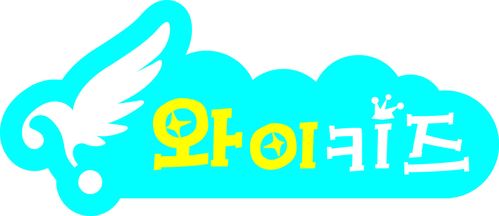
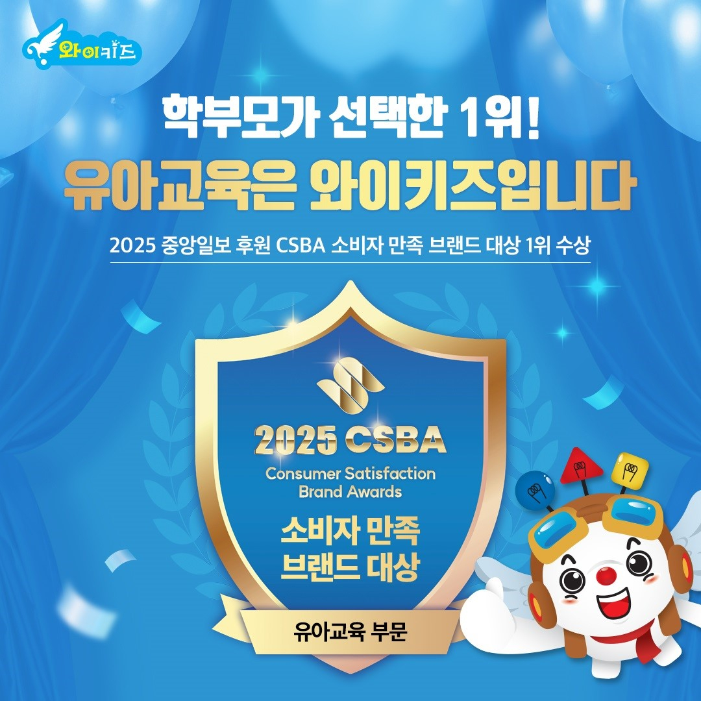

# [속보] 와이키즈, 2026 소비자만족 브랜드 대상 유아교육 부문 2년 연속 1위

유아 창의사고력 수학·과학 브랜드 **와이키즈**가 **JY네트워크가 주최하고 동아일보가 후원하는 '2026 소비자만족 브랜드 대상'** 유아교육 부문에서 **2년 연속 1위**를 수상했습니다. 운영사는 창의사고력 교육기업 **㈜창의와탐구**입니다. 동아일보가 **2026년 11월 6일 오후 2시 10분**(지희수 기자) 보도한 내용으로, 수상 소식은 브랜드 운영사인 창의와탐구 명의 자료로 전해졌습니다.

*▲ '2026 소비자만족 브랜드 대상' 유아교육 부문 2년 연속 1위를 수상한 와이키즈 (이미지: 창의와탐구 제공, 동아일보 보도)*

유아 대상 사고력 수학은 초등 사고력수학 시장의 '입구'에 해당합니다. 그래서 이 부문의 수상 소식은 단순한 홍보 문구가 아니라, 유아기 수학·과학 학습을 어디서 시작할지 고민하는 학부모들이 실제로 참고하는 지표로 쓰입니다. 이번 수상에서 확인해야 할 것은 크게 세 가지입니다. **무엇을 받았는지(주최·후원·부문)**, **2년 연속이라는 반복성이 어떤 의미인지**, 그리고 **수상의 근거가 된 프로그램 구조가 어떤지**입니다.

## 1. 수상 내용 한눈에

| 항목 | 내용 |
|:---|:---|
| 브랜드 | **와이키즈** (유아 창의사고력 수학·과학) |
| 운영사 | ㈜창의와탐구 |
| 주최 | JY네트워크 |
| 후원 | **동아일보** |
| 부문 | **유아교육** |
| 성적 | **2년 연속 1위** |
| 보도 | 동아일보 2026년 11월 6일 14:10 (지희수 기자) |

수상 소감으로 전해진 브랜드 관계자 코멘트의 핵심은 "2년 연속 수상은 프로그램을 신뢰해 준 학부모들 덕분"이라는 취지와, 앞으로도 **창의사고력 교육을 바탕으로 수학·과학 교육을 제공하겠다**는 내용입니다. 신제품 출시나 가격 정책 변경 같은 즉각적인 소비자 혜택 뉴스는 아니고, **브랜드 신뢰도를 확인하는 성격의 수상**입니다.

## 2. '2년 연속'이 갖는 의미 — 주최는 같고 후원 언론사는 바뀌었다

이번 수상이 눈에 띄는 이유는 **연속성**입니다. 지난해에도 와이키즈는 같은 상의 유아교육 부문에서 1위를 받았습니다. 2025년 보도에서는 **JY네트워크 주최·중앙일보 후원**으로 표기됐고, 올해는 **JY네트워크 주최·동아일보 후원**으로 표기됩니다. 즉 **주최 기관은 동일하게 유지되고, 후원 언론사만 바뀐 구조**입니다.

| 구분 | 2025 | 2026 |
|:---|:---|:---|
| 주최 | JY네트워크 | JY네트워크 |
| 후원 | 중앙일보 | 동아일보 |
| 부문 | 유아 교육 | 유아교육 |
| 성적 | 1위 | **1위 (2년 연속)** |
| 보도 시점 | 2025년 9월 | 2026년 11월 6일 |

이 구조에서 읽을 수 있는 것은 두 가지입니다.

첫째, **평가 주체가 매년 새로 소비자 반응을 확인하는 방식**이라는 점입니다. 한 해 반짝 이슈로 올라간 브랜드보다, 2년 연속 같은 부문에서 반복해서 선택된 브랜드가 학부모 입장에서 안정적으로 읽힙니다.

둘째, **수상 지표는 정량 성적과 성격이 다르다**는 점입니다. 경시대회 입상자 수나 영재교육원 합격자 수처럼 분모와 집계 기준이 명확한 숫자와 달리, 브랜드 대상은 소비자 평가·만족도 조사 기반입니다. 따라서 "상을 받았다"는 사실과 "우리 아이에게 맞는다"는 판단은 분리해서 봐야 합니다. 수상은 **후보를 좁히는 필터**로 쓰고, 최종 판단은 프로그램 구조와 체험으로 하는 편이 안전합니다.

*▲ 2025년 수상 당시 전해진 브랜드 제공 이미지 (이미지: 창의와탐구 제공, 중앙일보 2025년 9월 보도)*

## 3. 수상 근거가 된 프로그램 구조

이번 보도에서 브랜드가 내세운 강점은 네 가지로 정리됩니다.

**첫째, 언어사고력 기반의 유아 창의사고력 수학·과학.** 와이키즈는 수식 계산 훈련보다 **문제 상황을 언어로 이해하고 탐색하는 과정**을 앞세웁니다. 유아기에 숫자 조작을 먼저 훈련시키면 계산은 빨라지지만 문장제에서 막히는 경우가 많다는 점을 고려한 설계로 읽힙니다.

**둘째, 한국유아영재교육학회 인증 프로그램.** 인증을 받은 교육 프로그램과 **자체 개발 교재·교구**를 활용해 아이들이 문제 상황을 탐색하고 해결하는 과정에서 사고력을 기르도록 수업을 구성한다고 밝혔습니다. 교재·교구를 외부 조달이 아닌 자체 개발로 가져간다는 것은 커리큘럼 통제권이 본사에 있다는 뜻이기도 합니다.

**셋째, 소수정예 그룹 수업.** 교사와 또래 간 상호작용을 중심으로 **질문과 토론, 협동 학습**을 진행하고, 자신의 생각을 논리적으로 설명하고 표현하는 과정을 다룹니다. 2025년 보도에서는 그룹 규모를 **4~6명**으로 명시했습니다. 유아 사고력 수업에서 인원수는 곧 발표 기회의 횟수와 직결되므로, 학부모가 실제로 확인해야 할 항목입니다.

**넷째, 관찰 기반 학습 관리.** 아이들의 사고 과정과 개별 학습 특성을 관찰해 **성장 단계에 맞춘 학습 관리**를 제공한다는 설명입니다. 같은 교재를 쓰더라도 아이마다 막히는 지점이 다르기 때문에, 관찰 기록이 다음 단계 진도를 결정하는 구조인지가 중요합니다.

참고로 2025년 보도에서는 **영상 동화와 협동학습**, **전자칠판·터치스크린을 활용한 쌍방향 학습 환경**이 함께 언급됐습니다. 올해 보도에는 이 항목이 다시 나오지 않았으니, 최신 운영 여부는 센터 상담 시 확인하는 것이 정확합니다.

## 4. 정규 수업과 연결된 두 개의 대회

와이키즈는 정규 수업과 연계해 **상반기에는 '창의력 그리기 대회', 하반기에는 '창의력 글쓰기 대회'** 를 열어 왔습니다. 올해는 **제11회 창의력 글쓰기 대회**가 진행됐습니다. 11회라는 숫자는 이 행사가 **10년 이상 매년 반복된 정례 프로그램**이라는 뜻입니다.

유아 대상 대회의 성격을 정확히 이해할 필요가 있습니다. 순위를 가리는 경쟁보다, **아이가 자신의 생각을 그림과 글로 표현하는 경험** 자체에 목적이 있습니다. 사고력 수업의 성과는 당장의 점수로 확인하기 어렵기 때문에, 이런 정례 행사는 학부모가 아이의 표현 변화를 관찰할 수 있는 창구가 됩니다.

## 5. 창의와탐구의 브랜드 지형

와이키즈를 이해하려면 운영사 구조를 함께 봐야 합니다. ㈜창의와탐구는 유아부터 중등까지 이어지는 브랜드 포트폴리오를 운영합니다.

| 브랜드 | 대상·성격 |
|:---|:---|
| **와이키즈** | 유아(6·7세 중심) 창의사고력 수학·과학 |
| **와이즈만 영재교육** | 초등 사고력·영재교육 |
| **중등와이즈만CNI** | 중등 심화·내신·경시 |
| **와이즈만 BOOKs** | 교재·도서 출판 |

공식 홈페이지 기준 본사 주소는 **서울시 서초구 남부순환로 2219 나노빌딩 3·5F**, 대표전화는 **02-2033-8800**입니다. 2025년 보도에서는 대표를 **염만숙**으로 표기했습니다. 즉 유아(와이키즈) → 초등(와이즈만 영재교육) → 중등(중등와이즈만CNI)으로 이어지는 **수직 연계 구조**가 이 회사 브랜드 전략의 축입니다.

이 구조는 실사용 관점에서 장단점이 갈립니다. 장점은 **유아에서 중등까지 커리큘럼 연속성**을 기대할 수 있다는 점이고, 단점은 브랜드가 많아 **각 단계의 실제 강점이 어디에 있는지** 학부모가 직접 구분해야 한다는 점입니다.

## 6. 학부모가 확인할 세 가지

**첫째, 수상의 '구조'를 먼저 확인하세요.** 주최 기관, 후원 언론사, 부문 명칭, 연속 수상 여부를 보면 지표의 무게가 달라집니다. 이번 건은 주최가 2년 연속 동일하고 후원 언론사만 바뀐 케이스로, **평가의 연속성은 있지만 후원 주체가 달라진 점**은 함께 기억해 둘 부분입니다.

**둘째, 유아기에는 진도보다 '설명하는 습관'이 우선입니다.** 유아 사고력 수학에서 가장 흔한 실패는 문제를 많이 푸는 대신 **왜 그렇게 생각했는지 말로 설명하는 훈련**을 건너뛰는 경우입니다. 수업이 질문·토론·협동학습 중심으로 설계됐는지, 아이가 발표할 기회가 실제로 몇 번 주어지는지를 상담 때 물어보면 판단이 빨라집니다.

**셋째, 체험과 진단으로 적합도를 확인하세요.** 와이키즈 공식 홈페이지는 **수학 프로그램·과학 프로그램·체험 수업·6,7세 수학진단 검사** 메뉴를 운영하고 있습니다. 인증 프로그램과 교재·교구 구성이 아무리 좋아도 아이의 현재 언어 이해 수준과 맞지 않으면 흥미가 먼저 떨어집니다. **진단 → 체험 → 정규 등록** 순서로 확인하는 것이 일반적입니다.

## 정리

와이키즈가 **JY네트워크 주최·동아일보 후원 '2026 소비자만족 브랜드 대상' 유아교육 부문에서 2년 연속 1위**를 수상했습니다. 2025년에는 같은 상을 중앙일보 후원으로 받았으니, **주최는 유지되고 후원 언론사가 바뀐 2년 연속 수상**입니다.

수상의 근거로 제시된 축은 **언어사고력 기반 창의사고력 수학·과학**, **한국유아영재교육학회 인증 프로그램**, **자체 교재·교구**, **소수정예 그룹의 질문·토론·협동학습**, **관찰 기반 성장 단계 관리**입니다. 여기에 **제11회 창의력 글쓰기 대회**로 이어지는 정례 표현 활동이 더해집니다.

유아 사고력 수학 브랜드를 비교하는 중이라면, 수상 이력은 **1차 필터**로만 쓰고 최종 판단은 **프로그램 구조·그룹 인원·체험 수업**에서 하는 편이 안전합니다. 상은 브랜드가 시장에서 어떤 평가를 받았는지를 알려주지만, 아이와의 적합성은 체험에서만 확인됩니다.

---

**출처**
- 동아일보, 「와이키즈, '2026 소비자만족 브랜드 대상' 유아교육 부문 2년 연속 1위」, 2026.11.06 14:10, 지희수 기자 — [기사 보기](https://www.donga.com/news/Economy/article/all/20261106/134977544/1)
- 중앙일보, 「와이키즈, '2025 소비자만족 브랜드 대상' 유아 교육 부문 1위 수상」, 2025.09.29 — [기사 보기](https://www.joongang.co.kr/article/25370781)
- 와이키즈 공식 홈페이지 (프로그램·새소식·본사 정보) — [사이트 보기](https://whykids.imweb.me/)

#와이키즈 #창의와탐구 #소비자만족브랜드대상 #유아교육 #유아수학 #창의사고력 #사고력수학 #자녀교육
