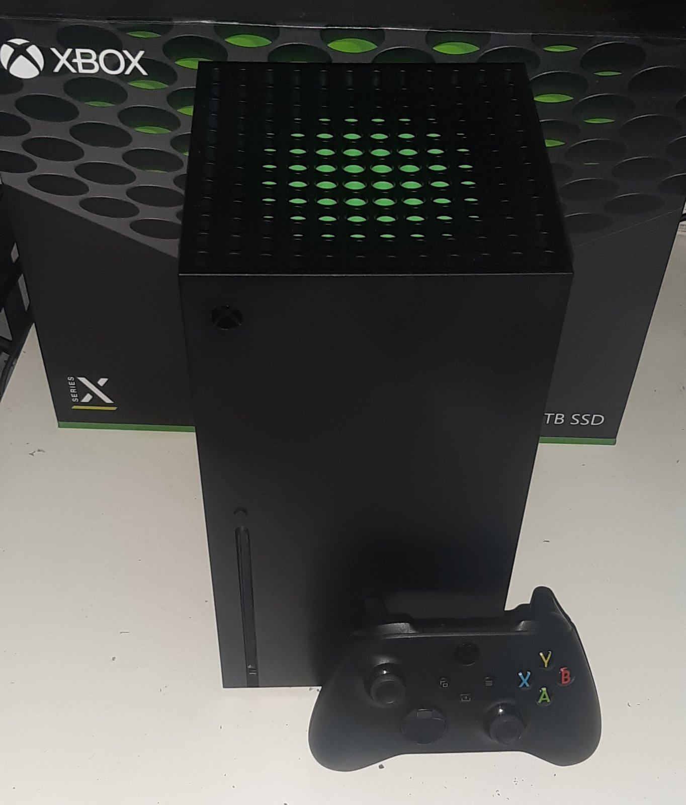
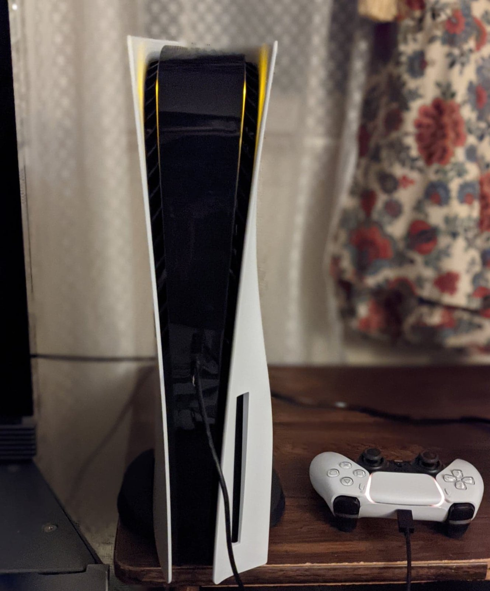
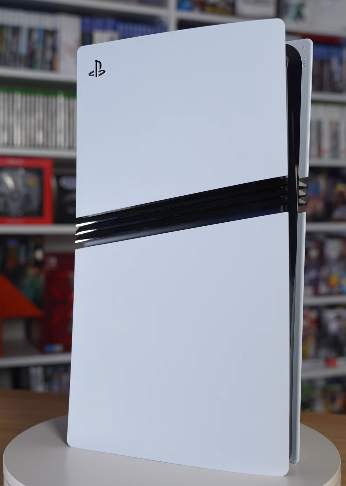

*GTA 6 공식 런치 갤러리 스크린샷. 2026년 11월 5일 락스타가 약 40장을 한꺼번에 공개했습니다 (출처: Rockstar Games 공식 홈페이지)*

> **📌 한줄 요약:** GTA 6는 **2026년 11월 19일** PS5·Xbox Series X/S로 나옵니다. 락스타가 공식적으로 밝힌 설치 용량은 **최대 212GB**이고, 사전 다운로드는 원래 11월 12일 예정이었는데 **11월 10일로 이틀 앞당겨졌습니다**. 국내 가격은 **스탠다드 89,800원 / 얼티밋 112,800원**입니다. 문제는 용량입니다. 512GB 모델에 212GB를 설치하면 남는 공간이 150GB 안팎이라, 지금 콘솔을 고민 중이라면 **저장공간부터 계산하는 게 순서**입니다.

---

## 이 글에서 확인할 수 있는 것

- 11월 19일 출시 전에 확정된 사실과 아직 확정되지 않은 것
- 212GB를 콘솔별로 설치하면 실제로 몇 GB가 남는지
- PS5 / PS5 Pro / Xbox Series X / Series S 중 무엇을 고를지 판단 기준
- 디스크판과 디지털판, 지금 사도 되는지
- 스탠다드와 얼티밋, 23,000원 차이의 실체
- 사전 다운로드 시작 시각과 미리 해둘 설정
- 솔직히 아쉬운 점 4가지

---

## 1. 지금 GTA 6가 다시 화제인 이유

GTA 5가 2013년 9월에 나왔으니, 넘버링 기준으로 **13년 만의 신작**입니다. 출시일은 여러 차례 밀린 끝에 **2026년 11월 19일**로 확정됐고, 이제 열흘 앞으로 다가왔습니다.

최근 분위기를 끌어올린 건 11월 5일 공개된 **런치 갤러리**입니다. 락스타가 공식 홈페이지에 약 40장의 스크린샷을 한 번에 올렸고, 바이스시티 야경과 그라스리버스, 레오니다키스, 포트 겔혼 같은 지역 컷이 함께 풀렸습니다. 같은 날 사전 다운로드 일정과 설치 용량까지 공식 확인되면서, 이제 남은 건 "무엇으로, 얼마나 담을 공간을 만들어 두고, 어느 에디션을 살지"입니다.

*GTA 6의 두 주인공 제이슨과 루시아. 이번 작품은 두 인물을 오가는 구성입니다 (출처: Rockstar Games 공식 홈페이지)*

---

## 2. 출시 전 확정된 사실 정리

| 항목 | 내용 |
|:---|:---|
| 출시일 | 2026년 11월 19일 |
| 플랫폼 | PS5, PS5 Pro, Xbox Series X, Xbox Series S |
| PC 버전 | 출시 라인업에 없음 (별도 발표 없음) |
| 설치 용량 | 최대 212GB (락스타 공식 확인) |
| 사전 다운로드 | 2026년 11월 10일 시작 (당초 12일 → 이틀 앞당김) |
| 국내 가격 | 스탠다드 89,800원 / 얼티밋 112,800원 |
| 북미 가격 | 스탠다드 79.99달러 / 얼티밋 99.99달러 |
| 예약 특전 | 빈티지 바이스시티 팩, GTA+ 1개월 |
| 물리 패키지 | 박스 안에 다운로드 코드 동봉 |

여기서 눈에 띄는 항목이 두 가지입니다. 첫째, **PC 버전이 없다**는 점입니다. 콘솔 독점 기간이 얼마나 될지는 아직 공식 발표가 없습니다. 둘째, **물리 패키지가 코드 방식**이라는 점입니다. 디스크를 넣고 바로 하는 구조가 아니라 박스에 든 코드를 입력해 내려받는 방식이라, 디스크판을 사도 212GB 다운로드는 똑같이 필요합니다.

*레오니다 주의 그라스리버스. 이번 작품은 바이스시티 외곽 지역의 규모도 크게 늘었습니다 (출처: Rockstar Games 공식 홈페이지)*

---

## 3. 212GB가 실제로 의미하는 것

스펙표에 적힌 용량과 실제로 쓸 수 있는 용량은 다릅니다. 시스템 파일이 차지하는 몫이 있기 때문입니다. 212GB를 설치했을 때 남는 공간을 계산하면 이렇게 됩니다.

| 기종 | 표기 용량 | 실제 사용 가능(근사) | 212GB 설치 후 잔여 |
|:---|:---|:---|:---|
| PS5 (초기형) | 825GB | 약 667GB | 약 455GB |
| PS5 슬림 | 1TB | 약 842GB | 약 630GB |
| PS5 Pro | 2TB | 약 1.8TB | 약 1.6TB |
| Xbox Series X | 1TB | 약 802GB | 약 590GB |
| Xbox Series S | 512GB | 약 362GB | 약 150GB |

표만 보면 "다 들어가는데?" 싶습니다. 하지만 실제 사용 환경은 다릅니다. 콘솔에는 GTA 6만 설치되어 있지 않습니다. 기존에 하던 게임 몇 개, 캡처 영상, 세이브 데이터가 이미 자리를 차지하고 있습니다. **콘솔 게임 한 개당 50~100GB**가 기본인 시대라, 여유 공간이 150GB라면 사실상 GTA 6 한 개로 꽉 차는 구조입니다.

특히 **Xbox Series S**는 주의가 필요합니다. 잔여 150GB는 시스템 업데이트와 향후 패치를 감당하기 빠듯합니다. GTA 6는 출시 후 온라인 모드 업데이트가 계속 붙는 게임이기 때문에, Series S 사용자라면 외장 SSD 추가를 함께 고려하는 편이 낫습니다. 참고로 212GB는 락스타가 밝힌 상한이고, 기종별 최적화 용량은 출시 후 달라질 수 있습니다.

---

## 4. 콘솔별 선택 기준

### Xbox Series S — 가장 저렴하지만 가장 빠듯

*Xbox Series X. Series S는 디스크 드라이브가 없는 소형 모델입니다 (출처: Wikimedia Commons, Der. Bellemer, CC BY-SA 4.0)*

본체 가격이 가장 낮고 Game Pass와 조합하기 좋습니다. 다만 저장공간 512GB에 212GB 게임을 담는 구조라, 다른 게임을 지우고 다시 받는 일이 반복될 가능성이 큽니다. **GTA 6만 주력으로 하고 다른 게임은 거의 안 하는 경우**라면 여전히 합리적인 선택입니다.

### Xbox Series X — 저장공간과 가격의 균형

1TB 모델이라 잔여 590GB가 남습니다. 4K TV를 쓰고 디스크 게임도 함께 즐기는 경우라면 무난합니다. 다만 이번 작품은 물리판도 코드 방식이라, 디스크 드라이브의 이점은 GTA 6에서는 크지 않습니다.

### PS5 기본형 — 가장 현실적인 선택

*PS5 기본형과 듀얼센스. 초기형은 825GB, 슬림은 1TB입니다 (출처: Wikimedia Commons, Osh33m, CC BY-SA 4.0)*

초기형 825GB 모델이라면 잔여가 455GB 수준입니다. 게임 3~4개를 함께 설치하는 편이라면 슬림(1TB)이나 M.2 SSD 추가를 권합니다. PS5는 M.2 NVMe SSD를 비교적 간단히 추가할 수 있어서, 저장공간 대응이 세 기종 중 가장 쉽습니다.

### PS5 Pro — 4K·고주사율 TV를 쓰는 경우

*PS5 Pro. 디스크 드라이브가 없는 디지털 모델이 기본입니다 (출처: Wikimedia Commons, BeatEmUps, CC BY 3.0)*

2TB라 용량 걱정은 사실상 사라집니다. 다만 **GTA 6가 PS5 Pro에서 60fps로 돌아가는지는 아직 공식 확정이 아닙니다.** 락스타는 프레임 모드에 대해 구체적으로 발표하지 않았고, 해외 매체들도 확인된 사실과 루머를 구분해 다루고 있는 상황입니다. 즉 지금 PS5 Pro를 사는 이유는 "GTA 6를 60fps로 하기 위해서"가 아니라 **"다른 게임까지 포함해 4K 화질과 2TB 용량을 함께 얻기 위해서"** 로 잡는 게 안전합니다.

---

## 5. 스탠다드 vs 얼티밋, 23,000원의 차이

| 구분 | 스탠다드 | 얼티밋 |
|:---|:---|:---|
| 국내 가격 | 89,800원 | 112,800원 |
| 본편 | 포함 | 포함 |
| 빈티지 바이스시티 팩 | 예약 구매 시 포함 | 포함 |
| GTA+ 1개월 | 예약 구매 시 포함 | 포함 |
| 전용 차량·무기·의상 | 없음 | 포함 |
| 단일 플레이 전용 상점 | 없음 | 6곳 해금 |
| 가격 차이 | — | +23,000원 |

얼티밋에 붙는 구성은 락스타 공식 에디션 페이지 기준으로 이렇습니다.

- **차량** — '95 그로티 치타, 쉬츠 스쿠알로, '67 바피드 도미네이터 버기, 갠나도 레트로 빌드, 제이슨 세이프하우스 차량
- **무기** — 호크 & 리틀 모건 리볼버, 개인화 무기 스킨(바리에이션)
- **상점** — 라이드아웃 커스텀스(차량 튜닝), 사라 유니섹스 살롱, 스톡 305(의류), 일렉트릭 팽 타투, 원아이드 윌리 모드샵, PTT 영긴$ 불법 상점
- **기타** — 바이스시티 스타일, 굿타임 기어, 클래식 카 컬렉션

핵심은 **단일 플레이 모드에서만 열리는 상점 6곳**입니다. 온라인 모드가 아니라 스토리 모드 안에서 차량 개조·문신·의류를 폭넓게 만질 수 있다는 뜻이라, GTA 5에서 차량 튜닝과 꾸미기에 시간을 많이 쓴 편이라면 체감 차이가 큽니다. 반대로 스토리만 빠르게 보고 온라인으로 넘어가는 스타일이라면 23,000원을 아끼는 쪽이 낫습니다.

참고로 예약 특전인 **빈티지 바이스시티 팩과 GTA+ 1개월은 두 에디션 모두**에게 주어집니다. 즉 얼티밋을 사는 이유는 특전이 아니라 전용 콘텐츠입니다.

*레오니다키스 지역. 이번 작품의 맵은 바이스시티를 포함해 주 전체로 확장됐습니다 (출처: Rockstar Games 공식 홈페이지)*

---

## 6. 사전 다운로드, 언제 무엇을 해두면 되나

- **PS5** — 11월 10일 0시, 지역 현지 시간 기준으로 열립니다.
- **Xbox Series X/S** — 11월 10일 0시 GMT 기준이라, 한국 시간으로는 **오전 9시**입니다.
- **필요 작업** — 콘솔 저장공간 확보, 유선 랜 연결 권장, 자동 업데이트 켜두기.

212GB는 회선 상태에 따라 차이가 큽니다. 100Mbps 회선에서 이론상 4~5시간, 실제로는 6시간 이상 걸리는 경우가 많습니다. 출시일에 맞춰 바로 하려면 사전 다운로드 기간(9일)을 그냥 넘기지 않는 게 좋습니다. 콘솔 설정에서 **"사용 중이 아닐 때 자동 다운로드"** 를 켜두면 밤사이 받아둘 수 있습니다.

---

## 7. 솔직히 아쉬운 점

1. **PC 버전 부재** — 콘솔이 없는 경우 선택지가 아예 없습니다. 독점 기간이 얼마인지도 아직 공식 발표가 없습니다.
2. **60fps 확정 아님** — PS5 Pro를 포함해 프레임 모드가 공식 발표되지 않았습니다. 출시 후 실측이 나와야 정확합니다.
3. **212GB의 부담** — 저장공간이 작은 콘솔에는 사실상 전용 게임 한 개를 배정하는 셈입니다.
4. **얼티밋의 애매한 경계** — 전용 상점 6곳이 스토리 모드 한정이라, 온라인 위주로 플레이하는 경우 체감이 떨어집니다.

---

## 8. 정리 — 어떤 경우에 무엇을 고르면 되나

- **콘솔을 새로 사는 경우** → PS5 슬림(1TB) 또는 Xbox Series X. 212GB를 감당할 여유가 있는 최소선입니다.
- **이미 Series S를 쓰는 경우** → 외장 SSD를 함께 준비하거나, 다른 게임을 정리하고 GTA 6 단일 체제로 가는 편이 낫습니다.
- **4K TV와 고주사율 모니터를 함께 쓰는 경우** → PS5 Pro. 단, 기대 이유는 화질·용량이지 60fps 확정이 아닙니다.
- **차량 개조와 꾸미기를 좋아하는 경우** → 얼티밋. 아니라면 스탠다드로 충분합니다.
- **출시 당일 바로 하고 싶은 경우** → 11월 10일 사전 다운로드 일정을 캘린더에 넣어두는 게 가장 중요합니다.

가성비만 놓고 보면 **스탠다드 + 저장공간 확보**가 여전히 답입니다. 23,000원 차이는 콘텐츠 취향 문제이지, 성능이나 편의의 차이는 아니기 때문입니다.

*포트 겔혼 지역. 11월 5일 공개된 런치 갤러리에는 이런 지역 컷이 다수 포함됐습니다 (출처: Rockstar Games 공식 홈페이지)*

---

**참고한 자료**
- Rockstar Games 공식 GTA VI 에디션 페이지 및 미디어(런치 갤러리)
- 락스타의 사전 다운로드 일정·설치 용량 공지 (해외 보도 종합: GamesRadar, Dexerto, Beebom, Guru3D)
- 플레이스테이션 스토어 코리아 예약 판매 가격
- 콘솔 저장공간 사양: Sony, Microsoft 공식 스펙
- 콘솔 제품 사진: Wikimedia Commons (Osh33m CC BY-SA 4.0, BeatEmUps CC BY 3.0, Der. Bellemer CC BY-SA 4.0)
