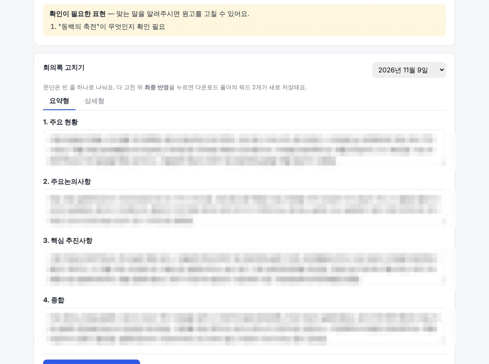

회사에서 월요일마다 주간회의가 열립니다. 회의가 끝나면 늘 같은 일이 기다렸습니다. **회의록 작성**입니다.

회의록은 정해진 형식이 있었습니다. 한 장짜리 **요약형**과, 부서별로 자세히 풀어 쓴 **상세형**, 이렇게 워드 2개를 매번 만들어야 했습니다. 게다가 단순히 회의 내용만 옮기는 게 아니라, 사내 인트라넷 **DAMO**에 올라온 **7개 부서의 주간업무보고 수치**까지 하나하나 대조해 가며 한 문단에 녹여 써야 했습니다.

이 과정을 손으로 하면 이렇게 흘러갔습니다.

1. 네이버 클로바노트에서 **녹취록과 요약본 두 파일**을 내려받기
2. DAMO에 로그인해 7개 부서 장표를 하나씩 열어 매출·달성률·일정 확인
3. 두 파일을 **규칙을 미리 학습시킨 GPT**에 올려 회의록 초안 받기
4. 장표 수치와 **교차 대조하며 검증**하고, 정해진 서식(제목 16pt, 본문 11pt, 맑은 고딕, 표·불릿 금지, "~함/~음/~됨" 체)에 맞춰 두 버전 완성

매주 **몇 시간**이 그대로 사라졌습니다. 내용 자체는 가치 있는 일인데, 옮겨 적고 서식 맞추는 '단순 반복'에 시간이 너무 많이 들었습니다.

## "이건 프로그램으로 만들 수 있지 않을까?"

반복되는 일에는 늘 같은 패턴이 있습니다. 입력이 정해져 있고(녹취 요약 + 부서 장표), 출력도 정해져 있다면(정해진 서식의 워드 2장), 그 사이는 자동화할 수 있습니다.

그래서 **나만 쓰는 작은 프로그램**을 만들기로 했습니다. 거창한 시스템이 아니라, 노트북에서 돌아가는 대시보드 한 화면이면 충분했습니다.

**핵심 아이디어: 파일 첨부 → "생성하기" 한 번 → 요약형·상세형 워드 2장 완성.**

## 어떻게 동작하나

겉으로는 버튼 하나지만, 안에서는 손으로 하던 순서를 그대로 밟습니다.

- **① 회의 날짜 선택** — 이 날짜(보고일)에 맞는 부서별 주간보고를 찾습니다.
- **② DAMO 로그인** — 로그인은 직접 합니다. (사내 보안상 아이디·비밀번호는 프로그램에 넣지 않고, 열린 브라우저 창에서 직접 로그인)
- **③ 녹취록·요약본 첨부** — 클로바노트에서 내려받은 **두 파일**(txt/docx)을 끌어다 놓습니다.
- **④ 생성하기** — 7개 부서 장표를 읽어 와, 두 파일과 함께 **규칙에 맞는 요약형·상세형 원고**를 만들고 정해진 서식의 워드 2장으로 저장합니다.

이 프로그램은 새로 만든 방식이 아니라, **원래 하던 일을 그대로 옮긴 것**입니다. 클로바노트에서 녹취록과 요약본을 내려받아, 규칙을 미리 학습시킨 **GPT**에 두 파일을 올리고 회의록 초안을 받은 뒤, 직접 검증해서 쓰던 과정이었습니다. 프로그램은 그 순서를 대신 밟습니다.

문장을 만드는 부분은 **GPT**를 사용했습니다. 단순 치환이 아니라, 녹취의 발언과 부서 장표의 수치를 **한 문단에 자연스럽게 녹여 쓰는** 일이라 사람이 쓰던 글의 결을 그대로 재현하는 게 중요했습니다. 그래서 **규칙과 함께 이전에 승인받은 회의록을 '기준 예시'로 넣어**, 문체·분량·구성이 늘 같은 톤을 유지하도록 했습니다.

애매하게 받아써진 표현은 지어내지 않고 **"확인이 필요한 표현"** 목록으로 따로 보여 줍니다. 그 부분만 확인해서 고치면 끝입니다.

## 만들고 나서 더 좋아진 점들

처음엔 "워드 2장만 자동으로 나오면 성공"이라고 생각했는데, 쓰다 보니 욕심이 생겼습니다. 실제 업무에서 필요한 기능을 하나씩 더했습니다.

### ① 화면에서 바로 고치고 '최종 반영'

AI가 쓴 초안이 100%는 아니니, 워드를 따로 열지 않고 화면에서 섹션별로 고친 뒤 버튼 한 번으로 워드에 반영되게 했습니다.

### ② 지난 기록 보관

만든 회의록이 자동으로 쌓여서, 나중에 다시 열어 보거나 고치거나 워드로 다시 뽑을 수 있습니다. 다운로드 폴더의 워드를 지웠어도 보관본에서 되살릴 수 있습니다.

### ③ 비밀번호 잠금

사내 자료를 다루다 보니, 실행할 때 비밀번호를 먼저 넣도록 했습니다.

### ④ 설치 없이 실행

처음엔 개발 도구를 깔아야 했지만, 지금은 **실행파일 하나**로 켜집니다. 윈도우용 실행파일과 맥용 앱 둘 다 만들어서, 받는 사람은 더블클릭만 하면 됩니다.

## 수작업 vs 프로그램

| 구분 | 예전(수작업) | 지금(프로그램) |
|---|---|---|
| 장표 확인 | 7개 부서 하나씩 열람 | 자동 수집 |
| 문장화 | 직접 교차 대조·작성 | AI 초안 + 검수 |
| 서식 맞추기 | 매번 수동 | 고정 서식 자동 적용 |
| 결과물 | 요약형·상세형 수동 2장 | 버튼 한 번에 2장 |
| 지난 회의록 | 폴더에서 수동 관리 | 프로그램에 자동 보관 |
| 걸리는 시간 | 수 시간 | 수 분 + 검수 |

## 배우고 느낀 점

- **반복 업무는 '입력과 출력이 정해져 있는가'로 판단**하면 자동화 대상이 보입니다.
- 완전 자동화가 목표가 아니라, **사람이 검수하기 좋은 초안을 빠르게** 만드는 게 더 현실적이고 안전합니다. 그래서 "확인 필요" 표시와 "바로 고치기"를 넣었습니다.
- 작은 도구라도 **실제로 매주 쓰다 보면** 필요한 기능이 자연스럽게 드러납니다. 지난 기록, 비밀번호, 실행파일화 모두 쓰면서 추가된 것들입니다.
- 거창하게 시작하지 않아도 됩니다. **노트북에서 도는 한 화면**이면 충분히 삶이 바뀝니다.

## 마무리

매주 반복되던 몇 시간짜리 일이, 지금은 파일 첨부와 버튼 한 번, 그리고 짧은 검수로 끝납니다. 무엇보다 **'옮겨 적는 일'에서 벗어나 '내용을 검토하는 일'에만 집중**할 수 있게 된 게 가장 큰 변화입니다.

혹시 매주 똑같은 보고서·회의록·정리 작업에 시간을 쓰고 계신다면, 그 일이야말로 가장 좋은 '첫 자동화 대상'일지 모릅니다.
