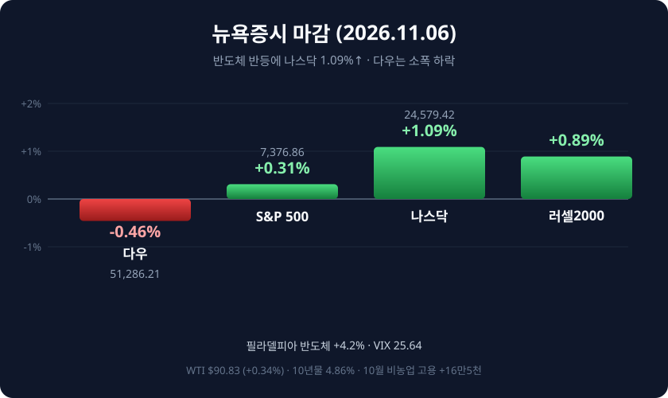

*2026년 11월 6일(현지시간) 뉴욕증시 주요 지수 등락률*

## 오늘의 증시 요약

**11월 6일(현지시간)** 뉴욕증시는 하루 만에 진정 국면을 찾았습니다. 나스닥종합지수는 264.43포인트(1.09%) 오른 **2만4,579.42**, S&P500은 23.19포인트(0.31%) 상승한 **7,376.86**에 마감했습니다. 반면 다우존스30산업평균지수는 236.85포인트(0.46%) 내린 **5만1,286.21**으로 3대 지수가 엇갈렸습니다.

| 지수 | 종가 | 전일비 | 등락률 |
|:----|:----|:------|:------:|
| 다우존스 | 51,286.21 | -236.85 | -0.46% |
| S&P500 | 7,376.86 | +23.19 | +0.31% |
| 나스닥 | 24,579.42 | +264.43 | +1.09% |
| 러셀2000 | 2,754 | +24.21 | +0.89% |
| 필라델피아 반도체 | — | — | +4.20% |

전날 다우가 3.44%, 나스닥이 5.52% 빠지며 2025년 4월 관세 쇼크 이후 최악의 하루를 기록한 뒤, 이날은 저가 매수세가 유입됐습니다. 나스닥100은 1.35% 올랐지만, 나스닥지수는 이번 주까지 4주 연속 하락했습니다.

## 반등의 주역은 반도체

전날 12.25% 폭락했던 필라델피아 반도체지수는 이날 4.2% 반등했습니다. AMD가 11.0%, 엔비디아가 2.8%, 마이크론이 5.1%, 샌디스크가 3.6% 올랐고, 클라우드플레어와 앱러빈은 각각 9.9%, 비스트라는 10.6% 급등했습니다.

다만 상승의 폭은 좁았습니다. S&P500 편입 종목 가운데 318개가 하락하고 184개만 올랐습니다. 업종별로는 기술 1.45%, 커뮤니케이션서비스 0.43%가 강했고, 전날 방어주로 몰렸던 필수소비재는 1.28% 밀리며 가장 부진했습니다. 반도체 반등을 추세 전환으로 보기 어렵다는 평가가 나오는 이유입니다.

## 고용은 예상보다 뜨거웠다

이날 발표된 10월 비농업 고용은 **16만5,000건**으로 시장 예상치(약 6만 건)를 크게 웃돌았습니다. 실업률은 4.1%로 낮아졌고, 시간당 평균임금은 전월 대비 0.4%, 전년 대비 3.1% 올랐습니다. 미시간대 소비자심리지수도 3개월 최고치를 기록했습니다.

지표가 확인되자 연준의 12월 금리 인상 가능성이 다시 부각됐습니다. 연준은 지난 10월 FOMC에서 기준금리(3.75~4.00%)를 동결하면서도 추가 긴축 여지를 남겨뒀습니다. 10년물 국채금리는 2.3bp 오른 4.858%, 2년물은 4.52%로 올랐고, 달러인덱스는 0.75% 상승한 102.32를 기록했습니다. 금 현물은 0.5% 내린 온스당 4,065달러 선으로 물러섰습니다.

## 유가는 주간 기준 급락

국제유가는 소폭 올랐지만 주간 낙폭이 컸습니다. WTI 12월물은 0.34% 오른 배럴당 **90.83달러**, 브렌트유는 0.03달러 오른 **98.32달러**에 마감했습니다.

주간으로는 WTI가 약 13%, 브렌트유가 10% 넘게 밀렸습니다. 브렌트유 기준으로는 코로나19 사태 초기 이후 가장 큰 주간 하락률입니다. 중간선거 이후 미국·이스라엘과 이란 간 긴장 완화 기대가 커진 점이 원인으로 꼽혔습니다. 에너지 업종은 한 주 동안 12.0% 하락했습니다.

## 주간 성적표와 다음 일정

이번 주 다우는 0.94%, S&P500은 2.68%, 나스닥은 3.37% 각각 하락했습니다. 나스닥100은 10월 6일 사상 최고치 대비 11.9% 낮은 수준으로, 조정 국면 진입이 확인된 상태입니다. 변동성지수(VIX)는 금요일에 25.64로 내렸지만 주간으로는 32% 상승했습니다.

- **11월 10일**: 미국 10월 소비자물가지수(CPI) — 12월 FOMC를 앞둔 마지막 물가 지표
- **12월 8~9일**: FOMC 정례회의(결과 12월 9일)

반도체가 바닥을 다지는지, 아니면 반등의 폭이 좁았던 만큼 한 차례 더 조정이 나올지는 10일 CPI가 가를 전망입니다. 물가가 예상보다 높게 나오면 금리 인상 우려가 다시 기술주 밸류에이션을 압박할 수 있습니다.

#뉴욕증시 #다우지수 #S&P500 #나스닥 #FOMC #유가 #고용보고서 #반도체 #미국증시
