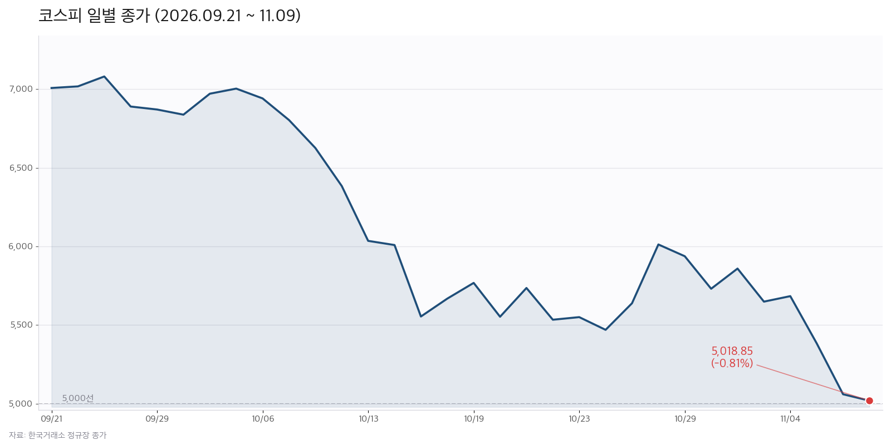
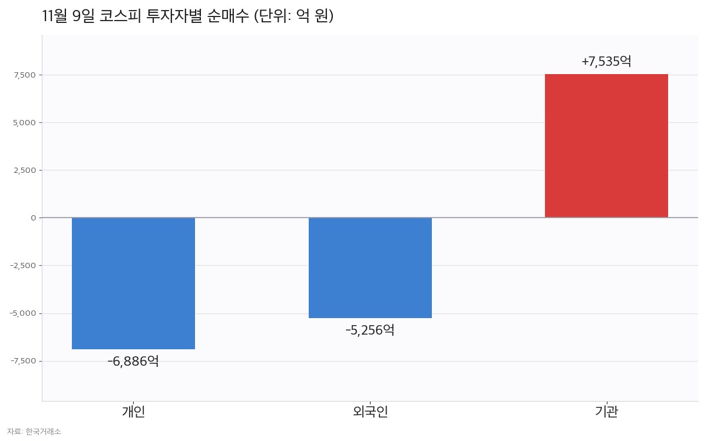

*코스피 일별 종가 (2026.09.21~11.09, 한국거래소 정규장 종가 기준)*

## 한 줄 요약

11월 9일(월) 코스피는 **5,018.85(-0.81%)**로 마감했습니다. 장중 5,172.94까지 올랐던 지수가 오후 들어 상승분을 모두 반납했습니다. 종가 기준 5,000선은 지켰지만 3거래일 연속 하락입니다.

| 구분 | 종가 | 전일비 | 등락률 |
|:----|:----|:------|:------:|
| **코스피** | 5,018.85 | ▼ 40.84 | -0.81% |
| **코스닥** | 638.97 | ▼ 5.30 | -0.82% |
| 코스피 거래대금 | 18조5,019억 | ▼ 9조 | -32.7% |
| 코스닥 거래대금 | 4조5,575억 | - | - |

상승 340개, 하락 530개로 하락 종목이 더 많았습니다.

## 5,000선을 지킨 하루

지수는 5,034.20으로 약보합 출발한 뒤 오전 한때 5,172.94(전일 대비 +2.24%)까지 올랐습니다. 그러나 오후 들어 매물이 쏟아지며 상승분을 반납했고, 장중 4,990.66까지 밀려 5,000선을 이탈했다가 종가에 5,018.85로 돌아왔습니다.

## 외국인 7거래일째 매도, 강도는 약해져

유가증권시장에서 외국인은 **5,256억 원** 순매도했습니다. 10월 30일부터 7거래일 연속입니다. 다만 전일 2조7,685억 원의 5분의 1 수준으로 매도 강도가 크게 낮아졌습니다.

*11월 9일 코스피 투자자별 순매수 대금 (단위: 억 원, 한국거래소)*

기관은 **7,535억 원** 순매수하며 지수를 받쳤습니다. 반면 개인은 6,886억 원 순매도로 돌아섰습니다. 전일 6,046억 원 순매수에서 방향이 바뀐 것입니다. 코스닥은 기관 1,119억 원 순매수, 개인·외국인은 순매도였습니다.

## 반도체는 반등, 2차전지는 급락

업종 흐름은 극명하게 갈렸습니다. 삼성전자 +0.64%, SK하이닉스 +0.35%로 반도체 대형주는 소폭 올랐습니다.

반대로 2차전지는 무너졌습니다. 삼성SDI **-11.32%**, LG에너지솔루션 -5.78%, 포스코퓨처엠 -5.01%입니다. 코스닥에서는 에코프로비엠 -8.66%, 에코프로 -8.46%로 낙폭이 컸습니다. 자동차도 현대차 -2.86%, 기아 -3.29%로 약했고, 조선은 한화오션 -3.80%였습니다.

## 오늘의 특징주

- **알테오젠 -16.01%** — 미국 IRA 약가협상 대상에 '키트루다 SC'가 포함될 수 있다는 우려에 급락, 장중 VI 발동
- **삼성SDI -11.32%** — 2차전지 업종 약세 속 시가총액 상위종목 중 최대 낙폭
- **한진칼 +5.81%** — 14조 원대 종목 중 드문 강세

## 남은 변수

3거래일 누적 낙폭은 -11.70%입니다. 52주 최고점(9,385.59)과 비교하면 여전히 46.5% 낮은 수준입니다. 거래대금은 18조5,019억 원으로 전일보다 9조 원 줄었습니다.

10일 오전 원·달러 환율은 1,340원대입니다. 다음 거래일에는 외국인 순매도가 멈추는지, 2차전지 낙폭이 진정되는지가 5,000선 방어의 관건입니다.

*본 포스팅은 한국거래소 종가 데이터와 국내 언론 마감 보도를 바탕으로 작성했으며, 특정 종목의 매매를 권유하는 글이 아닙니다. 수급 수치는 집계 시점에 따라 잠정치와 차이가 있을 수 있습니다.*

#코스피 #코스닥 #한국증시 #외국인 #증시시황 #마감시황 #반도체 #2차전지
