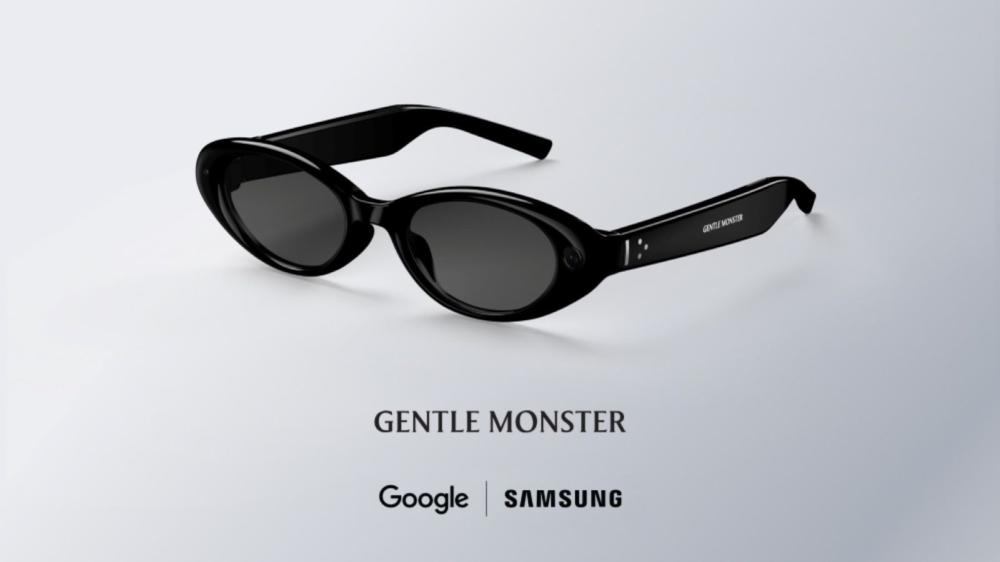
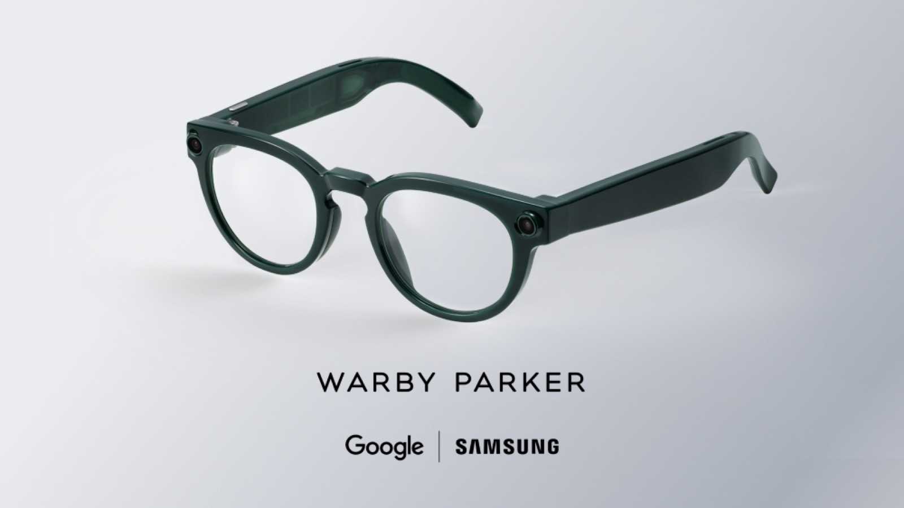
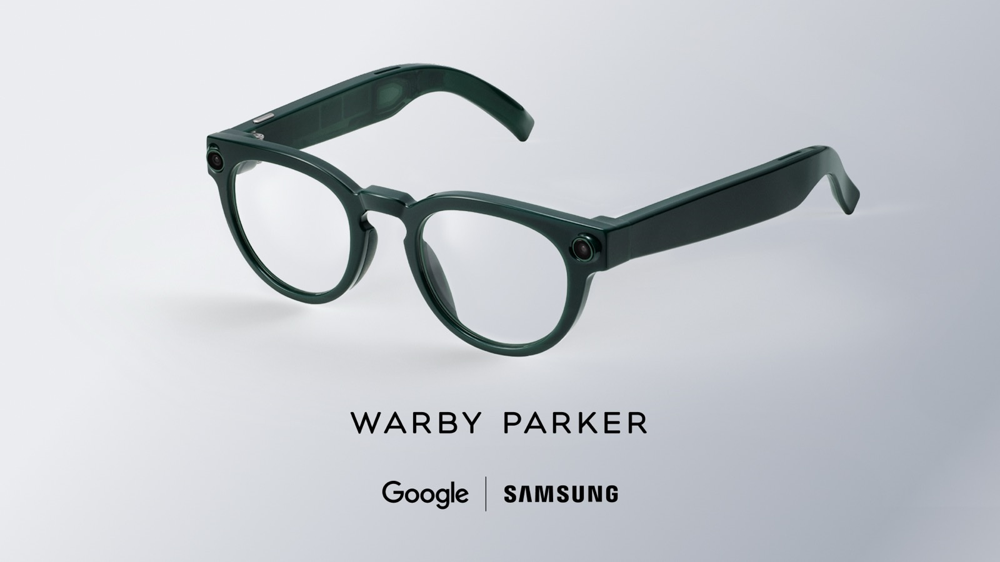
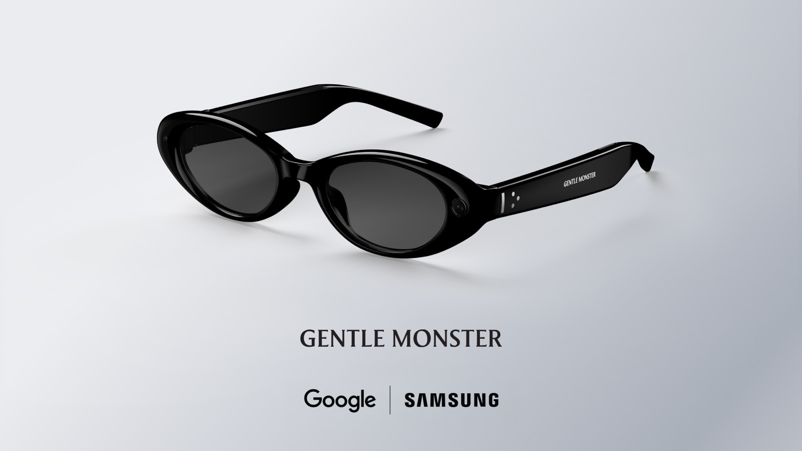

> **📌 한줄 요약:** 삼성과 구글이 함께 만든 첫 AI 안경 **인텔리전트 아이웨어(Intelligent Eyewear)**가 **2026년 11월 12일(목) 워비파커 컬렉션 예약판매**를 시작합니다. 워비파커 공동창업자 데이브 길보아가 3분기 실적 발표에서 직접 날짜를 못 박았고, 초기 물량은 **연휴 시즌(12월) 배송**입니다. 젠틀몬스터 버전은 **12월 출시** 예고만 나온 상태입니다. 가격은 아직 공식 발표가 없고, **11월 12일에 처음 공개될 가능성**이 큽니다.

*이미지 출처: 삼성전자 뉴스룸 공식 보도자료 (삼성·구글 인텔리전트 아이웨어)*

## 스마트폰을 꺼내지 않고 싶은 순간들

해외여행지 메뉴판 앞에서, 낯선 빌딩 로비에서, 회의실 화이트보드 앞에서 **주머니에 손을 넣어 폰을 꺼내는 동작**이 생각보다 자주 나옵니다. 손에 커피를 들었거나 장갑을 꼈거나 가방을 멘 상태라면 그 한 번의 동작이 꽤 번거롭고요.

이런 상황을 겨냥한 제품이 드디어 **실제 판매 일정**을 잡았습니다. 그동안 삼성의 AI 안경은 "언젠가 나온다"는 전시장 데모 수준이었는데, 이번엔 안경점의 실적 발표 자료를 통해 **예약 날짜**가 확정됐습니다. 판매 주체가 삼성전자가 아니라 **워비파커**라는 점이 이 제품의 성격을 잘 보여줍니다. 이제 스펙과 일정, 그리고 경쟁 제품과의 비교까지 공식 자료 기준으로 정리해 보겠습니다.

## 11월 12일 — 날짜를 확정한 건 삼성이 아니라 안경점이었다

보통 신제품 일정은 제조사가 먼저 알립니다. 그런데 이번에는 순서가 뒤집혔습니다. **워비파커가 11월 5일 미국 SEC에 제출한 3분기 실적 자료(8-K)** 에서 공동창업자 겸 공동 CEO 데이브 길보아가 이렇게 밝혔습니다.

> "일주일 뒤인 11월 12일, 첫 인텔리전트 아이웨어 컬렉션의 **예약 주문**을 받기 시작하며, 연휴 시즌 동안 고객 주문을 **배송**할 수 있기를 기대합니다."

삼성전자와 구글은 아직 자체 발표로 확정 날짜를 내놓지 않았습니다. 대신 흐름은 이렇게 좁혀져 왔습니다.

- **2026년 5월 19일** — 구글 I/O에서 "오디오 안경을 먼저, 이번 가을 출시" 발표
- **2026년 5월 20일** — 삼성 "가을, 일부 시장에서 출시 예정"
- **2026년 7월 22일** — 런던 갤럭시 언팩에서 젠틀몬스터·워비파커 협업 디자인과 주요 기능 공개
- **2026년 9월 27일** — 미국 FCC에서 두 개 ID(A3LSMO200P, A3LSMO200J)로 **프레임 11종** 인증
- **2026년 10월 1일** — 삼성 관계자 "11월 출시" 확인 보도
- **2026년 10월 30일** — **12월 중순**, 한국·미국 우선 판매 보도
- **2026년 11월 5일** — 워비파커, **11월 12일 예약판매** 공식 확인
- **2026년 11월 6일** — 젠틀몬스터, 호아킨 피닉스 주연·조나단 글레이저 감독 단편 공개 예고와 함께 "**12월 출시**" 언급

*이미지 출처: 삼성전자 뉴스룸 공식 보도자료*

## 예약부터 배송까지, 일정 한눈에

| 구분 | 내용 |
|---|---|
| 예약판매 시작 | **2026년 11월 12일(목)** — 워비파커 컬렉션 |
| 초기 배송 | 연휴 시즌(12월), 국내 보도 기준 **12월 중순** |
| 우선 판매 국가 | **한국·미국** (유럽·중국·일본은 1차 물량 제외) |
| 젠틀몬스터 버전 | **12월 출시** 예고, 예약 일정 미공개 |
| 가격 | **미공개** — 11월 12일 공개 가능성 |
| 도수 렌즈 | 워비파커·젠틀몬스터 매장 기반, 브랜드별 정책 확인 필요 |

일정에서 눈에 띄는 건 **두 브랜드의 시차**입니다. 워비파커가 11월 12일 예약을 열어도 젠틀몬스터는 12월 출시 예고만 있는 상태라, 디자인 취향이 젠틀몬스터 쪽이라면 한 달가량 더 기다려야 할 수 있습니다. 같은 플랫폼을 쓰는 제품이지만 판매 채널이 안경 브랜드라는 점이 이런 변수를 만듭니다.

## 무엇을 할 수 있나 — 화면은 없고, 귀와 눈이 인터페이스

가장 중요한 특징은 **디스플레이가 없다**는 점입니다. 갤럭시 XR 헤드셋처럼 눈앞에 화면을 띄우는 방식이 아니라, 안경테에 **카메라·마이크·스피커**를 넣고 **구글 제미나이**가 음성으로 답하는 구조입니다. 쉽게 말해 눈앞의 상황을 AI가 같이 보면서 귀로 알려주는 방식입니다.

- **실시간 번역** — 상대방의 말이나 눈앞의 외국어 간판·메뉴판을 카메라로 읽고 통역을 들려줍니다.
- **길안내** — 폰을 꺼내지 않고 음성으로 방향을 안내받습니다.
- **메시지·알림** — 놓친 메시지를 요약해 들려주고, 음성으로 답장까지 이어집니다.
- **사진 촬영** — 내장 카메라로 보는 것을 그대로 찍습니다. 해상도는 아직 미공개입니다.
- **삼성 생태계 연동** — 화이트보드나 회의 장면을 찍어 **삼성 노트(Samsung Notes)** 로 정리하고, 라이브 비주얼 공유도 지원합니다.
- **제스처 조작** — **갤럭시 워치9**를 통한 제스처 상호작용이 언급됐습니다. 즉 워치가 없으면 일부 조작이 제한될 수 있습니다.
- **프라이버시 표시** — 안드로이드 XR 정책상 **촬영 표시등이 필수**이고, 표시등을 가리면 녹화가 중단됩니다.

*이미지 출처: 삼성전자 뉴스룸 공식 보도자료 (젠틀몬스터 협업 모델)*

## 확인된 스펙과, 아직 모르는 것

| 항목 | 내용 | 상태 |
|---|---|---|
| 플랫폼 | 안드로이드 XR + 제미나이 | 공식 |
| 칩 | 퀄컴 스냅드래곤 AR1 Gen1 | 공식 |
| 디스플레이 | 없음(오디오 안경) | 공식 |
| 카메라 | 내장, 해상도 미공개 | 공식/미공개 |
| 오디오 | 귀 근처 지향성 스피커 | 공식 |
| 배터리 | 최대 9시간 + 케이스로 7회 완충 | 공식 |
| 연결 | 블루투스·와이파이(6GHz 대역 포함) | FCC |
| 프레임 | 11종(두 개 FCC ID) | FCC |
| 호환 기기 | 안드로이드·아이폰 모두 페어링 | 공식 |
| 무게 | 미공개 | — |
| 가격 | 미공개 | — |

표에서 눈여겨볼 부분은 **아이폰 지원**입니다. 프레임 안에 삼성 하드웨어가 들어가지만 구글 I/O 발표문에 "안드로이드와 iOS 폰 모두와 페어링된다"고 명시돼 있습니다. 다만 삼성 노트 연동이나 워치 제스처처럼 **갤럭시 전용 기능**은 안드로이드 진영에서만 동작할 가능성이 큽니다.

배터리는 **9시간 + 케이스 7회 충전**으로, 하루 종일 쓰고 케이스에 넣어두는 사용 패턴을 전제로 한 수치입니다. 안경 하나로 이틀을 버티는 개념은 아니라는 뜻입니다.

*이미지 출처: 삼성전자 뉴스룸 공식 보도자료 (워비파커 협업 모델)*

## 레이밴 메타 3세대와 비교 — 결국 '생태계 vs 완성도'

AI 안경을 처음 사는 경우라면 비교 대상은 사실상 메타입니다. 레이밴 메타는 이미 3세대까지 나왔고 국내에서도 판매 중이라, 삼성 제품은 **후발주자** 입장에서 비교됩니다.

| 항목 | 삼성 인텔리전트 아이웨어 | 레이밴 메타 Gen 3 | 레이밴 메타 오디오 | HTC 바이브 이글 |
|---|---|---|---|---|
| 가격 | 미공개 | 449달러(국내 74만 원) | 349달러 | 499달러 |
| 디스플레이 | 없음 | 없음 | 없음 | 없음 |
| AI | 제미나이 | 메타 AI | 메타 AI | 자체 |
| 카메라 | 내장 | 12MP·3K | 없음 | 있음 |
| 배터리 | 9시간 + 케이스 7회 | 최대 9시간 | 최대 9시간 | 표기 상이 |
| 프레임 브랜드 | 워비파커·젠틀몬스터 | 레이밴 | 레이밴 | 자체 |
| 강점 | 구글 서비스·안경 브랜드 도수 대응 | 완성도·앱 생태계·국내 AS | 카메라 없는 가벼운 구성 | 카메라 성능 |

*이미지 출처: 메타·레이밴 공식 제품 이미지 (레이밴 메타 라인업)*

비교 포인트를 정리하면 이렇습니다.

- **구글 서비스 중심이라면 삼성** — 지도·검색·번역·지메일·캘린더를 이미 구글 계정으로 쓰고 있다면 제미나이 연동이 자연스럽습니다.
- **완성도와 국내 지원을 본다면 메타** — 3세대까지 다듬어진 하드웨어, 국내 정식 판매·AS, 두꺼운 앱 생태계가 강점입니다.
- **도수 안경이 필요하다면 삼성 쪽이 유리** — 워비파커·젠틀몬스터라는 안경 브랜드가 판매와 피팅을 맡는 구조라, 도수 렌즈 삽입 절차가 상대적으로 명확합니다.
- **카메라가 필요 없다면 메타 오디오** — 349달러로 가장 저렴하고, 촬영 표시등·프라이버시 논란에서 자유롭습니다.

## 가격은 얼마일까 — 확인된 것과 아닌 것

가장 조심해야 할 부분입니다. **가격은 삼성도 구글도 워비파커도 젠틀몬스터도 아직 공개하지 않았습니다.** 온라인에 도는 300~500달러대 숫자는 대부분 유출·추정에서 나온 값이라 근거로 삼기 어렵습니다.

굵직한 단서는 두 가지입니다. 삼성은 이전에 "합리적인 수준의 프리미엄(reasonably premium)" 대역이라고 언급했고, 국내 보도에서는 **레이밴 메타 최신 제품(74만 원)보다 소폭 높은 수준**이 거론됐습니다. 두 단서를 겹쳐보면 **80만 원 안팎**이 출발선이 될 가능성이 있습니다. 다만 이건 어디까지나 보도·발언 기반 추정이고, **확정 가격은 11월 12일 예약 페이지가 열릴 때 나올 전망**입니다.

## 예약 전 체크리스트 5가지

1. **가격 공개 시점을 기다릴 것** — 11월 12일 예약 페이지에서 가격과 구성(케이스·충전기 포함 여부)이 처음 공개될 가능성이 큽니다. 그 전에 다른 채널에서 결제하지 않는 편이 안전합니다.
2. **도수 렌즈 정책 확인** — 안경 브랜드가 판매를 맡는 만큼, 도수 삽입 가능 범위와 추가 비용, 피팅 방식(매장 방문 필수 여부)을 먼저 확인해야 합니다.
3. **내 폰이 어느 쪽인지** — 아이폰도 페어링은 되지만, 삼성 노트·워치 제스처 같은 기능은 갤럭시에서만 동작할 가능성이 큽니다. 기대하는 기능이 어느 진영 것인지 따져야 합니다.
4. **1세대 리스크 감안** — 첫 제품은 펌웨어·앱 완성도가 몇 달에 걸쳐 개선되는 경우가 많습니다. 초기 물량을 프리미엄 가격에 사는 셈이라는 점을 염두에 둘 필요가 있습니다.
5. **젠틀몬스터 디자인이 목적이라면 대기** — 12월 출시 예고만 나온 상태라, 예약 일정과 가격이 별도로 공개될 수 있습니다.

*이미지 출처: 삼성전자 뉴스룸 공식 보도자료*

## 솔직히 아쉬운 점

화면이 없다는 건 장점이자 한계입니다. 알림이 와도 **눈으로 확인할 수 없고**, 지도도 음성 안내에 의존해야 합니다. 조용한 카페나 도서관처럼 소리를 내기 어려운 환경에서는 활용도가 크게 떨어집니다. 결국 이 제품은 "폰을 완전히 대체하는 기기"가 아니라 **폰을 꺼내는 횟수를 줄여주는 보조 기기**로 봐야 합니다.

또 하나는 **배터리 수명과 무게의 트레이드오프**입니다. 무게가 아직 공개되지 않았는데, 안경은 하루 종일 얼굴에 얹고 있는 물건이라 10g 차이가 착용감을 크게 바꿉니다. 실물 후기가 쌓이기 전까지는 무게·발열 관련 평가를 지켜보는 편이 좋습니다.

마지막으로 **프레임 11종**이라는 숫자는 선택지가 넓다는 뜻이지만, 실제로 국내에 들어오는 모델 수는 이보다 적을 수 있습니다. 예약 페이지에서 판매 모델을 직접 확인하는 게 확실합니다.

## 정리 — 이런 분께 추천

- 구글 지도·번역·제미나이를 이미 주력으로 쓰고, 폰을 꺼내는 횟수를 줄이고 싶은 분
- 도수 안경을 쓰면서 AI 기능을 얹고 싶어 안경 브랜드 채널을 신뢰하는 분
- 레이밴 메타를 눈여겨봤지만 구글 서비스 연동이 아쉬웠던 분
- 반대로, 화면으로 정보를 봐야 하거나 카메라 성능이 중요한 분이라면 이 제품보다 다른 선택지가 낫습니다.

가격이 공개되는 11월 12일이 사실상의 **첫 판단 시점**입니다. 예약을 서두르기보다 그날 공개되는 가격·구성·도수 정책을 확인하고, 12월 실사용 후기가 나온 뒤 결정해도 늦지 않습니다. 1세대 제품은 언제나 두 번째 물량이 더 나은 선택인 경우가 많으니까요.
